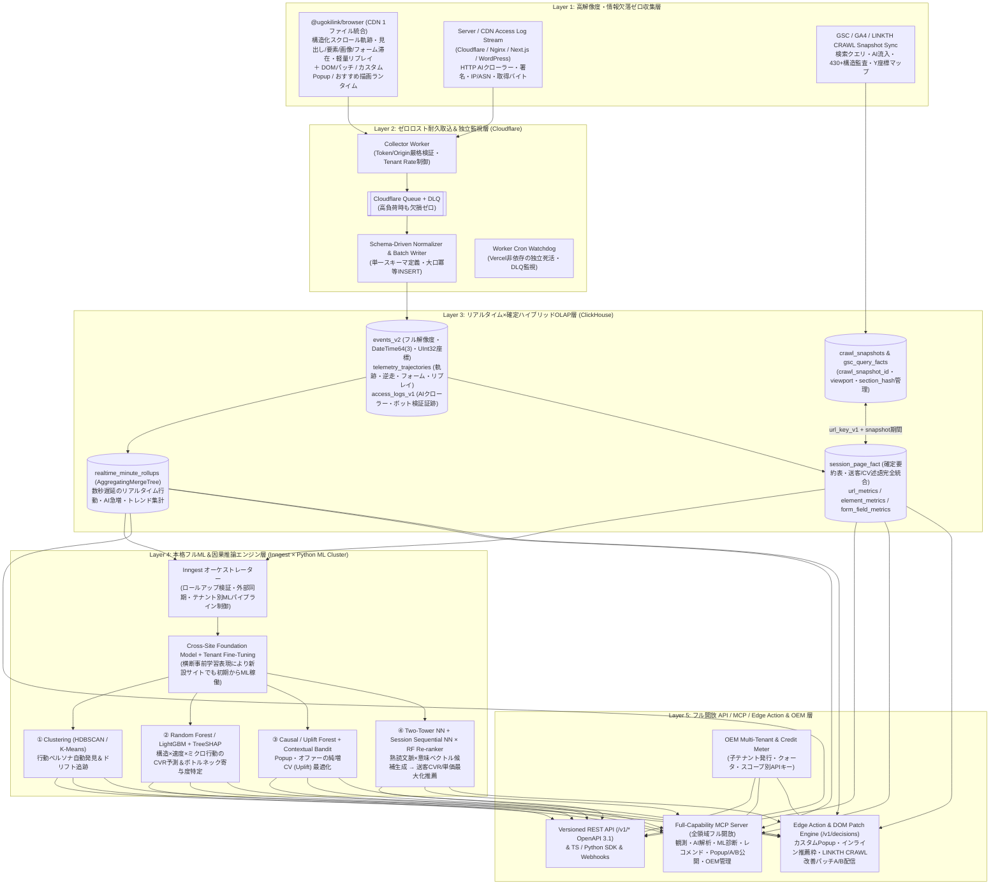

# UGOKI LINK（`ugokilink`）マスターアーキテクチャ設計書（妥協ゼロ・フルスペック決定版）

- **作成日**: 2026-11-18（全面改訂：機能制限・MVP縮小妥協の完全撤廃版）
- **ステータス**: 正式マスター仕様（SSOT）
- **位置づけ**: 姉妹基盤 `LINKTH CRAWL`（全430+監査・107 MCP・180 REST API・独自SFTモデル）と対をなす、**ヘッドレス行動・AIエージェント・リアルタイム機械学習・エッジ接客/推薦/A/B実験データプレーン**。

---

## 1. 基本思想と絶対原則（No-Compromise Principles）

1. **「工数がかかるから」「競合が強いから」による機能制限・解像度劣化を一切行わない**
   - 計測シグナルの切り捨て、日次バッチへの遅延妥協、MCPツール数の人工的制限、読み取り専用縛り、定型Popupのみの表現制限、MLアルゴリズムの格下げ（ルールベースお茶濁し）、GSC/OEM/行動リプレイのスコープ除外はすべて行わない。
   - **通信・DBメモリの無駄（非効率な生データ連射や未インデックス走査）だけを技術で消し、取得情報量・リアルタイム性・ML精度・配信表現力は最高水準でフル実装する。**
2. **ダミー退避（見本フォールバック）の完全撤廃（Data Integrity）**
   - API / MCP がデモ値や作り物の推定値を本物の顔をして返す経路は全廃する。
   - すべての応答に `status: "ok" | "insufficient_data" | "not_collected"`、サンプル数、信頼区間、根拠レベル、データ鮮度（ミリ秒/秒単位）、突合網羅率を付与する。
3. **ヘッドレス（API / SDK / MCP / Edge Runtime）ファースト**
   - 重い汎用 SaaS 管理画面の保守にリソースを奪われず、すべての機能を REST API（OpenAPI 3.1）・TypeScript/Python SDK・MCP Server・Edge Action Runtime として提供する。
   - 既存の社内実データ5画面（ヒートマップ、経路、CV経路、シナリオ、A/B）のみ、社内検証・目視監査ビューアとして維持する。

---

## 2. システム全体アーキテクチャ（5層フルスペック構成）

---

## 3. 情報欠落ゼロの収集・URL正規化・AIエージェント統合設計

### 3.1 「通信量は90%削り、情報解像度は逆に引き上げる」構造化テレメトリ
- **単一スキーマ駆動（Single Source of Truth Schema）**:
  - 現行の「送信側JSとWorker保存列の手動不一致によるデータ消失（`document_height` 破棄、`image_y` vs `element_y` 不一致等）」を根絶するため、TypeScript / JSON Schema の単一イベント定義から Browser SDK ペイロード型・Worker バリデータ・ClickHouse DDL を一括検証する。
  - `public/tracking.js` と `public/v2/tracking.js` の二重管理および 1PV＝11ファイル読込を廃止し、CDN 1ファイルバンドル（`@ugokilink/browser`）に統合する。
- **ミクロ行動データの完全保持（切り捨てゼロ）**:
  - 0.2秒ごとの無意味な単発 `scroll` POST 連射をやめる代わりに、ブラウザ内メモリで 60fps / rAF 計測を行い、以下の**高密度構造化テレメトリ**を5%新深度更新時および `visibilitychange` / `pagehide`（モバイル完全対応）で確実に送信する：
    1. **スクロール軌跡＆逆走ベクトル**: 最大到達px / 到達%、ページ高さ推移（遅延描画対応）、速度分位点（速読/精読/流し読み）、**「どのY座標帯からどのY座標帯へ何回逆走（読み返し・迷い）したか」の区間ペア配列**。
    2. **見出し・セクション・段落・画像のミリ秒滞在マップ**: 各見出し（`h1`〜`h4` / `section_selector`）・重要要素・比較表・画像の可視時間と熟読ミリ秒（`img.alt` を破壊していた旧バグを修正した上で完全計測）。
    3. **フォーム項目別フリクション（EFO完全計測）**: 各 `input/select/textarea` のフォーカス順、入力迷いミリ秒、書き直し回数、バリデーションエラー後離脱した最後の項目。
    4. **クリック精密文脈**: 通常クリック・連打（`rage_click`）・空振り（`dead_click`：深い `<a>` ネスト誤判定バグを修正済の正確な判定）の正規化座標（`UInt32`）、セレクタ、要素ハッシュ、リンク先URL。
    5. **軽量テレメトリ・リプレイ系列**: 重い動画や個人情報DOMを保存せず、「タイムスタンプ差分＋スクロール位置＋カーソル/タップ注目点＋発火イベント」の圧縮タイムラインを保持し、人間やAIエージェントのページ内行動を後から時系列で完全再現可能にする。

### 3.2 URLキー設計（動的パラメータも広告出し分けも一切潰さない3層キー）
クエリ文字列を一律削除する劣化仕様を排し、すべてのイベント・ログ・クロールデータに以下の3層キーを付与する：
1. **`url_key_v1`（LINKTH CRAWL 完全共通キー）**: `shared/url_canon.py::match_key`（= `lib/url/normalize-url.ts`）と1バイト一致。`utm_*`, `gclid`, `fbclid`, `_gl` 等の計測用パラメータのみを除去し、**ページ内容を決定する意味のあるクエリ（`?id=123`, `?variant=b`, `?area=tokyo` 等）はソートして保持**する。
2. **`path_key`（ディレクトリ・パス集計用）**: ホスト＋正規化パスのみ。テンプレート単位やディレクトリ単位のベンチマーク比較に使用。
3. **`campaign_attribution`（広告・流入パラメータ構造体）**: 除去した `utm_*`、広告クリックID、リファラ種別（自然検索 / AI検索エンジン / SNS / 広告 / 直接）、および **GSC 検索クエリ突合キー** を独立列として完全保持する。

### 3.3 人間 × HTTPクローラーAI × ブラウザ操作型AI の完全統合観測
- **3経路の統合**:
  1. **HTTPクローラー型AI（`POST /v1/log-ingestions`）**: Cloudflare Logpush / Worker、Nginx、Next.js Middleware、WordPress プラグイン用の公式コレクターを提供。`GPTBot`, `OAI-SearchBot`, `ChatGPT-User`, `ClaudeBot`, `PerplexityBot`, `Google-Extended`, `Applebot-Extended` 等の巡回頻度、HTTPステータス、取得バイト数、TTFB、`llms.txt` / `robots.txt` 参照状況をリアルタイム記録。
  2. **ブラウザ操作型AIエージェント（`@ugokilink/browser` ＆ サーバーヘッダ署名）**: WebDriver / Headless Chrome / CDP シグナル、人間離れした操作速度・直線座標遷移、および最新の Web Bot Auth（暗号署名付きエージェントヘッダ）を統合判定し、**「AIエージェントが画面のどのボタンを押し、どこで詰まったか（Agent Friction Heatmap）」** を可視化・API提供する。
  3. **AI検索経由の人間流入とCV追跡**: AIクローラーのページ取得 → AIエンジンの引用・送客 → 人間の訪問・熟読・CV までの **「AI検索フルファネルROI」** を同一 `url_key_v1` 上で一気通貫で算出する。
- **確度・証跡モデルの徹底**: 全レコードに `actor_kind`、`actor_confidence`（`verified` [逆引きDNS/公式IP帯/暗号署名] / `high` / `medium` / `low`）、`actor_evidence` を付与する。

---

## 4. リアルタイム×確定ハイブリッド ClickHouse 設計（メモリ安全とリアルタイム性の完全両立）

4.54GiB のメモリ制約を「日次バッチへの遅延妥協」で逃げるのではなく、**テーブル設計と ClickHouse ストリーミング集約** で正面突破する。

1. **`events_v2`（コア行動事実表）**:
   - `ORDER BY (tenant_id, site_id, url_key_v1, toStartOfHour(occurred_at), session_id, page_view_id)`
   - パーティションはサーバー受信月または週単位（端末時計ズレによる異常パーツ生成を防止）。全座標・ページ高を `UInt32`、時刻を `DateTime64(3)` で保持。
2. **`telemetry_trajectories`（高密度軌跡・セクション滞在・リプレイ表）**:
   - スクロール区間逆走、セクション別ミリ秒滞在配列、フォーム項目計測、軽量リプレイ系列を格納。日次パーティション（`toYYYYMMDD(received_at)`）で分離し、長期要約特徴量を抽出した後の古い生軌跡のみパーティション単位の `DROP`（再マージ負荷ゼロ）または R2 Parquet コールドアーカイブへ自動退避することで、**データを捨てずに ClickHouse メモリを常時軽量に保つ**。
3. **`realtime_minute_rollups`（数秒遅延のリアルタイム集約表：`AggregatingMergeTree`）**:
   - INSERT と同時に `AggregateFunction(uniq, ...)`, `AggregateFunction(quantilesTDigest, ...)` で分・時間単位の PV・到達率・クリック・AIボット来訪・送客クリックをリアルタイム更新。これにより **「今この瞬間（直近5分・1時間）」のAPIクエリも数ミリ秒・省メモリで応答** する。
4. **`session_page_fact`（確定セッション×ページビュー要約表：`ReplacingMergeTree`）**:
   - 1ページビュー（`page_view_id`）ごとの全特徴量（滞在、最大到達%、逆走回数、セクション熟読秒数、Dead/Rage数、フォーム到達/離脱、流入元、デバイス、`actor_kind`）に加え、**外部送客クリック（ASP等）・`tel:`・[`lib/conversions/predicate.ts`](file:///c:/Users/M2603/ugokimap-saas/lib/conversions/predicate.ts) の全CVルール一致結果と収益値** を保持する。ML学習・ファネル・セグメント比較の高速マートとなる。

---

## 5. 本格フルスペック機械学習＆エッジ実行システム（RF × NN × Clustering × Causal AI）

`lib/ml/pragmatic-ml-engine.ts` の固定係数モックを廃止し、専用 Python ML ワーカー群（`scikit-learn`, `LightGBM`, `EconML` / Causal Forest, `PyTorch` / ONNX Runtime）を Inngest オーケストレーション下で稼働させる。

### 5.1 初期データ不足すら突破する「2階層モデル機構（Cross-Site Foundation × Tenant Model）」
- 単一サイトでまだCV数が少ない導入初期でもMLの威力を発揮させるため、匿名化・正規化された構造×行動比率特徴量を用いた **サイト横断ベース表現モデル（Cross-Site Pre-trained Base）** と、各テナント・各サイト固有のデータで学習・上書きする **テナント専用モデル（`tenant_id / site_id / model_version` 完全分離保存）** の2階層構成をとる。

### 5.2 4大MLエンジンと3つの提供システム

#### システム①：行動分析からのインテリジェント Popup ＆ 接客配信（Sequential NN × Uplift Random Forest）
- **状態表現（Session Sequential NN）**: セッション内のページ遷移順・熟読見出し列・逆走タイミング・フォーム迷い系列を軽量 GRU / Transformer（ONNX量子化）に通し、リアルタイムの訪問者意図・離脱ハザード状態ベクトルを算出。
- **介入効果最大化（Uplift Random Forest / Causal Forest）**:
  - 単なる「CVしそうな人」ではなく、常時確保する **Holdout群（非表示比較群）** との反実仮想差分から **「今アクション（Popup・チャット・クーポン・FAQ提示）を出した時に純増CVR（Incremental Uplift）が最大になり、かつ『放っておいてもCVする層（Sure Things）』を邪魔しない確率」** をランダムフォレスト系因果モデルで予測する。
- **エッジ実行表現力（制限なし）**:
  - 定型バナーだけでなく、サンドボックス・CSP・署名検証を備えた **カスタムUIコンポーネント、マルチステップ診断モーダル、フローティングアシスト** をブラウザSDKからミリ秒で描画できる。

#### システム②：行動×構造×検索からの自動LP改善提案 ＆ ワンクリックA/Bパッチ配信（Random Forest + TreeSHAP × Multimodal）
- **多変量原因特定（Random Forest / LightGBM + TreeSHAP）**:
  - `LINKTH CRAWL` の全430+構造監査・90種ページ速度ルール・7要素意味スコア・デザイン崩れ18種・セクションY座標マップ（`crawl_snapshot_id` 期間厳密一致）と、`UGOKI LINK` の実測セクション滞在・離脱ハザード・Dead/Rageクリック・GSC検索クエリ整合度を統合学習。
  - **TreeSHAP** により、「なぜこのLPのCVRが低いのか」を各要素（例：Y=2,600px比較表の情報不足、ファーストビューLCP遅延、モバイル入力欄の離脱、検索クエリとH1のズレ）の寄与度スコアと信頼区間付きで正確にランキングする。
- **改善パッチ生成とエッジA/B実験直結**:
  - 提案テキストを出して終わりにせず、`LINKTH CRAWL` のパッチ生成エンジンと連動して **改善HTML/CSS/コピー差し替え案を生成し、そのまま `UGOKI LINK` のエッジ実験ランタイムでトラフィックを50:50（またはバンディット配分）に割って実地A/Bテスト（mSPRT逐次検定＆二標本検定）まで一気通貫で回せる**。

#### システム③：「あなたへのおすすめ」次世代レコメンドエンジン（Two-Tower NN × Random Forest Re-ranker）
- **Stage 1：ニューラル候補生成（Two-Tower Embedding Neural Network）**:
  - **Item Tower**: `LINKTH CRAWL` が抽出した全ページの本文・見出し構造・エンティティ・カテゴリ・スペック属性の密ベクトル（Embedding）。公開直後で行動ログが0件の新着記事・新商品でもコールドスタートなしで即座に推薦対象に入る。
  - **User / Context Tower**: 訪問者の流入検索クエリ、過去セッション履歴、および **「今読んでいるページのどの見出し・どの段落で何秒足を止めて熟読したか」** をリアルタイム合成したコンテキストベクトル。初訪問（Cookieなし）ユーザーでもその場の熟読箇所だけでパーソナライズ候補（上位30〜50件）をミリ秒抽出する。
- **Stage 2：ビジネス価値最大化リランキング（Random Forest / GBDT Re-ranker）**:
  - 候補群に対し、単純クリック率（釣りタイトル耐性）ではなく **「クリック後の熟読完了確率 × 最終CV（ASP送客・問い合わせ・購入）到達率 × 記事/商品の単価（粗利重み） × 鮮度」** をランダムフォレスト/GBDTでスコアリングし、売上期待値が最大になるトップN件を返す。
  - サイト内の指定セレクタ（記事末、サイドバー、インフィード、離脱Popup内）へ自動DOMマウントするウィジェット機能と、ヘッドレスJSON API（`POST /v1/recommend`）の両方で提供する。

#### 共通基盤④：行動クラスタリングエンジン（Auto-Persona Clustering）
- HDBSCAN / K-Means により、サイト固有の行動クラスタ（例：「料金・保証徹底比較層」「スペック表即決層」「AI検索経由の指名確認層」「フォーム直前迷い離脱層」）を自動抽出し、クラスタ別のCVR・主要流入クエリ・離脱セクションをAPI提供する（再学習時のクラスタID対応付け・版管理つき）。

---

## 6. フルスペック API（`/v1`）・SDK・Full-Capability MCP・OEM 仕様

### 6.1 認証・マルチテナント・OEM 基盤
- **3種の認証トークンと細粒度スコープ**:
  1. `ugk_pub_*`（Publishable Site Token）: Browser SDK からのイベント送信・Edge Decision/Recommend 取得専用（登録ドメイン Origin 厳格検証＋レート制限）。
  2. `ugk_sec_*`（Secret Server Key）: スコープ制御（`analytics:read`, `logs:write`, `ml:read`, `ml:train`, `decisions:write`, `decisions:publish`, `experiments:manage`, `sites:manage`）。
  3. `ugk_oem_*`（OEM Partner Key）: `LINKTH CRAWL` と共通設計の代理店・OEM親テナント用キー。子テナント発行・月間イベント/ML推論クレジット上限設定・使用量メータリング（上限時 HTTP 402）を完全サポート。
- **`LINKTH CRAWL` とのドメイン所有確認自動リンク**: 両システムで所有確認済みのドメイン（または同一OEM組織配下サイト）をサーバー側台帳で自動結合する。

### 6.2 REST API（`/v1/*` OpenAPI 3.1 完全準拠）＆ SDK（`@ugokilink/browser`, `@ugokilink/node`, `ugokilink` Python）
- **Ingest**: `/v1/collect/events`, `/v1/log-ingestions`, `/v1/gsc/sync`
- **Analytics & Trajectories (Real-time + Historical)**:
  - `/v1/sites/{id}/freshness`, `/v1/sites/{id}/realtime`（直近分秒単位のリアルタイム稼働）
  - `/v1/sites/{id}/metrics`, `/v1/sites/{id}/sections`（見出し・Y座標セクション別滞在/離脱/クリック）
  - `/v1/sites/{id}/friction`（Dead/Rage/逆走区間/離脱要因分解）, `/v1/sites/{id}/forms`（項目別EFO分析）
  - `/v1/sites/{id}/journeys`, `/v1/sites/{id}/funnels`, `/v1/sites/{id}/trajectories/{session_id}`（行動リプレイ系列）
  - `/v1/sites/{id}/conversions`（CV述語ルール登録・送客/CV計測）
- **AI Agent & Search Fusion**:
  - `/v1/sites/{id}/agents/crawlers`（HTTPボット巡回・取得構造・ステータス）
  - `/v1/sites/{id}/agents/operators`（ブラウザ操作型AIの軌跡・操作詰まり箇所）
  - `/v1/sites/{id}/agents/roi`（AIクローラー巡回 → AI検索流入 → 人間熟読・CVのフルファネル相関）
  - `/v1/sites/{id}/search-behavior`（GSC検索クエリ別のページ内熟読・直帰・CV突合）
- **Structure × Behavior Fusion (`LINKTH CRAWL` 連携)**:
  - `/v1/sites/{id}/url-insights`（単一URLの430+構造×90速度×人間行動×AIエージェント完全カルテ）
  - `/v1/sites/{id}/fix-priority`（直接一致・症状一致による行動裏取り済み課題優先度ランキング）
- **ML Intelligence**:
  - `/v1/sites/{id}/ml/models`（テナント別モデル台帳・精度指標・SHAP特徴量重要度・再学習トリガー）
  - `/v1/sites/{id}/ml/personas`（自動クラスタリング結果・クラスタ別CVR/特徴）
  - `/v1/sites/{id}/ml/bottlenecks`（Random Forest + TreeSHAP によるCVR阻害要因分解＆改善リフト予測）
- **Edge Action, Recommendation & Experimentation**:
  - `POST /v1/decisions`（Uplift Popup / カスタム接客アクション低遅延判定）
  - `POST /v1/recommend`（Two-Tower NN × RF リランクによる「あなたへのおすすめ」リアルタイム取得）
  - `/v1/sites/{id}/scenarios`（Popup・インライン差し替え・DOMパッチの作成／Dry-run／公開／即時Kill Switch）
  - `/v1/sites/{id}/experiments`（Holdout管理・A/B・バンディット実験作成・mSPRT統計検定・勝者昇格）
- **OEM & Async Jobs & Webhooks**:
  - `/v1/oem/sub-tenants`, `/v1/usage`, `/v1/jobs/{id}`, `/v1/webhooks`

### 6.3 Full-Capability MCP Server（人工的な本数制限・Read-Only縛りなし）
ツール数を削るのではなく、`LINKTH CRAWL` と同じ思想で **ドメイン別プレフィックスと厳密な入出力スキーマ** により整理し、権限スコープに応じて観測から施策実行・A/B実験運用まで Claude Code / AI エージェントから一気通貫で自律実行可能にする（全クエリ完全パラメータバインド、外部文字列のデータ境界カプセル化を徹底）：
- **`ugokilink_status_*`**: サイト一覧、リアルタイム稼働・鮮度確認、URL正規化キー検証、クレジット使用量
- **`ugokilink_behavior_*`**: ページ指標、リアルタイムトレンド、セクション別熟読/離脱、フリクション、フォームEFO、ファネル、セグメント比較、セッション軌跡リプレイ取得、既存25種の高度分析クエリ実行
- **`ugokilink_agent_*`**: HTTP AIクローラー解析、ブラウザ操作AIヒートマップ/詰まり解析、AI検索フルファネルROI
- **`ugokilink_fusion_*`**: `LINKTH CRAWL` × 行動 × GSCクエリ統合カルテ、行動裏取り済み修正優先度（`fix_priority`）、改版前後スナップショット比較
- **`ugokilink_ml_*`**: ペルソナクラスタ取得、TreeSHAP ボトルネック診断、Uplift セグメント試算、おすすめシミュレーション、モデル学習状態・再学習起動
- **`ugokilink_action_*`（要 `write` / `publish` スコープ）**: CV定義管理、Popup/おすすめ枠/DOMパッチシナリオの作成・Dry-run・公開・即時緊急停止（Kill Switch）、A/B実験の開始・検定結果取得・勝者適用
- **`ugokilink_oem_*`（要 `oem` スコープ）**: 子テナント作成・一覧・クォータ設定

---

## 7. 最速フルスペック構築ロードマップ（機能を削らず土台から積み上げる5段階）

| Step | フェーズ名 | 実装内容（妥協なし） | 完了ゲート |
|---|---|---|---|
| **Step 1** | **耐久インフラ止血 ＆ V2収集・リアルタイムOLAP基盤** | ・`hybrid-query.ts` SQL穴4箇所完全修正、Cron修正、旧Inngest停止 ・`Collector Worker -> Cloudflare Queue + DLQ -> Batch Writer` ＆ Worker独立死活監視 ・単一スキーマ駆動の `@ugokilink/browser`（1ファイル統合・構造化スクロール軌跡/セクション滞在/フォーム/軽量リプレイ完全収集） ・ClickHouse `events_v2` / `telemetry_trajectories` / `realtime_minute_rollups` / `session_page_fact`（送客・CV述語完全統合）構築＋既存7,454万行からのバックフィル | ・高負荷時ロスト0件・4.54GiB超過ゼロ ・リアルタイム集計（数秒遅延）と確定要約表が実DB検証SQLと100%一致 ・情報欠落ゼロで不要生イベント行数90%削減 |
| **Step 2** | **AIエージェント完全統合（ログ取込）＆ LINKTH CRAWL / GSC 突合基盤** | ・`POST /v1/log-ingestions`（Cloudflare/Nginx/Next.js/WP対応）と `access_logs_v1`（逆引きDNS/IP帯/署名による確度判定） ・GSC検索クエリ同期と `url_key_v1` + `crawl_snapshot_id` + ドメイン所有確認による `LINKTH CRAWL` 完全結合 ・AI検索フルファネルROI ＆ 行動裏取り済み `fix-priority` / `url-insights` エンジン実装 | ・HTTP型AIクローラーとブラウザ操作型AIの両方が確度付きで捕捉完了 ・ダミー退避ゼロで訪問数90%+のURLが構造・検索データと正確に結合 |
| **Step 3** | **Full-Spec `/v1` API・SDK・MCP・OEM基盤の公開** | ・3種APIキー（Publishable / Scoped Secret / OEM）・レート制限・クレジットメーター実装 ・OpenAPI 3.1 準拠 `/v1/*` エンドポイント群、TS/Python SDK、および全カテゴリ MCP Server の構築 | ・Claude Code（MCP）およびSDKから自社5媒体の全行動・AIログ・構造突合データがミリ秒〜数秒で正確に取得可能 |
| **Step 4** | **本格4大MLエンジン稼働（Inngest × Python ML Cluster）** | ・Cross-Site Foundation × テナント完全分離 Python ML ワーカー構築 ・① HDBSCAN/K-Means ペルソナクラスタリング、② Random Forest/LightGBM + TreeSHAP ボトルネック特定、③ Causal/Uplift Forest 接客効果予測、④ Two-Tower NN + Sequential NN × RF Re-ranker おすすめエンジンの本実装とONNX/Edgeモデル配信パイプライン確立 | ・自社稼働媒体（`wakegai.jp`, `bihadashop.jp`, `bousuikouji.info`）の実データで全4モデルの学習・時系列検証・確率較正・台帳登録が完了 |
| **Step 5** | **Edge Action・おすすめウィジェット・DOMパッチA/B実験ランタイム完成** | ・`/v1/decisions` & `/v1/recommend` 超低遅延Edge配信（KV/R2モデル参照＋Holdout自動割当＋数秒Kill Switch） ・カスタムPopup、自動マウント型「あなたへのおすすめ」枠、および `LINKTH CRAWL` 改善パッチの動的A/Bテスト＆バンディット配信ランタイム実装 | ・自社媒体上で①Uplift Popup、②構造×SHAP改善パッチA/Bテスト、③Two-Tower×RFおすすめ枠が実稼働し、Holdout比較でリフト計測が完結 |
