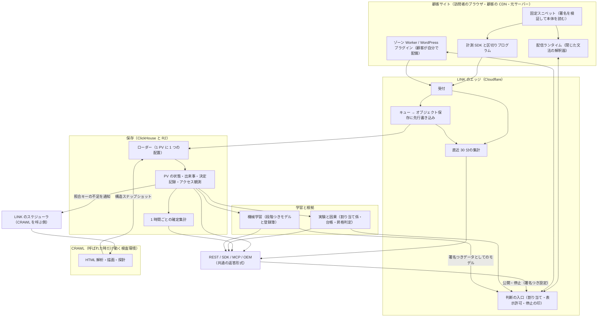

# UGOKI LINK マスター設計書 v2 — 妥協なし・夢物語なし

- 作成日: 2026-11-19
- 元になった文書: `docs/proposals/2026-11-18-ugokilink-master-architecture.md`（以下「マスター版」。本体チェックアウト側にある）
- 位置づけ: マスター版の版アップ。設計だけを書いた文書で、コードは 1 行も変えていない。
- 読み方: まず §0 の 3 行。オーナーの判断が要る点は §14、作る順番は §13、LINKTH CRAWL 側の変更は §15。§4〜§11 は領域ごとの中身。
- 略し方: UGOKI LINK を「LINK」、LINKTH CRAWL を「CRAWL」、ページ表示 1 回を「PV」と書く。

## 0. 3 行要約

1. 機能は 1 つも削っていない。実現できない言い切り 41 件を、限界ぎりぎりの仕組みと、数字で判定できる通過条件に置き換えた。
2. 中心になる考え方は 3 つ。何回届いても同じ結果になるデータ、内容の照合キーによる CRAWL との突合、決めた瞬間を記録する機械学習。
3. 今の通信量では、最初の実験結果（成約率 2% で +20%）が出るのは計測開始から 11〜17 週間後（判断 2 の割り方しだいで延びる）。足りない間は「まだ言えない」と返す。

補足（同じ 3 点を詳しく書いたもの）:

1. **機能は 1 つも削っていない。変えたのは、「欠損ゼロ」「完全検知」「数秒で必ず止まる」のように、書かれた形では実現できない主張 41 件の言い方と仕組みである。** どれも物理・統計・法律・今のコードと両立しないので、「限界ぎりぎりで実現できる仕組み」と「数字で判定できる通過条件」に置き換えた（代表的なものを §2.2 に 16 項目でまとめた）。
2. **中心になる考え方は 3 つ。** ①何回・どの順で届いても同じ結果になるデータの持ち方にする（届け方の保証に頼らない）。②CRAWL との突合は URL の文字列・日付・ピクセル位置ではなく、「同じプログラムが両側で計算した内容の照合キーが等しいか」で行う。③機械学習は「決めた瞬間の記録」を初日から残し、段階ごとの通過条件を数式で保存して、条件を満たした段だけを本番に出す。
3. **今の通信量（5 サイト合計で 30 日 約 16.4 万 PV）で言えることには上限がある。** 例: 成約率 2% の指標で +20% の差を 1 件判定する試験は、5 サイト合算でも 2〜6 週間かかる（5 サイトが同じ成果の定義を共有する場合。共有しないサイトは合算から外れ、その分だけ延びる）。1 サイト単独で 8 週間に見える差は、全単位が対象になる最良の場合でも +21.5%。しかも最初の 1 件は、計測の切り替えとタグの重さの検定を先に済ませるので、計測開始から 11〜17 週間後になる（検定の間は何も出さない場合。§14 の判断 2 で推奨する割り方では約 14〜17 週間以上。§13.8、§16）。足りない間は弱い代用品を出さず、「まだ言えない。あと何が要るか」を API が返す。

## 1. この版の立場

結論: 工数や競合を理由に削らず、物理・統計・法律・今のコードが許さないことは書かない。過去のオーナー決定と衝突する機能は、設計したうえで決定待ちとして止める。

### 1.1 守った 2 つの規則

- **規則 A（妥協しない）**: 「工数がかかる」「他社が強い」「難しい」を理由に、削る・弱める・後回しにすることをしない。「後で」と書いてよいのは、数字で判定できる通過条件か、本当に先に必要な前提がある時だけ。
- **規則 B（夢物語を書かない）**: ブラウザやクラウドの仕様、統計、法律、安全、今あるコードが不可能にしていることには頼らない。限界がある所には、その限界ぎりぎりで動く仕組みを置き、限界そのものを文書と API に明記する。

### 1.2 制約を 3 種類に分けた

- **種類 1: 工数・競合・難しさ。** 理由として認めない。マスター版が外した制限は、この版でも外したまま。
- **種類 2: 物理・統計・法律・安全・コードの現状。** 設計の境界として扱う。境界の内側で最も強い仕組みを選び、「ここから先は観測できない／言えない」を機械が読める一覧にする（§4.9）。
- **種類 3: 過去のオーナー決定と衝突するもの。** 黙って破らないし、黙って従って機能を落とすこともしない。機能は最後まで設計し、「禁止の代わりに何で守るか」を付けて §14 に再決定の候補として並べた。決定が出るまで、その機能は API 上「権限なし（`not_entitled`）」で止まる。

### 1.3 すべての答えに付けるもの

LINK が返す数字には、必ず次の 4 つが付く。付けられない数字は返さない。作り物の値（見本データ）は本番経路に存在させない。

- **状態**: `ok`／`insufficient_data`（データ不足）／`not_collected`（そもそも集めていない）／`pending`（処理中）／`invalid`（データはあるが検査に落ちた）／`not_applicable`／`not_entitled`（権限・決定待ち）／`suppressed`（人数が少なく伏せた）。
- **根拠の強さ（4 段階）**: `planned`（計画）＜ `inferred`（推定）＜ `observed`（実測）＜ `proven`（無作為の介入で実証）。
- **件数と区間**: 何件から出した数字で、どの幅までぶれうるか。
- **未達の通過条件**: 何が足りないか、いくつ必要で今いくつか、何をすれば開くか。

「通過条件」は以下「ゲート」と書く。ゲートはすべて 1 つの台帳に入り、`GET /v1/sites/{id}/capabilities` で「どの機能が今使えて、使えないものは何待ちか」を一覧できる。

### 1.4 この文書の作り方

- 調査 15 本（両リポジトリの実コード 8 本、外部仕様の裏取り 7 本）。
- 8 領域それぞれを「設計 → 2 方向から批判（夢物語が残っていないか／妥協が紛れていないか）→ 書き直し」。
- 領域どうしの食い違いを 96 件洗い出し、1 件ずつ 1 つの裁定にした（§12）。
- その裁定 96 件を、別の目で 1 件ずつ疑った。65 件はそのまま、31 件は直した（重大 5、中 12、軽 14）。
- 領域を組み合わせて初めて現れるリスクを 35 件洗い出し、この文書自身の言い切りを 16 か所言い直した（§17。§2.2 の 16 項目とは別のもの）。
- マスター版の主張 109 件を 1 行ずつ拾い、行き先を確認した（§2.1）。
- 何を自分で確かめ、何が未確認かは §18 に分けて書いた。

## 2. マスター版から何が変わったか

結論: マスター版の主張 109 件のうち、63 件はそのまま又は強化して採用し、41 件は実現できる形に置き換え、抜けていた 5 件を補った。機能は減っていない。

### 2.1 数で見る

マスター版から拾った主張は 109 件。内訳は次のとおり。

| 判定 | 件数 | 意味 |
|---|---|---|
| そのまま採用 | 12 | 書かれたとおり実現できる |
| 強化して採用 | 51 | 機能は同じ。仕組みと通過条件を足した |
| 置き換え | 41 | 書かれた形では実現できない。届く限界の形に直した |
| 抜けていた | 5 | どの領域も拾っていなかった。この版で補った（§12.4） |

### 2.2 夢物語として置き換えた 16 件

「元の主張 → 置き換え（理由）」の順で書く。

1. **情報欠落ゼロ・モバイル完全対応** → 損失を 11 種類に分けて数える台帳を全回答に付ける。受信確認後の損失は上限 0.01% をゲートにする。（スクリプトが動かなかった PV、遮断された PV、送信前に落とされた PV は、ページ側から原理的に見えない。）
2. **集計の 100% 一致・メモリエラーなし・ClickHouse からミリ秒応答** → 重複に強い集計だけで作る確定集計、データベース利用者全員分のメモリ予算表、直近分はエッジ（訪問者に近い場所で動く Cloudflare 上の小さなサーバー群）で持つ集計。（合計や分位は重複で狂う。メモリ上限はサーバー全体で 1 つ。ネットワーク往復がある。）
3. **両製品の URL キーがバイト単位で一致** → URL キーを計算する関数は 1 つだけにし、そこを唯一の権威にする。（今ある 2 つの実装は、国際化ドメイン・壊れたエスケープ・並び順ですでに食い違う。うち CRAWL 側の Python 版は、古いチェックアウトに未コミットのファイルとして在るだけである。）
4. **クロール時点との期間完全一致、縦位置（Y=2,600px）での突合** → 内容の照合キーが等しいかで突合し、変更時刻は「この時刻からこの時刻の間」という幅で持つ。（描画は変更の前後を挟むだけ。キャッシュは 2 つの版を同時に配る。ページの高さは端末ごとに違う。）
5. **訪問の 90% 以上を正確に突合** → 網羅率と精度を実測し、その下限をゲートにする。
6. **Google-Extended／Applebot-Extended をログで検知** → 「方針の状態」として記録する。（この 2 つは robots.txt 専用の指示語で、リクエストには一度も現れない。）
7. **ブラウザ操作型 AI の完全検知、全 AI 共通の摩擦ヒートマップ** → 証明を公開している相手は決定的に検証する。利用者自身のブラウザの中で動く AI は、確率ではなく「人間より何倍それらしいか」と誤検知率の上限証明で扱う。摩擦は 4 つの計器に分ける。（ローカルの AI は目印を出さない。クローラーに画面はない。）
8. **AI 検索の投資対効果を 1 本の数字で** → 段階ごとの台帳と、低・中・高の幅。（引用された事実と、引用からのクリックは観測できない。）
9. **訪問ごとの自然検索クエリ** → 着地ページ × 日 × 端末 × 国の分布として持つ。クエリ別の到達率は、仮定を置かない上下限で出す。
10. **匿名化セッションで作るサイト横断の基盤モデル** → データではなく重みを移す、サイト間の部分的な持ち寄りを統計モデルで行う、同意したテナントからは合計値だけを出す。行の持ち寄りは採らない。（同意の規則、テナント数、抽出攻撃。）
11. **エッジで ONNX（学習済みモデルの共通ファイル形式）のニューラルネット、訪問者ごとの効果推定を今すぐ** → モデルは「データ」として配る（木の表と整数演算）。訪問者ごとの効果推定は最上段に置き、必要な件数を満たしたら開く。（エッジは実行時にコードを組み立てられない。必要な標本は 1 群 約 12.5 万単位で、今の通信量では行がたまるまで約 7 か月、10 倍なら約 3 週間。）
12. **TreeSHAP（木のモデルの予測を、項目ごとの寄与に分けて説明する手法）で「成約率が低い原因」と改善幅を予測** → 「モデルが何を使ったか」の説明に限定する。原因は実験で確かめ、説明の各項目は自動的に実験の候補になる。
13. **KV（Cloudflare の、世界中に配る設定の置き場）で数秒の緊急停止、ちらつきなし** → 経路ごとの停止クラス。上にかぶさる表示は 3〜6 秒、元サーバーに焼き込んだ変更は分単位（測って公表）。（KV の伝播に上限はない。）
14. **ページ内に自由な HTML／JavaScript** → 表現は自由のまま、権限だけ固定する。ページ本体に入るのは署名つきの「閉じた文法のデータ」だけ。自由なコードは別オリジンの枠の中で動く。
15. **CRAWL の既存資産（430 超の監査、速度ルール 90、独自 SFT モデル、区画の Y マップ）** → 実数に直す。本線（ローカルの作業ブランチ `mainline/step2-recheck-fixes`。うち 80 コミットは未 push）は課題タイプ 294・公開ツール 82、手元のチェックアウトは 251・54。SFT モデル（小型の言語モデルを追加学習したもの）はブランチ限定で初版は隔離中。区画の抽出は、呼ばれた時にだけ動き、既定では内部リンクの多い上位 50 ページ（引数で増やせる。本線の上限は 2,000）。
16. **R2（Cloudflare のファイル置き場。以下「オブジェクト保存」とも書く）の長期保管で何も捨てない** → 生データは保持期間で必ず消す。期間を越えて残せるのは、人数しきい値を満たす一般化した統計と、法務が署名した「識別子なしの粗い行」だけ。訪問者のデータを含まない行（検証済みクローラーのアクセス行、利用量の件数）の扱いは §5.7。（保持と削除の義務。）

上の 16 項目に入れていない置き換えもある（Origin ヘッダーによる認証、60fps の計測、連打や空振りの「正確な」判定、完全再現のリプレイ、CRAWL のパッチ生成エンジンを既存資産とする前提、途中監視の検定 1 種類だけでの判定、「コールドスタートなし」、CRAWL と共通の OEM（他社が自社ブランドで再販する形）の設計、ドメイン証明だけでの自動連携、セッション ID 指定の軌跡取得、マスター版の手順 4・5 の完了条件）。それぞれの理由と行き先は、各章と付録 B の対応表（`ledger.md`）にある。

### 2.3 妥協として外した制限（機能を戻し、守りは仕組みへ移した）

前回の提案書（2026-11-18 のレビュー）や過去の決定にあった制限のうち、実害を防いでいたものは「同じ害を防ぐ仕組み」に置き換え、工数由来のものは外した。

- **日次バッチのみ** → 直近集計も出す。害（重複で狂う集計、小さいサーバーの過負荷）は、重複に強い集計とメモリ枠で防ぐ（§5）。
- **型つきテンプレートのポップアップのみ** → 自由な表現、入力を受けるウィザード、会話型アシスタントまで。害（顧客サイト内でのスクリプト実行）は、閉じた文法と別オリジン枠で防ぐ（§10）。
- **MCP（AI エージェントが道具として呼ぶための窓口）は読み取りの十数ツールのみ** → 全機能を MCP に出す。公開してよいかは「その項目の出どころ」と「人が決めた枠」で決める（§11）。
- **バンディット・コピーのテスト・1 サイトでの結論の禁止** → 条件つきで解禁（§9、決定 D-12R）。
- **録画の全面禁止** → 文字も画面も取らない集計リプレイは決定なしで出す。訪問単位の再生はオーナーの判断（§14 の判断 8）と同意が条件（§4.6）。
- **Search Console・OEM・課金は対象外** → すべて設計に入れた（§6、§11）。
- **ML より先にルール** → ルールは最下段として残す。上の段は初日から「挑戦者」として学習し、通過条件を満たした時だけ昇格する（§8）。
- **24 サイト未満はサイト横断の結論不可** → 2 サイトから「登録したサイトの平均効果」は言える。「新しいサイトでも効く」は予測区間が 0 をまたがない時だけ言う（§9.7）。

### 2.4 新しく足した主な仕組み

1. 状態を送る計測プロトコル（何回届いても結果が同じ）と、損失台帳（§4）。
2. 受信確認した送信はデータベースより先にオブジェクト保存へ。データベースは「作り直せる索引」になる（§5）。
3. 共通の区切りプログラムと、入力の種類ごとの照合キー。監査の鮮度が突合の条件になる（§6）。
4. 「実訪問は提案するだけ、決めるのは検査環境かオーナー」という統制規則（§6.7）。
5. サーバーからブラウザへの受け渡し（`Server-Timing` ヘッダー）で、文書リクエストと PV を決定的に結ぶ（§7.4）。
6. ローカル AI 向けの「尤度比＋誤検知上限の証明書」（§7.5）。
7. 決定記録「広く記録し、狭く使う」と、当てずっぽうの偽造を数えて除く決定トークン（§8.2）。
8. 出さなかった場合も含めて「いつ出すか」を無作為化する記録方式。対照 1 つで、登録した候補のタイミングを評価できる（§8.3）。
9. 断らずに値段を出す実験計画（必要日数つきの選択肢メニュー）と、小さいサイトでも「種類ごと」に実証へ届く前向きメタ分析（§9.4、§9.7）。
10. 変更効果台帳と、ページ単位の無作為ロールアウト。検索に効く変更を因果で測れる（§9.9）。
11. 経路別の停止クラスと自動遮断（§10.2）。
12. 公開権限を「項目の出どころ」で決め、自律の枠を「露出した人数の上限」で縛る（§11.6、§11.7）。
13. CRAWL との連携許可（ドメイン証明 1 つ＋双方の承認）と、不変スナップショット契約（§11.2〜11.3）。
14. ゲート台帳と機能一覧 API。全領域の「何待ちか」が 1 か所で見える（§12.2）。

## 3. 全体構成

結論: マスター版の 5 層の考え方は保ち、層をまたぐ共通部品を「1 つしか作らない」と決めた。3 つの領域がそれぞれ自前で持とうとしていた部品が衝突していたため（§12.1 の 3）。

### 3.1 1 つしか作らないもの（共通部品）

- **契約スキーマ 1 つ**: 項目の定義から、SDK の符号化、受付の検証、テーブル定義、API の型、プライバシーの開示文、削除計画まで自動生成する。手で書いた定義がずれて項目が黙って消える事故（今は 47 項目が消えている）をなくす。
- **区切りプログラム 1 つ**: ページを見出し単位の区画に分け、照合キーを出す JavaScript。訪問者のブラウザ、CRAWL の描画、生 HTML の解析で同じものを使う。
- **URL キーの関数 1 つ**（`urlkey/2`）。
- **割り当て係 1 つ**（以下アロケータ）: 誰にどの案を見せるかを決める唯一の仕組み。実験、ポップアップ、取り置き、段階的な展開、計測タグ自体の比較まで全部ここを通る。
- **署名つき設定束 1 つ**: 計測の設定、配信の方針、モデルを 1 つの形式・1 つの署名サービスで配る。
- **顧客側プログラム 1 つずつ**: 顧客の CDN で動かすゾーン Worker は 1 本、WordPress プラグインも 1 本。役割は部品として切り替える。
- **返答形式 1 つ、ゲート台帳 1 つ、定数台帳 1 つ、「知りえないこと」の台帳 1 つ（§4.9）。**
- **スケジューラ 1 つ**: CRAWL を呼ぶ予定はすべて LINK 側が持つ（2026-09-28 の裁定どおり、CRAWL は呼ばれた時だけ答える）。

## 4. 収集: 計測プロトコルと SDK

結論: 「欠損ゼロ」「60fps で全部」「完全再現」の代わりに、①何回届いても同じ結果に収束する送り方、②すべての損失を「直す・上限を付ける・数える」台帳、③訪問者が入力・選択した内容に依存しない行動の形式（文字列の欄は閉じた一覧に限り、既定は拒否）、④保存より前に同意の状態を決める手順、で作る。

今のコードとの差: 今の計測タグは 10 件か 5 秒ごとに送るだけで、再送・PV の ID・重複排除がない。受付は `200` を返してから書き込むので、失敗が見えない。クライアントの 47 項目が途中で黙って消えている。

### 4.1 送り方（何回届いても同じ結果になる）

- **単位は PV**。`pv_id` は 128 ビットの乱数で、メモリにだけ持つ。
- **累積値を送る。** 区画・ブロック・要素の照合キー（§6.1）をキーにして、「その時点までの値」を絶対値で送る。足し算の差分ではないので、重複しても順番が入れ替わっても、大きい方を取れば正しい状態になる。単調に増えると証明できない項目は「値と送信番号」の組で送り、番号が新しい方を採る。
- **差分フレームと全量フレーム。** ふだんは変わった累積値だけ。ページが隠れる時と後送りの送信は必ず全量。だから「確認応答が届いた＝保存された」に正しさが依存しない。
- **出来事は番号つきで、確認されるまで毎回同梱。**
- **状態検査。** 全フレームに、累積値の個数・時間の合計・件数の合計・出来事の最大番号を載せる。保存側が同じ計算をして合わなければ、その PV を確定集計から外して数える。
- **どのフレームも単独で置き場所が決まる。** URL の ID、キーの版、URL パラメータ規則の版、集計の切り口の符号（端末区分・画面幅・流入の種類など）、直近状態を全フレームに載せる（約 17 バイト増）。キューは順序を保証しないので、最初に届くのが差分でも困らないようにする。
- **受付は、キューへの投入が成功してから確認応答を返す。** キューが拒否したらオブジェクト保存へ退避し、両方だめな時だけ `503`。1 項目が不正でもフレーム全体は捨てず、その項目だけ落として印を付ける。
- **確認後の損失を検出する。** フレームは前回の確認応答を復唱する。復唱されたのに 10 分後に保存に無ければ「確認後損失」。
- 大きさ: 隠れる時は 16 KiB 以下（ブラウザが文書単位で共有する 64 KiB 枠の 4 分の 1）、表示中は 48 KiB 以下。
- ゲート（`tel.G1`）: 落とす・重ねる・並べ替えるを無作為に混ぜた 10 万通りの試験で、保存された状態が「届いた中で最大の送信番号の時点のブラウザの状態」と一致し、確認後に失われた送信は 100% 検出される。実運用では確認後損失は上限 0.01%、状態検査に落ちる PV は 0.1% 以下。

### 4.2 PV の一生と送るタイミング

- **PV の始まり**: 読み込み、事前描画の有効化、「戻る」キャッシュからの復帰、画面遷移のないページ切り替え（ページのキーが変わった時）。
- **送る契機**: 開始直後、変化があった時（2 秒待ってまとめ、最長 10 秒）、心拍、ページが隠れるたび、復帰、60 秒無操作、回線復帰、重要な出来事（外部リンク・成果・露出・フォーム送信は、ボタンを押し下げた時点で準備して即送信、確認まで再送）。
- **心拍の間隔は実測で自動調整**する（ブラウザ系統ごとに、測った末尾の損失から 2〜30 秒の間で決める）。Chromium では後送りの送信（`fetchLater`）を常に 1 つ装填しておく。`unload` と `beforeunload` は使わない。
- **読み込み方**: サイトに貼るのは、固定のスニペット 1 つと、中身が空の固定ファイルへの参照 1 つ。後者は、ブラウザが内容を照合する値（完全性の指定）で中身を固定するので、オンライン側からは差し替えられない。これを置く理由は、スクリプトを「取得はするが実行しない」クローラーを見えるようにするため（スニペットだけだと、実行しない相手は LINK に一度も通信しない）。タグをサーバーが出力する導入（プラグイン、オリジンキット、ゾーン Worker）では、この参照にページの印をパラメータとして付け、実行しないクローラーをページ単位で数える（中身の照合は変わらない）。スニペットは、オフラインで保管する鍵で署名されたリリース一覧を検証し、計測本体・区切りプログラム・配信本体を内容ハッシュ指定で読む。地域の区分・停止の合図・抽出率は「データ」として別に取る。この形にすると、LINK のオンライン側の鍵がすべて漏れても、顧客サイトのオリジン（ページ本体の権限）でスクリプトを実行させることはできない（§10.1）。
- **オンラインのデータにできるのは「止める・粗くする・厳しくする」だけ。** 別に取るデータは、事前に署名した数種類の固定の型から選ぶ方式にする。有効な地域区分は「署名つきのサイト既定・元サーバーの申告・このデータ」のうち最も厳しいものを採るので、オンライン側の操作で、同意のモードを「署名つきのサイト既定」や「元サーバーの申告」より上に引き上げることはできない。元サーバーの申告も同意管理ツールも無いタグだけのサイトでは、地域の型の選び間違いがあると、サイト既定までは上がりうる。これは開示記録に書く。端末区分やページ群ごとの抽出率は、署名つき設定束からだけ受け取る。
- **リリース一覧の期限切れで計測を止めない。** 一覧は 30 日で切れるが、切れた後も、最後に検証できた計測本体と区切りプログラムはハッシュ固定のまま読み続け、印を付ける。止まるのは配信だけ。再署名は 14 日ごと、鍵の担当は 2 人にし、復旧を四半期ごとに訓練する。期限切れの間に初めて来た訪問者は、最小版だけで測る。「最後に検証できた版」を覚えるには端末側の保存が要る。識別子を含まない一覧のハッシュだけを保存することを `cookieless` で認めるかは、モードの定義と開示記録に明記して法務確認に出す。認められるまで、`cookieless` のサイトは期限切れと同時に全訪問者が最小版になるので、期限切れを起こさない側（再署名、2 人の担当、期限の 50・70・85% での警報）が唯一の守りになる。

### 4.3 行動の取り方（入力した文字を送らない）

- 定期的に見に行くのではなく、スクロール・表示領域の変化・入力のたびに 1 つの関数が動き、経過時間を「注視帯（画面中央 40%）にある区画」へ加える。
- **滞在**: 区画ごとの表示時間と、入力の間隔を 4 つの帯（5 秒未満／5〜15 秒／15〜60 秒／60 秒以上）で数える。「何秒動かなければ離席とみなすか」をサーバー側で後から変えられる。スクロールの速さも 4 つの帯に分けて注視時間を数えるので、流し読みか精読かが区画単位で分かる。ページの高さの変化も記録に残す。
- **ブロック**: 行動ボタン、アフィリエイト枠、表、図、フォーム、埋め込みは常に見る。残りは PV ごとに無作為抽出し、抽出確率をフレームに載せて集計側で重みを戻す。
- **読み返し**、**フォーム**（値は読まない。順番、ためらい、戻り、修正回数、エラーだけ。パスワードや支払いの欄は存在だけ）、**クリック**（要素の照合キーと、要素の中での位置つき。連打と「押しても何も起きない」は統計として保存し、しきい値はサーバー側で決める）、動画、コピー回数、スクリプトエラー、表示速度の指標。
- 「この要素は壊れている」と言うには、CRAWL の探針が同じ要素で再現することを条件にする。
- ゲート（`tel.G7`）: 入力した文字・選んだ選択肢だけが違う 2 回の操作で、外へ出るバイト列が（件数と時間の項目を除いて）完全に同じ。3 種類のブラウザエンジンで確認する。
- 文字列として外へ出るのは閉じた一覧だけ: URL のホストとパス、外部の参照元のホストとパス、登録済みのキャンペーン値、定足数つきの預かり文（§6.7）。唯一、訪問者が打った文字が出る例外はサイト内検索の語で、同意の目的「サイト内検索」が有効で、法務の署名とオーナーの決定が記録されたサイトでだけ専用の口へ送る（既定は切。それまで `not_entitled`。上のゲートはこの目的が切の状態で検査する）。検索語が URL のパスに入るサイトでは、その型を登録するまでパス経由で語が出うる。これは限界として §6.4 に書いた。 物販 EC では、EC 側が決めた商品 ID もこの一覧に入る（§8.13）。

### 4.4 損失台帳・信頼度

- 台帳はサイト × 日 × 端末 × ブラウザ系統ごと（アプリ内ブラウザは別系統）。全回答に要約を付ける。数える損失は 11 種類ある（スクリプトを取得しなかった／取得したが送信が無い／SDK が動く前に終わった／途中の未確認の送信／最後の送信／確認後の損失／隔離と項目の切り捨て／粗くした分／重い端末で落とした機能／取れなくなった項目／同意とオプトアウト）。次の 2 項目は、そのうち数え方が難しいものである。
- **スクリプトが動かなかった／遮断された分**: サーバー側の経路があれば、文書リクエストと PV を突き合わせて数える（§7.4）。タグだけの導入では、設定の取得数と最初のフレーム数の差、`noscript` 用の画像、ホストのアクセスログで数える。どれも無ければ `not_collected`。
- **閉じる直前の分**: 全 PV について「最後に見えていた区間の送信が届いたか」を数える。加えて、2 秒ごとに送る監査群を無作為に作り（今は PV の約 13%）、取りこぼしの大きさを測る。末尾に関わる指標は「最後に届いた状態」から「それ＋心拍間隔」までの幅で返す。
- **信頼度**: エッジで証明済み ＞ 顧客の元サーバーが署名 ＞ 受付が発行した引換券の連続性 ＞ なし。課金に数えるのは「保存済み・連続性以上・保留でない」PV だけで、エッジで証明済みでない PV にはネットワーク単位の 1 日の上限を掛ける（元サーバーの署名つきにも、高めの値で掛ける。§11.8）。
- 限界として明記: タグだけの導入では、PV の「数」そのものは偽造から守れない。守るにはサーバー側の経路が要る。

### 4.5 同意と本人の識別

- **モード 5 つ**: `off`／`cookieless`（何も保存しない）／`stats_exempt`（計測と A/B だけ）／`session`（30 分のファーストパーティ Cookie）／`full`（長く続く訪問者 ID）。項目ごとに「目的」を持たせる（会員連携、時系列、ページ内容、サイト内検索、広告、自動操作の検知、持ち寄り、実験、個別最適化）。
- **決め方**: サイトが呼ぶ同意 API や同意管理ツールの答えがあれば、それに従う。無ければ地域区分で決めるが、「署名つきのサイト既定・顧客の元サーバーが返す地域区分・設定取得時の地域区分」のうち最も厳しいものを採る（§4.2）。分からなければ `off`。決まる前に Cookie も保存領域も触らない。
- **`off` の意味**: フレームを送らず、端末にも何も保存しない。ただしモードが決まる前に、ページの HTML にある固定ファイルと設定の取得が 1 回ずつ LINK に届く（アドレスと名乗りが見える）。`off` と決まった地域では、この取得のうち自動操作の証拠がある行だけを記録し、人と推定される行は書かない。この事前の通信は開示記録に載せる。
- **`cookieless` の正確な意味**: 「端末に識別子を保存しない」である。サーバー側では、アドレスの上位部分とネットワーク番号を最長 35 日持つ。ただし受け渡しの照合（前後 120 秒）が済んだら PV との結びつきを捨てるので、後から PV とは結べない。ネットワーク単位の仮名も残る（§7.9）。1 日の上限用は 1 日限り。実験用は実験ごとの鍵で作り、その実験の期間中、同じネットワークからの PV をまとめる。用途をまたいでは結べない。これは開示記録に書く。
- **モード × 法域の表は、行ごとに法務の署名が要る。** 署名までは厳しい側で動く。**日本の行が署名されるまで 5 サイトは `cookieless` で動き、実験は PV 単位に限られる**（§14 の判断 1）。
- **未成年向けサイトの印**が付いたサイトは `cookieless` 止まり。**ブラウザのプライバシー信号**（追跡を望まないという利用者の設定）は、法域の行ごとに扱いを決める。どの行でも、信号があれば持ち寄り・広告用途・会員連携はしない。
- **識別の質 A／B／C**: A は顧客の元サーバーが発行するスクリプトから見えない Cookie（13 か月以内）。B はスクリプトが書く Cookie（Safari では、そのサイトでの最後の操作から 7 日で消える。追跡用の印が付いたリンクからの着地では 24 時間）。C はなし。A を出すための導入手順をホスティングの種類ごとに用意する（以下オリジンキット）。
- **オプトアウト**は API とサイト側の関数の両方。削除は 14 日以内。オプトアウトの記憶がスクリプト書きの Cookie しか無いサイト（Safari では 7 日で消える）は、同意のモードを 1 段低く抑える。
- **会員 ID の連携**は、顧客のサーバーで計算したハッシュを受け取り、受付でテナントごとの鍵を掛け直して保存する（同じメールアドレスでも、別のテナントとは同じ値にならない）。テナントが自分の会員記録と結べるように、識別子つきの書き出しと会員単位の読み取りは、テナント自身のハッシュの一覧を受け取って照合する（またはテナント専用の変換の口を使う）。OEM の親は、子 1 つずつの引換券でだけ呼べる。 会員の購入履歴を推薦に使う場合の条件は §8.13 の 6。
- **開示記録**はスキーマから自動生成し、サイトの方針ページに載っているかを LINK 自身の検証器が確かめる。載っていなければ、日本の外部送信の規律（利用者の情報を外部へ送らせる時に、内容・送り先・目的の通知か公表を求める決まり。Cookie の有無は関係ない）の対象になりうるサイトでは `off` にする。既定は「対象」として扱い、対象外と法務が署名したサイトだけ `cookieless` で測る（判断 1 の確認項目）。

### 4.6 リプレイ（3 階層）

- **階層 0（オーナーの決定は不要。新しい SDK と検査環境の描画がそろう手順 21 で出す）**: ページ × 版 × 端末区分ごとの「区画から区画への移り方」のモデルと、代表的な読み方の経路。50 PV 以上かつ 3 つ以上のネットワークから集まった時だけ公開し、CRAWL の描画に重ねて見せる。今すでに保存しているスクロール記録より粗い情報なので、新しい決定は要らない。ただし判断 8 の (b) が記録されるまでは、区画の並びの記録が 30 日で消えるので、階層 0 は直近 30 日以内の窓に限り、その旨を答えに付ける。
- **階層 1（§14 の判断 8 の後）**: 訪問単位の動きの時系列。整数だけ（スクロールの要所、ポインタの静止とタップ、目印）で、文字・画面・入力は取らない。判断 8 が記録されるまでブラウザの外に出さない。用途は集計と特徴量の再計算に限る。
- **階層 2（個別の再生）**: 同意の目的「時系列」（既定は切）と、§14 の判断 8 の (d) の条件（50 PV 以上に当たる絞り込みだけ、答えごとの使い捨ての番号、会員と結びついた PV は除外など）を満たした時だけ。判断 8 の記録と法務の確認が前提。
- 身元を証明できたホスト型 AI と、自前の検査走行は、間引かない操作記録を取る（§7.6）。
- 「完全再現」は言わない。文字なしの時系列は、その時画面に何が出ていたかを示せない。

### 4.7 定義を 1 か所にする仕組み

- 1 つの契約から、符号化・検証・テーブル定義・API と MCP の型・同意の表・開示記録・学習用の特徴候補を生成する。
- 検査: 生成し直して差分ゼロ。同じ試験データを SDK・受付・ClickHouse に通す。カタログの全クエリをテーブル定義に対してコンパイルする。わざと壊した変更が必ず落ちる。
- 本番: リリースごとに全項目が生き残ったかを確かめる。項目 × SDK 版 × ブラウザごとに充填率を監視し、崩れた項目は `not_collected`（その項目は取れていない、という明示）として返す。黙って 0 にはしない。

### 4.8 SDK 自身の重さを因果で確かめる

- 予算は試作で決めて検査で凍結する（目標: 計測本体は圧縮後 20 KB 以下、処理 1 回は 95% が 2 ミリ秒以下、ページへの書き込みなし）。
- **ページ全体の予算は 1 つ**にする。計測・区切り・配信・モデルを合計すると、モデルで出すポップアップがあるページでは圧縮後 約 114 KB になりうる。領域ごとの予算の足し算では誰も合計を見ないため。
- **無作為比較で確かめる**: 「最小版（約 1 KB）／軽量版／全部版（計測に加え、配信を描画なしで動かす）」を無作為に割り当て、操作への応答が 200 ミリ秒を超える PV の割合が 1.5 ポイント以内に収まること等を検定する（操作への応答の計測値が取れた PV を各群 3 万件。取れる PV を 4 割と仮定すると、今の通信量で約 6 週間、幅は 33〜55 日）。通った後も 5% は最小版のまま残し、監視を続ける。
- **検定の間、配信を全部止めるかどうかは選べる。** 全部版の群を「検証専用（描画しない）」と「配信してよい」に分ける層を、アロケータに登録する。検定に使うのは検証専用の側だけなので、比較は偏らない。半々に分けると、検定は約 6 週間から約 12 週間に延びるが、その間も PV の 6 分の 1 で最初の実験を進められる。全部を検証専用にすれば検定は最短だが、その間は何も出せない（§14 の判断 2）。
- **比べ方の注意**: どの群でも同じ最小版がまず動き、表示速度と外部クリックは最小版が報告する。比較は「割り当てられた群」で行う。広告ブロックや弱い回線で重い群の PV だけが抜けると、重い群が見かけ上速く見えるため。
- **この比較が覆う範囲**: 「LINK が読み込み、評価するもの全部」まで。描画そのものの重さ（事前に隠す、修正、かぶさる表示、ずれ）は、施策の種類ごとに、害の常時監視と表示速度の比較で別に測る。測り終えるまで、その種類には「性能は未検証」の印が付く。
- ページ全体の予算は 4 つの数字（バイト数、表示中 1 分あたりのリクエスト数、処理時間、端末を省電力の状態から起こした回数）で持ち、全部品をそろえた試作の実測で決める。決まるまで、影の動作より上は出さない。モデルやページ別の断片は、発火の条件が整ってから読む。計測と配信の通信は 1 つの予定係にまとめる。
- 重い端末では段階的に機能を落とし、落とした事実を PV に記録する。

### 4.9 「知りえないこと」の台帳

ブラウザから原理的に分からないことを、機械が読める一覧にする（限界、根拠となる仕様、最も強い代用指標、その指標で言える上限、何があれば開くか）。API や MCP の説明文がその話題に触れているのに上限を書いていなければ、リリース検査が落ちる。例: 走らなかった PV、背景タブで開いたリンク、訪問ごとの検索クエリ、ローカル AI の身元。

### 4.10 成果の取り方

- 成果のルール（サイトごとに最大 50）はブラウザ側で評価し、「どのルールの第何版が、どの要素で成立したか」だけを送る。
- CRAWL は同じルールを自分の描画の上で評価し、ページの版ごとに「該当する要素の集合」を返す。これで、**CRAWL が描画した版のページについては、新しく作ったルールを過去のクリックにさかのぼって適用できる**。描画の無い版と、第三者の道具が差し込んだ要素には届かないので、さかのぼりで付けた成果には出どころの印と網羅率を付ける。
- クリックの種類は、通常・中クリック・キーボード・「新しいタブで開いた（推定）」。電話やメールのリンクは、番号やアドレスを送らず「行き先の種類」だけを区別して数える（マスター版にはあったが、領域別の設計ではリンク先の条件としてしか扱われていなかったので、この版で足した。契約への項目追加が要り、作業資料には未反映）。ゲート: 実機の試験（`tel.G3` の機種群）で、電話・メールのリンクのタップが記録される割合をブラウザ系統ごとに測り、下限（初期値 95%）に届かない系統は `not_collected` と返す。
- 外部リンクの行き先は、ホスト・パス・登録済みのパラメータだけを見て、アフィリエイトのキー（§6.5）に変換する。
- 重複は「注文番号のハッシュ、無ければルール＋要素＋ 2 秒」で 1 件にまとめる。
- 新しい SDK の成果数が旧い SDK より少なくないことは、並行稼働の「両方」の群で、ルールごとに確かめる（`tel.G17`）。
- 施策が差し込んだ要素（複製したアフィリエイト枠、新しいボタン）には、公開の時点で全ルールを当て、結果を設定束に書いておく。そうしないと、後から作ったルールが対照の群にだけ完全に当たり、「施策を見た人ほど成果が少ない」という偽の傾向が学習と分析に入る。

### 4.11 旧データとの橋渡し

並行稼働は、PV 単位の無作為 3 分割（旧のみ／新のみ／両方）で行う。指標 × 端末 × ブラウザごとに換算比と幅を出し、**すべての換算比の誤差が ±5% に収まるまで続ける**（日数では切らない）。換算した旧い系列は `inferred` として出し、新しい系列と足し合わせない。

## 5. 保存とリアルタイム集計

結論: マスター版のテーブルと「リアルタイム」の約束は残す。ただし「届け方の保証」ではなく「計算の性質」で正しさを作る。すべての事実に出どころの ID を持たせ、PV ごとに置き場所を 1 回だけ決め、書き込みはすべて「何回やっても同じ」合成にする。

今のコードとの差: 行動イベントの主テーブル（`events`）は、実行できる定義が導入スクリプトの 1 つだけで、並び順は（サイト、時刻）、重複を消す仕組みも保持期限もない（監査や融合用の周辺テーブルには期限つきの定義がある）。本番のテーブル定義は記録されていない。集計ビューが原因のエラーが 1,742 件記録されている（既定の設定では、ビューの失敗は元の挿入も失敗させる）。

### 5.1 正しさの作り方

- **ID**: 送信は（`pv_id`、送信番号）、出来事は（`pv_id`、連番）。決定・リクエスト・検査結果も同じ考え方。
- **合成の種類を項目ごとに決める**: 最大、最小、集合、ビット和、「番号が最新のものを採る」。初めて到達した時刻は最小で持つので、「何秒で到達したか」「ある時点の状態」も合成後に残る。
- **読む時は必ず ID でまとめてから数える。** 件数・合計・分位は、まとめた後の値の上でだけ計算する。
- **置き場所は PV ごとに 1 回だけ、ローダーが決める**（URL の ID、開始時刻、保持日数、期限の週など）。以後は全行に写すだけで再計算しない。
- 言わないこと: 欠損ゼロ（受付より手前の損失は見えない）、ちょうど 1 回の配送、送信者の真正性。

### 5.2 取り込み（データベースより先にオブジェクト保存へ）

1. 受付が検証し、キューに入ってから確認応答を返す。
2. キューの消費側が、変更できないオブジェクトとして R2 に書く（先行書き込み）。
3. データベースの横で動くローダー（1 つの担当範囲に 1 つ）が、置き場所を決め、順番つきの目録を条件つき書き込みで R2 に残し、テーブルごとに 1 回の同期挿入を行う。目録は全順序なので、止まったはずの古いローダーが動いても同じ内容を上書きするだけになる。
4. テナントのテーブルには、挿入時に連動する集計ビューを置かない。ビューが落ちると挿入全体が落ち、巻き戻しもないため。派生テーブルはローダーが作り、同じものを SQL でも作り直せるようにしておく。
5. 壊れた送信は二分して隔離し（7 日保持、再取り込み可、削除の対象）、数える。

この形にすると、**データベースは「オブジェクト保存から作り直せる索引」**になる。日次バックアップ（8 日保持）と再生で復旧できる。データベースが止まっている間は R2 に溜まり、遅れが 10 分を超えたら、データベース由来のリアルタイム回答は `not_collected` を返す。エッジ側の直近集計は答え続ける。取り込みが黙って止まった時に気づけるよう、アプリのホスティングに依らない独立の見張りを Worker の定期実行で動かす（担当範囲ごとに毎分の見張りフレーム、ローダーの生存の印、隔離の深さ）。5 分で警報を出す。

### 5.3 「直近の数分」を 3 段で答える

- **エッジの直近集計**: 直近 30 分の「分ごと・PV ごとの状態」を強い整合性を持つ小さな保存単位（Durable Object）に持つ。決まった一覧の問いに、サーバー側の処理時間で 95% が 20 ミリ秒以内に答える（ゲート。呼び手からの往復時間は別で、実測して公表する）。受付と先行書き込みの両方から入るので、片方が落ちても後で埋まる。
- **データベースの直近読み**: 直近 120 分を ID でまとめて正確に答える。見積もったメモリが枠を超える問いは受け付けない。
- **近似の段**: 分ごとの「ID の集合のスケッチ」を 48 時間。スケッチ同士の引き算はしない。誤差は測った値を付けて返す。

### 5.4 確定集計と「今日」

- 集計の単位は（サイト、1 時間）。時刻が過ぎて 30 分後に、その 1 時間を ID でまとめて確定し、全ての集計をそこから 1 つのビルド番号で作る。読む側は「現行」と印の付いたビルドだけを見る。
- 遅れて届いた送信・削除・URL の統合の変更・定義の変更は、同じ「汚れた単位を作り直す」道を通る。
- 「今日」は、確定済みの時間帯と、まだ確定していない時間帯の正確な読みをつなげて答える。確定が 120 分以上遅れたら `insufficient_data`。
- 全回答に品質の欄を付ける（どの段から答えたか、正確か近似か、遅れ、突き合わせの結果）。正確さは根拠の強さとは別の欄にする。

### 5.5 メモリの予算

- 手順 0: データベースにログインできる利用者を全員洗い出し、予算の行を割り当てるか、ロックする。
- 規則: 「利用者ごとの上限 × 同時実行数」の合計に予備を足して、サーバー上限の 85% 以内。8 GiB 級なら、サーバー上限は 7.2 GiB（実メモリの 0.9 倍）、その 85% は 6.1 GiB で、予算の合計 5.7 GiB は収まる。
- **今のサーバーは、過去のレビュー文書の記述から上限が 4.54 GiB と推定される（コードやログでは未確認。サーバー全体の上限かどうかも含めて §18.4）。この値が正しければ、新しい役割だけで 3.8 GiB、旧システムの読み取りを絞っても 0.75 GiB で、ちょうど 100% になる。** だから新しい保存は専用の 8 GiB 級の機械に置く（§14 の判断 5）。
- 禁止する問い: テナントとサイトの指定なし、期間の指定なし、結合の右側に生テーブル、並び順に無い ID での集約。超えた問いは `429` か、分割して実行するジョブに回す。

### 5.6 テナントの分離（二重）

- 層 A: 問いを組み立てる部品が、認証された主体からテナントとサイトを差し込む。構文木の検査で抜けを落とす。
- 層 B: テナントごとに読み取り専用のデータベース利用者を作り、行の方針で「その利用者名に対応するテナントの行だけ」を見せる。許可する方針と制限する方針を同じ条件で 1 つずつ置く（後から誰かが許可を足しても広がらない）。利用者は設定も役割も変えられない。
- 5 分ごとに見張りの問いを流す（方針なしなら 0 行、他テナントは見えない、設定の書き換えは失敗する）。見張りに当たったら、そのテーブルを止めて事故として扱う。
- OEM の親は、子に入る時だけ短命の引換券を使う。複数テナントを見られるデータベース利用者は作らない。

### 5.7 保持・削除・長期の統計

- **保持**: サイトごとに、公表した刻み（最大 12 種、1〜36 か月）から選ぶ。テーブルの中の保管単位（パーティション。ページの区画とは別物）を「期限の週」ごとに分けるので、期限が来た週の分をまとめて落とせる（最大 7 日早く消える方向にずれる）。
- **削除**: 本人 → その人の PV と単位 → 生成された削除計画の全テーブルで削除 → 作り直し → キャッシュ破棄。**24 時間以内に見えなくし、本体の保存からは 5 日以内に物理的に消す。バックアップと学習用の抜き出しは 8 日で入れ替わるので、すべての写しから消えるのは最長 13 日後。証明書は 14 日以内に出す**（一致件数と、どの ID でも届かない種類を明記）。個人に結びつく列が、削除計画の届かないテーブルにあると検査が落ちる。物理的な消去は、該当行を含む保存単位を丸ごと書き直すので、規模が大きくなると 1 回の消去が枠を超えうる。見込みが 48 時間を超えたら、他の保守作業を止めて担当者を呼ぶ。1000 倍の規模では、「結びつきだけを消す」形を法務が認めるかどうかが前提になる。
- **鍵の入れ替えで削除を取りこぼさない**: 鍵を掛けた仮名には必ず鍵の版を付け、削除は「まだ行が残っているすべての版」で本人を引く。鍵の版を消すのは、その版の行が 0 になってから。
- **保存の外の写しも計画に入れる**: 外部の計算基盤への抜き出し、配布済みのモデル、持ち寄りに出した統計、パネルの記録、隔離と保留、並行稼働中の旧い保存。四半期ごとに、仕込んだ架空の本人で全経路を試す。
- **物販 EC の追加分**: 会員の要約（エッジ）、注文の明細、商品の状態の履歴を削除計画と保持の表に入れる。会員の要約は、依頼を受けたら最初に消す（§8.13 の 6）。商品の状態の履歴は訪問者のデータを含まない。
- **証明書は「届かない種類」を名前で書く**: 識別子がもう残っていない PV、鍵を消した後の封印済みアドレス、人数しきい値以上の集計。
- **長期の層**: 落とす前に、(1) 人数しきい値（既定 50）を満たす一般化した統計と、(2) 識別子を一切持たない、粗くした PV 単位の行（定義の版ごとに、法務の署名と「同じ行が 50 件以上ある」ことの検査が条件。ML の系列の保存もこの 1 つ）を別の層に書く。細かい集計は元データと一緒に消える。このほか、検証済みクローラーのアクセス行（訪問者のデータを含まない）と利用量の件数は、テナントの退出まで残る。
- **生の送信**は保持期間の間、R2 が正本。消去は該当部分の書き換えで行う（法務の確認が要る。§14）。

### 5.8 CRAWL の事実の持ち方

- 構造は照合キーの等値で結ぶ（§6.3）。
- 照合キーを持たない事実（応答ヘッダー、検査環境の速度、検索結果、AI 概要）は「観測の連なり」として持ち、「その時点で有効だった値」を時刻で引く。状態は、確認済み（同じ観測が前後を挟む）／挟まれている／古い、の 3 つ。後ろ 2 つは `inferred`。
- 測っていないものは空（NULL）。0 を書かない。今の取り込みコードは、未計測を 0 として保存し、同じクロールを取り込み直すと行が重複する作りである（上流の口が CRAWL 側で外されているため、定期取り込みは動いていない。動くのは、消してから入れる手動スクリプトだけ）。

### 5.9 突き合わせ（集計が自分で自分を採点しない）

5 つの独立した確認を回す。①目録と保存の照合、②別々に書いたテーブル間の不変条件、③見張りテナントに決まった操作（重複・順序入れ替え・遅延・削除）を毎時再生、④抜き取った単位を SQL の別実装で再計算、⑤自社サイトごとに毎時、CRAWL のブラウザで本番の SDK を使った台本どおりの訪問を行い、API の答えと照合。

⑤の訪問は「検査の印」を付けて本番経路を通すが、人の集計からは必ず除く（§12.1 の 4）。今の規模では、この見張りだけで 1 日 120 PV、人の PV の 2.2% にあたるため。

### 5.10 旧データの引き継ぎ

本番のテーブル定義を記録する → 保持期間より古い行を、人数しきい値つきの統計に畳んでから落とす → 残りを新しい ID で PV に組み直す。旧いクリック行の文字列（セレクタや文言）を捨てる前に、成果のルールを旧い行に当てて結果を残す（順番を逆にすると、過去の成果の履歴は二度と作れない）。復元できるもの（ページ高さの幅、深さ帯ごとの滞在、戻り、表示速度）は `inferred` として戻す。復元できないもの（PV の ID、区画、要素の位置、フォームの所要時間）は戻さない。旧データの水準は 2 通りある。当時そのまま測った値は `observed` が上限で、`proven` にはしない。新しい尺度に換算した系列（§4.11）と、復元した項目は `inferred`。どちらも、照合キーの突合と既定の学習データからは除く。

### 5.11 輸送と費用

- 今はキュー。並行して、オブジェクト保存へ直接流す新しい経路に「影の書き込み」をしておき、30 日間 100% 一致し遅延が基準内なら切り替える。
- 輸送だけの月額の概算（1 倍／100 倍／1000 倍）: キュー 1／157／1,575 ドル、直接経路 0／18／204 ドル。このほかに、受付のリクエスト（100 倍で約 36、1000 倍で約 390 ドルと CPU 分）、R2 の操作（約 7／30／90 ドル）、エッジの直近集計（1 未満／約 28／約 260 ドル）、データベースの機械がかかる。1000 倍で瞬間 10 倍の山が来るとキュー 1 本の上限（毎秒 5,000 件）を超えるので、分割を前提にする。
- **レプリカ（複製機）について**: 元の設計は「費用の判断」として先送りしていたが、これは規則 A に反するので条件を決める。追加の条件は次のどれかである。①復旧訓練で測った復旧時間が、動いている自律の枠の「監視間隔」のうち最長のものを超えた時。②確定集計と削除の作業が、保守の車線の半分超を 7 日間使い続けた時。③測った復旧時間が、公表した読み取り API の可用性の目標（手順 12 で決める）を 1 回の障害で使い切る長さになった時。③は、外部テナントを入れる前（手順 29）に必ず判定する。それまでの障害時は、エッジの直近集計と確定済み回答のキャッシュで答える。保存に依るガードレールが見えない間は、自律の公開が止まる（§9.3）。

### 5.12 顧客側へのデータの受け渡し（写しの書き出しと、正本を顧客側に置く段）

2026-11-19 のオーナー方針で追加した節。検査の対象になった設計資料には無い。追加後に Codex の独立レビューを 1 回受け、指摘を反映した。

結論: 計測データは顧客のものとして、顧客の保存先へ渡せるようにする。段は 3 つ。狙いは費用の削減よりも、「データの持ち主は顧客で、自由に使える」ことにある。

- **段 1 標準**: LINK 側で保存する（§5.1〜5.11 のとおり）。
- **段 2 標準＋書き出し**: 顧客の保存先（オブジェクト保存やデータ倉庫）へ、継続的に写しを書き出す。全プランに付ける。BI や自社の画面は、ここか API から作れる。
- **段 3 顧客側に正本**: 受付と保存を顧客のアカウントで動かし、LINK は許可を得て読む。§5.2 の「データベースより先にオブジェクト保存へ書く」形の、保存先を顧客のものに替えるだけで成り立つ。顧客がインフラ代を払うので、料金を下げられるのはこの段。

渡し方と決まり:

- **送り先に BigQuery を含める。** 顧客が自分のデータセットに LINK 用の書き込み権限を付ければ、そこへ直接書き出す。許可を出すのは顧客で、LINK 側に新しい承認は要らない（読みに行く GA4 の接続許可（§11.10）とは別）。下の決まり（根拠の同梱、他テナントを含めない、削除の通知）は BigQuery でも同じに掛かる。
- **開いた形式で渡す。** 生の送信は独自の圧縮形式なので、表形式のファイルと項目の定義（契約スキーマから生成）に直す。確定集計と、PV 単位の行の両方を出せる。
- **根拠も一緒に渡す。** 各行に、計測の版、同意のモード、信頼度、欠けの印を付ける。数字だけが一人歩きしないようにする。
- **自分のサイトの訪問者のデータには、人数しきい値を掛けない。** 顧客自身が管理者だからである。「10 件未満を伏せる」（§11.3、§12.3）は、CRAWL のアカウントや OEM の親など、別の当事者に渡す時の規則で、同じ管理者が認証して受け取る書き出しには掛けない。他テナントのデータと、持ち寄りの結果は含めない。各行には、同意のモードに加えて、目的ごとの許可、撤回の世代、保持の期限も付ける。
- **削除は書き出し先にも届かせる。** 書き出しの目録を残し、削除の依頼が来たら、対象の行を顧客に通知する。段 2・3 で顧客側の写しを消す責任は顧客にある。だから、§5.7 の「すべての写しから最長 13 日で消える」が言えるのは LINK 側の保存までで、段 2 でも顧客側の写しには及ばない。通知は再送し、顧客側からの完了の応答を受け取る形にする。証明書は「LINK 側で消したことを確認／顧客に通知し完了の応答あり／通知したが未確認／管理の外」に分けて書く。
- **段 3 で LINK が保証できる範囲は狭まる。** 14 日以内の削除、分離の確認、損失の上限は、顧客の環境の設定に依る。LINK が保証するのは「配った部品が正しく設定され、動いていて、権限と容量が足りている場合」までである。設定が正しくても、停止・権限の取り消し・容量不足は起きるので、設定に加えて稼働の状態も自己診断し、結果を機能一覧に出す。
- **段 3 でも、学習・突合・実験の判定にはデータを読む必要がある。** 読み取りの許可（期限つき、取り消し可能）か、顧客側で計算の部品を動かす形のどちらかを選ぶ。許可が無いサイトでは、それらの機能は `not_entitled` を返す。
- **プライバシー上の立場**: 訪問者のデータが顧客自身の受付と保存に入る段 3 では、「外部へ送らせる」範囲が狭まる可能性がある。開示と同意がどう変わるかは法務の確認が要る（§14 の判断 24）。

費用についての正直な見立て: 保存と取り込みはもともと安い（今の規模でキューは月 1 ドル、100 倍で 157 ドル。§5.11）。費用の大半は、学習の計算、CRAWL の描画、運用の人手である。保存を顧客に寄せるだけでは大きな値下げにならない。大きく下げるなら、学習と描画を「使った分だけ」の課金にする。段 3 は顧客ごとに環境と版が違うので、こちらの運用の手間は減らず、形が変わる。

## 6. LINKTH CRAWL との突合（URL・区画・時間）

結論: マスター版の突合（URL キーのバイト一致、スナップショットとの期間一致、縦ピクセル、訪問の 90%）は書かれた形では成立しない。届く限界は、「**訪問者のブラウザと CRAWL が同じプログラムで区画を切り、入力の種類ごとの照合キーが等しい時だけ結ぶ。実訪問は提案するだけで、決めるのは検査環境かオーナー。すべての答えに網羅率・精度・ずれを幅つきで付ける**」である。

今のコードとの差: 今の突合は「URL 文字列の完全一致 ＋ 画面幅の区分 ＋ 縦位置の範囲」。URL キーの方式は 5 つ以上が混在する。共通の正規化関数は LINK の表示用の経路から呼ばれているだけで、取り込み・SQL・突合のどの経路でもキーとして使われていない。CRAWL 側の Python 版は古いチェックアウトに未コミットのファイルとして在るだけで、本線には無い。CRAWL の区画は呼ばれた時に既定で上位 50 ページが抽出され、回をまたいだ対応づけはない。CRAWL の「モバイル」は、幅 390px のデスクトップ用ブラウザである。計測タグと CRAWL は要素の指し方の文法も違う（`:nth-child` と `:nth-of-type`）。

### 6.1 区切りプログラムと照合キー

- 依存のない JavaScript を 1 つ、内容ハッシュで固定する。SDK、CRAWL の描画、生 HTML の解析で同じものを動かす。一致は仮定せず、測る。
- 匿名の範囲の外のページでは照合キーを送らず、`not_collected` と返す。
- 区画の決め方は、配置・クラス名・自動生成の ID を一切読まない。本文の根（`article` や `main` など）を決め、同意バナー・チャット・広告・コメント・関連記事を版つきの一覧で除き、`h2` と `h3` を区切りにする。見出しの少ないページはブロックの冒頭 80 文字で、区切りが無いページは 5% 刻みの深さ帯（位置だけ）で扱う。
- **照合キーは入力の種類ごとに分ける。** 役割は 1 キーに 1 つ。

| 照合キー | 何から計算するか | 何に使うか |
|---|---|---|
| `sec_fp` | 見出しの文字と親の見出し（同じものが並ぶ時は順番も） | 区画を同じものと見なす |
| `body_fp`（と 128 ビットの要約） | 区画の本文 | 本文が変わったかを見る |
| `skel_fp` | 区画の並び | ページの構造の版を決める |
| `css_fp` | スタイルの版 | 見た目の事実が有効かを決める |
| `el_fp` | 要素の種類と行き先・ラベル | リンクやボタンを同じものと見なす |

  ほかに、ページの頭部（`head_fp`）、リンクの集合（`links_fp`）、読み込む資源（`res_fp`）、LINK が差し込んだ枠（`slot_fp`）のキーがある。
- **実験中でも ID が変わらない。** LINK の配信が書き換えた部分は「元の値の控え」を通して読むので、どの案を見た人でも区画の ID は同じになる。実験が突合を壊さない。
- 同じ見出しの区画が 1 サイトに大量にあると、32 ビットの本文キーは衝突する（同じ見出しの区画が 10 万件あると、少なくとも 1 組が衝突する確率は 69%）。だからサーバー側は区画の内容を 128 ビットの要約で指し、ページの外から区画を指す時は必ずページの ID を添える。
- ゲート（`join.G1`〜`G2`）: 固定した試験ページ 200 以上で、3 種類のブラウザエンジンと生 HTML 解析の ID が完全一致。実訪問では、WebKit の骨組みが Chromium の最頻の骨組みと一致する割合の下限が 0.97 以上。

### 6.2 位置は「区画の座標」で持ち、ずれを測る

- 行動は区画単位（到達、初回到達までの時間、注視時間、出入り、最大進捗、ここで離脱）で持つ。端末・フォント・広告・遅延読み込みが違っても比べられる。
- ピクセルで語れるのは実際のブラウザだけ。SDK は一定の確率で区画の位置を送り（これを以下「実測の配置図」と呼ぶ）、ページ × 版 × 画面幅の区分ごとに配置の型へまとめる。
- ずれの指標: 実訪問の区画が検査環境にもある割合（`M_sec`）、順序のずれ（`O`）、位置のずれ（`G`）。広告と同意バナーの高さは両側から引いて比べる。
- **ずれが閾値を超えたら、LINK のスケジューラが CRAWL に再描画を頼む**（検査環境にまだ無い骨組みのキーを実訪問が報告した、`M_sec` が 0.90 未満、`O` が 0.10 超、のどれかなら ID だけの描画。スタイルの版が変わった、高さの中央値が 5% 動いた、`G` が 0.08 超なら全部の描画）。2 回描画しても再現しなければ「検査環境では再現できない」と記録し、実訪問側が変わるまで費用を使わない。
- 本文だけが変わった時（知っている骨組みに、知らない本文のキー）も引き金にする。まず軽い取得を行い、生の HTML に新しい本文が無ければ ID だけの描画に進む。LINK が差し込んだ枠のキーが変わった時は全部の描画。リクエストのたびに変わるスタイル（揺らぐと判定済みのもの）は引き金にしない。
- 検査環境の位置・画面写真・押しやすさの判定が有効なのは、骨組みとスタイルの照合キーが等しく、`G` が 0.08 以下の時だけ。

### 6.3 版・時刻・系譜

- PV は入力の種類ごとの照合キーを運ぶ（約 40 バイト）。事実はどの種類に属するかを宣言し、**照合キーが等しい PV にだけ有効**になる。監査結果の「鮮度」が、そのまま突合の条件になる。
- 構造の版は（ページ、案の組、骨組み）。実訪問は「候補」を作るだけで、検査環境の確認かオーナー・CMS の記録で「確定」になる。
- **変更の時刻は幅で持つ**（古い版を最後に見た時刻〜新しい版を最初に見た時刻）。介入台帳（こちらが適用した変更の記録。§9.9 の変更効果台帳の入力の 1 つ）、CMS の更新時刻、条件つき取得、前後の描画の順に狭める。入り混じった期間は比較から除く。
- 区画に変わらない ID を与える系譜: キーが等しければ同じ。違う場合は、台帳と固定印を正解に、文の重なり・包含・見出しの近さ・順位の動きで判定する。系譜に頼った出力は、精度の下限が 0.98 を満たすまで `inferred`。
- 検査環境での揺らぎは、数分おきの 2 回描画で学ぶ。毎回変わる区画は見出しのキーだけで結ぶ。見出しのキーで引き継げるのは「同じ区画である」という対応までで、意味のラベルや監査結果は引き継がない（中身が毎回違うため）。画面写真や押しやすさのように、本文・画像・フォント・表示状態にも依る事実は、必要な照合キーと描画条件を事実ごとに定義し、検査環境で再現できないものは未確認のまま扱う。

### 6.4 URL の同一性

- **関数は 1 つ（`urlkey/2`）、呼ぶ場所は 3 つ。** SDK（行動データでは唯一 URL を見られるので正本）、受付（同じ関数をもう一度掛けて変わらないことの確認）、CRAWL データの取り込み。SQL ではキーを計算し直さない。CRAWL は生の URL を送り、キーを付けるのは LINK。
- **URL のパラメータは種類分けする。** 内容を変える／雑音／利用者の入力／未分類。利用者が入力した値は長さの区分だけにする。未分類のパラメータも、名前と長さの区分だけを送り（数字だけかどうかも漏らさない）、PV に「キーが粗い」印を付ける。入力した検索語が、URL のパラメータ経由では漏れない。パスに入力語が入る形（`/search/語/` など）は、検査環境でサイト内検索のフォームの送り先を調べて「入力を含むパスの型」として登録し、その部分を長さの区分に置き換える（この版で足した。作業資料には未反映）。登録前のパスは、限界として §4.9 の台帳に載せる。
- **種類分けを有効にするのは検査環境の証拠だけ。** 付けた URL と外した URL の組を CRAWL に取得させ、59 組すべてで転送先・正規 URL・骨組み・頭部が一致したら「雑音」。実訪問の一致は、どれを先に試すかの順位づけにしか使わない。 比べる対象には、本文・商品・価格・リンクなど、その URL で使う事実が依るものも含める（題名と見出しが同じまま、パラメータで価格や地域だけ変わるページを「同じ」と誤らないため）。
- 別名（転送、検証済みの正規 URL、雑音パラメータ、端末別の別ページ）は、種類と時刻の付いた辺として持つ。転送を外しても、過去の統合は消えない。サイトとテナントはまたがない。
- **未分類のパラメータで別のページが混ざっても、後から分けられるようにする。** URL の生の値はブラウザの外に出ないので、URL からは二度と分けられない。そこで、キーが粗い PV は「URL の ID ＋ 頭部の照合キー」で副次的に仕分けておく。未分類のパラメータが定足数に達したら、取得の組を自動で走らせて期限内に分類する。 頭部も同じで分けられないページは、ページ別の正解や評価に混ぜない。
- ゲート（`join.G10`〜`G11`）: 適合試験ベクトル 300 以上が両リポジトリで合格。訪問で重み付けした網羅率の下限が、キー 0.98、ID 0.98、位置 0.90。統合の精度の下限 0.98。「別々のキーなのに中身が同じ」の割合が 0.02 以下。

### 6.5 要素とアフィリエイト枠、売上のつなぎ方

- リンク・ボタン・画像・入力欄・埋め込みに照合キーを与え、検査環境の探針・監査と実訪問のクリックを同じ ID で結ぶ。入力値は読まない。
- アフィリエイトの登録簿: ホストとパラメータの役割から「ネットワーク：プログラム：商品」のキーを作る。**CRAWL は、登録簿に載っているネットワークのホストにアクセスしない**（クリックの水増しになる）。通信の層で遮断し、出口の記録で「登録済みホストへのリクエスト 0」をゲートにする。登録簿に無いホストは遮断できないので、外部ホストへの転送は既定で追わず、新しいホストは登録してから扱う。
- **売上を結ぶ粒度は、ネットワークごとに届く所まで。**
  1. ネットワークが自由に使えるパラメータを文書化している場合（A8.net、afb の `id1`〜`id5`）: クリックの瞬間に枠の符号を付ける。ネットワークが書面で認めれば、クリックごとの乱数も付けて訪問単位で結ぶ（`observed`）。
  2. 事前登録の ID しか無い場合（楽天、Amazon）: 自分のアカウントに登録済みの ID を枠のグループに割り当て、グループ別の収益を解く（少ない ID を「設計された測定」に使う）。これは報酬の計上先を決める値を変える操作なので、使ってよい ID はオーナーがパスキー（端末の生体認証などで行う本人確認）で承認した自社の ID の一覧に限り、その一覧はオフライン署名の表に載せる。週替わりの入れ替えは、ネットワークの規約が認めると確認できた場合だけ。確認できるまでは、通信量の多いグループに固定の ID を置き、覆えたクリックの割合を答えに付ける。
  3. 注文明細が出る場合:（ID、商品、日）で枠に結ぶ。
  4. クリック時刻や参照元つきの成果報告の場合: 時間窓に自社のクリックが 1 件だけでも `inferred`（記録されなかったクリックや別の端末がありうるので、「候補が 1 つ」は「特定できた」ではない）。複数なら按分で、同じく `inferred`。個別の帰属を `observed` と呼ぶのは、1 のような決定的な対応だけ。売上そのものの観測と、枠や訪問への帰属の確かさは、別の欄に持つ。
  5. プログラム × 日の按分: 「配分」の印を付けた `inferred`。枠の成績や学習の正解には使わない。
- クリック時にパラメータを足す操作は、**ネットワークが文書化した発行者用のパラメータに限る**。行き先・パス・ネットワーク側のパラメータは決して変えない。全ての案で同じに適用するので、実験の比較は崩れない。これは過去の規則（リンクを書き換えない）の改定になるので §14 に載せた。
- **どのパラメータを足してよいかは、オンラインでは変えられない。** ネットワークごとの「足してよいパラメータ名」の表は、オフライン署名のリリースの中に置く。オンラインで配るのは、ネットワークの ID と枠の符号だけ。ランタイムは表に無い名前を拒否し、すでにあるパラメータは上書きしない。サイト × ネットワークごとの有効化は、人のパスキー承認だけで行い、自律の枠には入れない。オンラインの鍵が漏れても、報酬の受け取り先を書き換えられないようにするため。記事の中に枠の符号を書き込む場合も同じ規則で、プラグイン経由・人の承認つきに限る。
- **この操作そのものを無作為の層として展開する。** 5% は常にパラメータなしで残し、最初はネットワークごとにクリックの 10% 以下から始める。「ネットワーク報告のクリック ÷ 自社で数えたクリック」を初日から日次で監視し、外れたらそのネットワークだけ自動で止める。全ての案に同じく適用する以上、設定を誤ると、どの実験にもガードレールにも映らないまま全クリックの帰属が消えるため。
- ゲート（`join.G13`）: 自社で数えた外部クリックとネットワーク報告のクリックの比が、14 日以上・ネットワーク報告のクリック 200 件以上で、95% の幅ごと 0.85〜1.15 の中（幅は「同じクリックを 2 通りに数えた差」として出す。独立な 2 つの数として扱うと、約 390 クリックまで通らない）。サイトごと・端末区分ごとに見る。検査走行とパネルの時間帯はこの照合から除く。これが、学習の正解と売上指標の共通の入口になる。

### 6.6 検索クエリから「答えの区画」へ

- Search Console の行（ページ × クエリ × 日 × 端末 × 国）をページの ID に結ぶ。一括書き出しは**過去にさかのぼれないので、導入の初日に有効化する**。接続は LINK 側で持つ。
- 区画の文を埋め込み（文の意味を数値の並びにしたもの）にし、クエリとの近さと文字の一致を合わせて順位づけする。得点と 2 位との差が足りなければ「はっきりした答えの区画なし」と返す。
- 言えること: (a) そのページに Google から来た人全体の到達率。(b) クエリ q の到達率の、仮定なしの上下限（q がその着地の大半を占める時だけ幅が狭くなる）。(c) 統計モデルによるクエリ別の推定（事前分布なしの当てはめでも幅が狭い時だけ）。
- 言えないこと: 訪問ごとの検索クエリ、クエリ別の直帰率や成約率。

### 6.7 CRAWL の役割と統制規則

- CRAWL は「呼ばれたら答える検査装置」。版・系譜・別名・予算・頻度はすべて LINK が持つ。
- **仕事は 3 種類**: ①生 HTML の ID 計算（通常のクロールの全ページで、HTML を捨てる前に実行）、②ID だけの描画（1 ページ約 1.3 秒）、③全部の描画（位置、計算済みスタイル、画面写真、探針）。③は初回か、骨組み・スタイル・位置が変わった時だけ。
- **統制規則**: 版・URL の規則・別名が有効になるのは、検査環境の確認か、オーナー／CMS の記録があった時だけ。描画を頼めるのは、定足数（受付が発行した引換券つきの PV が 3 件以上、2 つ以上のネットワークから）か、通信に依らない確認（CMS の更新時刻、サイトマップ、台帳）がある時で、サイトごとの 1 日の予算内。受付は認証なしで受けるので、1 件の PV に費用を使わせない。
- **「ネットワークの数」を数える仕組みの補正**: 日本のモバイル通信は少数の通信事業者のアドレス帯に集まるので、そのままだと大勢の人を 1 つと数えてしまい、モバイル中心のページで定足数が永久に満たない。ネットワークを種類（携帯、固定、ホスティング、プロキシ）に分け、上限と重みを種類ごとの実測から決める。アドレスに頼らない定足数（元サーバーが署名したセッションの数、通信に依らない確認）も使う。上限に当たった PV は捨てずに重みを下げ、その割合を答えに付ける。
- 新しいページの初見では、まず軽い取得だけを行う。サイトマップか CMS に載っていれば、それが確認になり描画に進む。公開フックがあれば、それ単独で確認になる。
- 検査環境の作法: 端末の特性を名乗り、CRAWL の製品名と署名を付け、robots に従う。解析・広告・アフィリエイトのホストは常に遮断する。LINK の受付は、描画が目的の時だけ遮断する（見張りの訪問や導入の確認では、検査の印を付けて通す。§12.2）。
- 描画できない時は理由と「何があれば開くか」を返す（オーナーによる robots の例外、検査用の通行証、最後の手段として下記の預かり）。代わりの地図は作らない。
- **文の預かり**: 対象は、検索に載り、ログインなしで誰でも開ける URL（サイトが宣言した匿名の範囲）だけ。会員ページ・入力欄・編集領域・非公開の印の付いた領域は読まない。テナントごとに既定は切で、同意の目的「ページ内容」が許す時だけ送り、個人情報らしい文字列を含む文は受付が拒否する。法務の署名が記録されるまで `not_entitled`。そのうえで、検査環境が見られないページでは、同じ 128 ビット要約を 10 PV 以上・3 つ以上のネットワークが報告した時だけ、区画の文を預かる。出どころは「実訪問」と記録し、`inferred` の分析にだけ使う。引用・アシスタントの回答・自動生成の材料には使わない（偽造できるため）。預かる文は、通常の送信の記録（保持期間の間ずっと残る）には入れない。受付が発行した使い切りの番号で専用の口へ送り、PV・セッション・訪問者への参照を持たない形で保存する。サイト内検索の語も同じ扱いで、定足数に満たない語は鍵つきハッシュの計数だけを持つ。広告のキーワードは広告主自身が登録した値なので、定足数を掛けない（個人情報らしい形の値だけ除く）。録画の禁止との関係は §14 の判断 8。

### 6.8 突合の品質を全回答に付ける

- 網羅率・精度・ずれを、件数と 95% の下限つきで返す。計算できないゲートは「未達」。
- ゲートは主張ごと: 区画そのものの指標は、その区画の一致と精度だけ要る。ページ内の比較はずれの指標も要る。文に関する主張は検査環境の文が要る。見た目の主張は有効な全部描画が要る。
- 件数の固定しきい値は使わず、「幅が十分狭いか」で出す（到達率は ±10 ポイント、時間は相対 ±25%）。足りない時は、ページ → 型と役割 → サイトの順に部分的に持ち寄った推定を幅つきで返す。自分のデータの重みが 0.8 以上なら `observed`、それ未満は `inferred`。持ち寄りはテナントの外に出ない。
- 規模の現実: 1 サイト 300 ページと仮定すると、30 日で 100 PV に届くのは約 52 ページ（閲覧の 72%）。残りは主張ごとのゲートと持ち寄りで扱う。

## 7. 行為者の識別と AI 検索の可視化

結論: マスター版の「観測する」という約束は、すべて「どこまで見えているかを宣言した層」として残す。証明を公開している事業者は決定的に検証する。利用者自身のブラウザの中で動く AI は、確率ではなく「人間より何倍それらしいか」と誤検知の上限で扱う。AI 検索の効果は 1 本の数字にせず、段階ごとの台帳にして、観測できない「引用」の部分を両側から挟む。

今のコードとの差: 行為者の一覧が 4 つあり互いに食い違う。AI 流入の表には合成した行がある（最初に消す）。サーバー側の観測を LINK 自身の保存に書き込む経路がない。今あるのは、表示のたびに外部の 2 か所（Cloudflare の集計と、別製品の収集器）を読みに行く経路で、名乗りだけを見ており、検証も保存もしていない。

### 7.1 登録簿・観測・判定を分ける

- **登録簿**: 事業者 × 面（検索、学習、利用者の代理など）× 目的。名乗りに使う語、検証方法の並び（その一覧が「これで全部」と明言されているか、その事業者専用か）、robots の適用範囲、JavaScript を実行するか。各項目に「事業者の説明／実測／不明」の別を付ける。
- **robots 専用の語は別枠**にする。Google-Extended や Applebot-Extended は HTTP の行為者ではなく、方針の状態としてだけ記録する。
- **証拠のスナップショット**: 各社のアドレス一覧と鍵の一覧を、今日から保存する。過去のリクエストを「当時の一覧」で判定するため。これも後からさかのぼれない。
- **観測（追記のみ）と判定（計算し直せる）を別のテーブルにする。** 「名乗り」と「証明」は同じ欄に入れない。何も既定で「検証済み」「人間」にしない。
- 言い方の規則: 「X を名乗るリクエスト数」は `observed`。「X によるリクエスト数」は証明がある時だけ出す。
- **判定には版を付ける。** 登録簿を更新すると、過去の日の「人の数」が変わる。確定集計・突き合わせ・実験は同じ版の中で比べ、請求は締めた時点の判定で固定する。直近 30 日の人の数は「暫定」と明記する。

### 7.2 決定的な検証

- **署名（RFC 9421。リクエストに電子署名を付ける標準）**: OpenAI のクラウドブラウザ（これが唯一の目印）、Google-Agent の一部など。知らない署名者は「そのドメインを支配している誰か」として扱う。
- **「これで全部」と明言された専用のアドレス一覧**: Claude-Agent。該当すれば肯定、名乗っているのに該当しなければ否定できる。
- **アドレス一覧との照合**: OpenAI、Anthropic、Perplexity、Google、Amazon、Applebot、Bingbot など。
- **逆引き**: Googlebot、Bingbot、Applebot など。
- **手段なし**: 利用者のブラウザ内の AI、開発者が自前で動かすツール、名乗らないクローラー。
- 「偽物」と言えるのは、情報源が網羅を明言している時だけ。それ以外は「一覧に無い」と数える。
- **アドレスが信用できる経路かを確かめる**: CRAWL に、偽の転送ヘッダーを付けて元サーバーへ直接リクエストさせる。偽のアドレスが記録されたら、その経路の判定は「名乗りのみ」止まりにする。探針の宛先は、持ち主であると証明できたホストに限る。元サーバーがプロキシ以外からの接続を正しく拒否している場合は、「直接は拒否され、同じ目印のリクエストがプロキシ経由ではログに現れる」ことを確かめて合格とし、その根拠を判定に残す。
- ブラウザ側の SDK は何も検証しない。ページのスクリプトはリクエストヘッダーを読めないし、判定結果を見せると回避の手がかりになる。

### 7.3 どの経路で何が見えるか

- 顧客の CDN 上のゾーン Worker: 経路に乗ったリクエストのすべて（キャッシュ命中も含む）、ヘッダー、本当のアドレス。秒単位。その場で検証と受け渡しができる。見えないのは、CDN を通さないホストと、ファイアウォールが先に遮断したリクエスト（どちらが先に動くかは未確認。自社ゾーンの試験で確かめて記録する）。
- CDN のログ配信: 遮断されたものも含む全リクエスト。既定では、名乗りと参照元以外のヘッダーが無い（追加の項目を設定すれば取れるが、署名のヘッダーを取れるかは未確認）。分単位が目安で、保証は無い。
- CDN のクローラー分析: 件数だけ。抽出値で、数時間遅れ。
- プラットフォームのログ転送／自前サーバーの拡張ログ: リクエストの事実。前者は有料プランのみ。
- 共有ホスティングのログ: アドレス・名乗り・パス・結果。翌日。こちらから取りに行かず、送ってもらう。
- WordPress プラグイン: **観測者にはしない**（ページキャッシュに当たると PHP が動かない）。設置と転送の役だけ。
- LINK の受付と SDK の配布元: どのホスティングでも使える。ホスト型 AI の送信は相手の出口から来るので、アドレス一覧の照合はここでも使える。署名での検証は、相手が副次的なリクエストにも署名する場合だけ（署名が唯一の目印である相手については未確認で、署名しないなら、文書リクエストを見られるサーバー側の経路が要る）。JavaScript を実行しないクローラーが SDK のファイルだけ取った事実も見える。

行を作るのは、文書・robots.txt・llms.txt・サイトマップ・フィード・SDK ファイルの取得・おとりのパス・名乗りか証明のあるボットの全リクエスト。**おとり**（robots.txt の禁止行にしか現れないパス）へのアクセスは、自動操作の強い証拠として扱う（人が robots.txt を読んで手で開く場合は区別できない。これは限界として明記する）。網羅率は行為者の種類ごとに公表し、件数の水増しには使わない。

人の閲覧については、標準的なブラウザの名乗りは取得した時点で「系統と版」に縮める。生の値が残るのは、自動操作の証拠（登録簿にあるボットの語、署名、アドレス一覧の一致、おとりへのアクセス）がある行だけ。知らない語を含む名乗りは、それだけでは証拠にしない（LINE などのアプリ内ブラウザを使う人が大量に該当するため）。知らない語は名前ごとの件数だけを数え、同じ語が 10 リクエスト以上・3 つ以上のネットワークから来て初めて見本を保存し、人の審査で登録簿に載せる。

### 7.4 サーバーからブラウザへの受け渡し

- 文書の応答の `Server-Timing` ヘッダーに、リクエストの ID（コードが動く経路では署名も）を載せる。SDK はブラウザの性能 API からそれを読み、`pv_id` と一緒に送る。
- 受付は「その ID の観測が、同じホスト・パスで前後 120 秒以内に実在するか」で確かめ、行為者の種類はサーバー側だけで決める。**判定はクライアントに返さない。**
- これで、新しい文書リクエストがある PV については「文書リクエスト」と「PV」を 1 対 1 で結べ、スクリプトが動かなかった訪問を数えられる（§4.4）。「戻る」キャッシュからの復帰と、画面遷移のないページ切り替えには新しい文書リクエストが無いので、「受け渡しなし」の種類として別に数え、スクリプト未実行の推定の分母から外す。
- 限界: ブラウザのキャッシュ・変更なしの応答（304）・「戻る」キャッシュのもとで ID がどう見えるかは未確認で、3 エンジン × 7 種類の遷移の実測表を作ってから「決定的」と呼ぶ（ゲート）。それまでは結合率と、時間窓による確率的な結合を、その旨を明記して返す。顧客が設定できない前段のキャッシュは、同じ ID を複数の人に配る（検出して印を付ける）。共有ホスティングでは翌日に時刻で結ぶ方式になり、あいまいさを公表する（これは仮説で、実測で確かめる）。

### 7.5 利用者のブラウザの中で動く AI

- **出すもの**: 既知の系統に対する尤度比（人間と比べて何倍それらしいか）、未知らしさの得点、セッションの状態（自動操作／人らしい／未決）。
- **出さないもの**: 「このセッションが AI である確率」。検知された割合は「AI の割合 × 検出率 ＋ 人の割合 × 誤検知率」なので、正解つきの野生の人間データが無い限り、AI の割合も的中率も決まらない。
- **採点できる範囲を宣言する。** 細かいポインタがあり、入力が一定数以上ある PV だけ。タッチだけ・無操作は「採点不能」とし、その割合を必ず併記する。
- **特徴**: PV ごとに 60 個の行動統計を、ブラウザ内で 400 バイト以下に縮める。端末の指紋は使わない。
- **正例**: 8 系統以上の操作基盤を、自社ページで実際に走らせる。**負例**: 同意を得た有償の人間パネル（しきい値決めに 300 人以上、試験に 1,000 人以上。支援技術・入力方式・広告ブロックの利用者群を含む）。
- **得点ごとに証明書を付ける**: 人の誤検知率の上限（試験者で 0 件なら「3 ÷ 人数」。300 人で 1%、1,000 人で 0.3%）。野生の検知割合から出る上限（正解ラベルは要らないが、「AI の割合は宣言した上限以下」という前提つき。初期値は 0.2 で、その値を上限と一緒に公表する）。系統別の再現率。学習していない基盤での再現率（測ったまま）。「パネルの人」と「野生のセッション」をモデルが見分けられないこと（見分けられたら、検査環境の癖が学習データに漏れている）。
- **検知できないと明記するもの**: 読むだけの訪問、利用者の操作をまねる AI。

### 7.6 AI にとっての使いにくさ（4 つの計器。混ぜない）

- **A. 操作可能性の監査**（通信量ゼロでも有効、`observed`）: 成果までの道筋にある各要素が、読み上げソフトなどが使うページの構造情報（アクセシビリティツリー）・ページ構造・画素のどれで到達できるか。CRAWL の描画から出す。
- **B. 検査走行**（目的を定義できる唯一の種類）: LINK 側のデスクトップ実行機で、各サイトの成果定義から課題を作り、成功率と「どの要素で詰まったか」を出す。修正の効果は同時の無作為比較で確かめ、その構成（操作基盤 × モデルの版 × ページの版 × 課題）に限って実証とする。訪問者の見込みには使わない。
- **C. HTTP クローラー**: 取得の摩擦だけ（結果コード、転送、禁止中のリクエスト、遮断、途中切れ、生 HTML に無い内容）。画面は存在しない。
- **D. 野生のブラウザ AI**: 身元を証明できたホスト型は操作の全記録（要素・区画・操作・時間・結果。入力値は取らない）。明示的な証拠のある自動操作は要約。モデルで推定しただけのセッションは、分類器の特徴に使っていない指標だけ。野生の目的は分からないので、「詰まった」とは言わず行動だけを報告する。

**検査走行の作法**: 検査の印が付いた PV は、成果を記録はするが、遷移先を自社の受け皿に差し替え、アフィリエイトのホストには決して行かない。有償パネルの課題も受け皿で終わる。これが無いと、検査の通信がクリックを水増しし、実験と学習の正解を壊す。やり方は、通信の経路を誰が握っているかで分ける。こちらが制御できる実行環境（CRAWL のブラウザ群、LINK のデスクトップ実行機）では、アフィリエイトのホストを通信の層で遮断する。制御できない相手（事業者のクラウドで動く AI 製品、パネルの人の端末）には、サーバー側で検査用の表示を作る。ゾーン Worker かプラグインが署名つきの検査用パラメータを確かめ、HTML の応答の中でリンク先を受け皿に差し替え、表示計測用の画像を外し、検査用の Cookie を置いて次のページでも効くようにする。サーバー側の経路が無いタグだけのサイトでは、制御できない相手の走行は、アフィリエイトの枠が無いページに限る。

**0 と言える範囲**: 「人のデータに検査の PV が 0」「ネットワークのホストへのリクエストが 0」をゲートにできるのは、こちらが制御できる実行環境だけである。事業者のクラウドで動く AI 製品と、パネルの人については、印がどれだけ持続したかの実測と検出の上限を示す。検査の状態を保てない製品には、着地したページで終わる課題しか与えない。

### 7.7 AI 検索の台帳

段階ごとに、出どころと根拠の強さを固定する。

- 段階 0 適格性（robots、CDN の方針、事業者への拒否設定）: `observed`。
- 段階 1〜3 学習用の取得／索引用の取得／利用者起点の取得: `observed`（目的は事業者の名乗りによる）。
- 段階 4 引用: 探針の構成については `observed`、それ以外は `inferred`。
- 段階 5 AI からの流入: 参照元が付いたものは `observed` の下限。参照元なしの訪問は、取得イベントの前後 30 分と対照の時間帯の差から出す幅（`inferred`）。検索結果内の AI 機能からのクリックは 3 つの推定の幅（`inferred`）。
- 段階 6〜7 関与と成果: `observed`（区画単位）。

出力は面ごとに、「帰属できたセッションあたりの通信量」「取得 1 回あたりの訪問」「価値と費用の幅（下限は実測、中と上は推定）」。学習用クローラーの価値は「設計上観測できない」と返す。共有のクローラー（検索と AI で同じもの）は、段階を分けられないと明記する。事業者ごとの取得の急増は、曜日 × 時間帯の基準線（4 週間以上）との比で検出し、通知で知らせる（`act.G34`: 誤報はサイト × 週に 1 回以下）。

### 7.8 「引用」を両側から挟む

- **探針**: AI 概要は検索結果の提供元経由、アシスタントは公式 API のみ。質問は Search Console の表示回数に比例して抜き取る。結果は「その面・その構成について `observed`」。
- **探針とログの突合**: 「引用された時に取得されていた割合」と「取得された時に引用された割合」から、野生の引用数の幅を出す。
- **改訂の探針**: 自社が改訂した前後で答えが変わる質問をすると、相手がどの版を持っているか分かる。
- **適格性の無作為化**: robots などの変更を、ディレクトリ単位で「今／後で」に無作為に割り振る。取得・引用・AI 流入への効果を、ディレクトリの対が 6 対以上あり、計画器の必要件数（§9.4）を満たした時に限って `proven` で言える。満たさない間は `observed` と、あと何対・何件要るかを返す。検索の索引と共有する語の変更は、オーナーが元々行うと決めた変更に限る。人の承認つきで、影響の小さいディレクトリから波で適用し、検索流入と索引ページ数をガードレールにして自動で戻す。主要な検索流入のディレクトリは 2 回目の人の承認の後にだけ適用し、危険にさらしてよい検索流入の数を予算として持つ。オーナーが元々行うと決めていない変更を実験のためだけに行う依頼には、`not_entitled`（オーナーの決定待ち）を返す。
- **専用の確認 URL**: 探針からしか要求されない推測できない URL で、各面の本当の取得元と robots の守り方を確かめる。
- **回答文の保存**: 既定は構造化した抽出とハッシュだけ（過去の決定のまま）。生の文は、提供者ごとに規約を確認して法務が署名した時だけ、暗号化と期限つきで持つ。

### 7.9 アドレス由来の証拠のプライバシー

- **E 類**（リクエストの時点で自動操作の証拠がある行）: アドレスを、サイトごと・日ごとの公開鍵で封じる。取得する側は復号の秘密を持たない。秘密鍵は 30 日後に消す（鍵を 1 本消せば、どこに複製があっても読めなくなる）。
- **T 類**（既定）: アドレスの上位部分とネットワーク番号だけ。人と推定される行は 35 日で日次の集計に畳んで消す。
- **P 類**（任意）: 全文書行を 72 時間だけ封じて持ち、後から証拠が出た行を E 類に上げる。
- ネットワーク単位の仮名は、用途ごと（1 日の上限用／実験ごと／定足数の計数用／後から作る集団の人数判定用）に別の鍵で作る。用途をまたいで結べず、用途より長く残らない。通信の指紋は流量制限に一時的に使うだけで保存しない。
- 人のモデルから除外するのは決定的な証拠がある行だけ。得点による除外は感度分析として別に出す。

## 8. 機械学習

結論: マスター版のモデル（離脱の予兆、効果の個人差、配分の自動調整、ニューラル推薦、セグメント、サイト横断）は全部作る。ただし「段」として積み、各段は最初の有効な決定記録から挑戦者として学習を始め、**保存された数式の通過条件を満たした段だけ**を本番に出す。今ある履歴だけで正直に出せるのは、正解の全数調査・読み進みの生存曲線・ルールによるセグメント・オフラインの候補表まで。

今のコードとの差: CRAWL 側の ML は枠組みだけで中身が無く、1 サイトで作った 1 個のクラスタリングモデル（訪問を 2 群に分けるもの）が、テナントの区別のない 1 ファイルとしてコミットされている。古い版はそれを全テナントに返し、本線は署名ファイルが無いため読み込み自体に失敗する。成約率と感情の学習器は引数不足で落ち、テストは模擬で隠れている。成果の定義が 5 つあり、成果の後の行動が特徴に混じり、検証用の分割も確率の補正もない。LINK 側には、存在しない CRAWL の機能を呼ぶ代わりにモデル名ごと作って返す箇所がある。

### 8.1 正解の契約と売上

- 成果の定義は版つきで 1 つ。語彙は 3 段: サイトのルール ⊂ 正解ラベル ⊂ 指標（ラベル＋単位＋期間＋集計）。
- すぐ分かる正解: 読了相当、アフィリエイトクリック、問い合わせ、購入。
- 売上は §6.5 の粒度の段でつなぐ。**遅れは待たずにモデルにする**（成果の確率 × その経過日数までに届く確率）。承認率は少数データに強い推定で出す。見込み売上（`inferred`）は、確定した時点で承認済み売上（`observed`）に置き換える。
- ゲート: 正解の全数調査が済んでいること。クリックの照合（`join.G13`）。登録簿のクリックの 95% 以上がキーに変換でき、手で確かめた 200 件で精度の下限が 0.95 以上。

### 8.2 特徴の契約と決定記録

- 特徴ごとに「いつ分かる値か」「同意の最低条件」「状態（候補 → 記録中 → 適格 → 有効 → 引退）」を持つ。計測の全項目と、突合できる CRAWL の事実は、自動で候補に登録される。
- **広く記録し、狭く使う。** 何かを決めるたびに、記録中以上の全特徴の生の値と、その瞬間の計測状態を保存する。値の区切り方は学習の時に決めるので、**後から思いついた特徴にも、記録を始めた日からの履歴がある**。
- 学習の行＝配信の行。決めた後に分かった情報は 1 つも入れない（今の「成果の後の行動が混じる」漏れを塞ぐ）。CRAWL の区画の特徴は、その PV が実際に見た版の照合キーで結ぶ。
- **決定トークン**: 判断の入口が署名つきの引換券を出す。有効な引換券の行だけが、学習・評価・判定に入る。成果は引換券 × ラベルごとに 1 件、単位あたり 1 日 1 件まで。決定は PV の中で番号を振り、次の送信でも繰り返すので、損失は「欠番率」として測れる。限界: 本物のブラウザを台本で動かす偽造は、引換券では防げない。残る守りは、単位あたり 1 日 1 件の上限、ネットワーク単位の上限、ネットワーク報告のクリックとの照合である。
- 何も出さなかった群も、「出していたら発火した時点」で同じ行を記録する。
- 特徴の採用は自動: 14 日間の充填率 0.95 以上、連続 2 回の時系列分割で改善の下限が 0 超、多数を試す分の補正つき。3 周期つづけて寄与が無ければ引退。
- **視覚の特徴**（マスター版の「マルチモーダル」の中身を定義する）: CRAWL の全部描画から取れる、最初の画面の構成、行動ボタンの計算済みスタイル、画面写真の区画ハッシュを特徴の族として候補に登録する。画像の埋め込みは挑戦者。採用は同じ規則。

### 8.3 ポップアップ: いつ・出すか・どれを

- **「いつ」の段**: ルール → 区画を 1 つ進むごと（または 5 秒ごと）の離脱の予兆を当てる木のモデル → 出来事の並びを読む小さなニューラルネット（整数演算）。
- **タイミングそのものを無作為化する。** しきい値を、事前に登録した候補（得点の分位、今のルール、「出さない」）から単位ごとに引く。全員について「初めてしきい値を越えた時刻」を、表示しなくても記録する。対照 1 つで、登録した候補のタイミングを評価できる。ただし越えた時刻を記録できるのは、その単位が実際に表示を受ける時点までで、比較は低い方のしきい値を越えた単位の中で行う。今の規模で同時に比べられるのは「今のルール＋しきい値 1 つ＋出さない」まで（近い指標のみ）。10 倍で 3〜4 個になる。
- **「出すか・どれを」の段**: 「出さない」を含む無作為試験 → 事前登録した 3 つ以下のセグメント → 配分を自動で寄せる方式（新しい案は、同じ種類の過去の成績を出発点にする）→ 浅い方針の木 → 訪問者ごとの効果推定。最上段は「効果の下限が費用を上回り、害がガードレール内」の時だけ出し、不確かなら見送る。
- 自動配分の定数は実験側の台帳に一本化する: 各案の最低配分は 10% か「1 ÷（案の数 × 2）」の大きい方、適応しない均等枠 10%、開始は案あたりの見込み成果が 310 件以上（+20% を見る場合）、更新は、いちばん少ない案に確定した成果が 50 件以上たまる長さを、区切りの開始時に決めて行う（最長 7 日）、確認は全単位での再生検定。 更新の条件は件数が優先で、7 日は「確認する周期」である。3 案なら最少の案に 50 件たまるのに今の規模で 10〜11 日かかるので、たまるまでは配分を据え置く。
- 今の規模の現実: 15 分あたりの成果は 0.3 件なので、分単位の更新は意味がない。文脈つき方針の評価は、確率を記録した全単位を使い（均等枠は整合の確認用）、今の規模で 16〜163 日かかる。

### 8.4 ランディングページの改善: 検出・提案・証明

- **検出**: 読み進みの生存曲線（今ある履歴から出せる）→ 区画単位の「ここで失う確率」→ CRAWL の区画特徴を使うサイト横断モデル。
- **判定は「期待より多く失っているか」**（`inferred`）: ページ内の位置と区画の役割から期待値を作り、観測 ÷ 期待が 1.25 を超える確率が 0.95 以上で旗を立てる。誤って旗を立てる割合は 10% に抑える。いちばん細かく通る水準（ページ × 区画 → 型 × 役割 → サイト × 役割）で返す。
- **区画の役割**: 固定の分類表。大規模言語モデルのラベルを「本文・分類表・指示文・前処理・モデルの実体・推論の設定」の組ごとに保存し（内容だけをキーにすると、新旧の仕様のラベルが混ざる）、軽い分類器に写す。人が付けた 300 件以上で検証する。
- **提案**: 5 つの源（ルール該当、旗の立った区画や要素への探針、同じ役割で成績の良い区画との対比、検索の空白、推薦から内部リンクへ）。どれも「型つきの修正案＋仮説」。順位は「過去の同種の効果の幅 × 通信量 ÷ 判定までの日数」。出力は `planned`。
- **証明**: 1 ページなら訪問者単位の修正テスト。種類として言うなら、ページの対を無作為に割り振る展開（§9.9）。足りなければ `planned` のまま「あと何日」を返す。
- 説明手法（TreeSHAP）は「期待値のモデルが何を見たか」の説明に限る。`proven` 未満で改善幅の数字は出さない。

### 8.5 推薦

- **対象**: ページ、区画への直リンク、オファー（既存のアフィリエイト枠を、1 バイトも変えない複製として再掲する）。 物販 EC では商品そのものが対象になる。在庫・カート・会員を踏まえた扱いは §8.13。
- **最下段は初回訪問から動く**: 内容の近さ、リンクの近さ、一緒に読まれた履歴、似たセッション、新しさで重みを落とした人気を合わせる。ブラウザが 50 件以下の候補を、そのセッションの関心（着地ページの検索クエリの傾向＋滞在で重み付けした区画のベクトル）で並べ替える。 候補の集合・順位・表示位置・実際に選ばれた確率を記録する。旧い方式が一度も出さなかった候補を新しい方式が選ぶ場合、過去の記録では評価できないので、新しい無作為の探索で評価する。
- **全ての表示で少しだけ探索する。** 並べ方に確率を持たせ、その確率を記録する。これが無いと、後から学習も評価もできない。
- **上の段**: 学習した順位づけ → 共読の対で学んだ写像 → 二塔型や系列型のニューラルネット。**上の段は、調整済みの下の段に、事前登録した差で勝った時だけ採用する**（再現性の研究では、調整した単純な手法がニューラルに並ぶ）。
- **価値は円で比べる**: クリックの確率 ×（読了の重み × 読了の確率 ＋ 正解ラベルごとの「到達の確率 × 1 件あたりの価値」の合計）。ラベルは、アフィリエイトクリック（価値はクリック単価）、問い合わせ、購入（価値は §6.5 の段でつないだ金額。テナントが粗利の重みを登録していれば掛ける）。価値がつながっていないラベルは「クリックのみが根拠」と明示する。問い合わせと購入の項は、領域別の設計ではアフィリエイトだけだったので、この版で足した（作業資料には未反映）。
- **新しいページ**: 確認 → 描画 → 埋め込み → 候補入り。確認からの所要時間を測って公表する（目標は 95% が 30 分以内）。公開フックも定足数も無いページは別枠で報告する。
- **商品側の属性**（マスター版で扱いが薄かった点を補う）: 構造化データの商品・価格、アフィリエイト登録簿の商品 ID、区画から抜き出した固有名・カテゴリ・比較表のスペック属性を、CRAWL の全部描画の出力項目に加え（§15 の 6）、特徴の候補にする。粗利は、テナントが商品 ID ごとに登録する値として受ける。抽出の精度は、人が付けた 200 件で下限を測ってゲートにする（初期値 0.9。手順 15 で作る）。

### 8.6 セグメント

- ルール → 重心型の分類 → 密度型の分類。成果と直結する特徴は入れない。
- **学習し直しても ID が続く**: 新旧の対応を計算して系譜に記録し、重なりが半分以上なら同じ ID。
- ゲート: 抜き取りを変えても同じ分かれ方になること（一致度 0.75 以上）、1 群の大きさが「500 セッション」と「全体の 3%」の大きい方以上。成果の違いを語るのは、別の期間で再現した時だけ。

### 8.7 サイト横断の強さ（テナントのデータを動かさない）

- **今日からできること**: 商用利用できる公開の日本語埋め込み（候補を自前の評価で選ぶ）。サイト → 型 → ページ → 区画の部分的な持ち寄り。自社サイトで学んだモデルを「重み」として移し、テナントごとに補正する。
- **同意したテナントだけ**: 合計値だけが外に出る連合学習。分割には一定数以上のテナントと単位が要り、1 テナントの支配に上限を置き、離脱したら 14 日以内に学習し直す。開くのは出発点の値と比較基準で、訪問者ごとの効果推定は開かない。
- **行の持ち寄りは採らない。**
- 表形式の基盤モデルは、商用可の版（1 万行以下）に限り、正例が 200〜5,000 件のテナントなど狙いを絞って使う。ライセンスの確認が条件。
- テナントをまたぐ公開は、実験側と共通の台帳 1 つで管理し、流れの種類ごとに行を持つ。実験の統計 1 行は 5 テナント以上・各群 50 単位以上。連合学習の合計値は 10 テナント以上、1 つの分割に 5 テナント以上・50 単位以上。どちらも 1 テナントの重みは 3 分の 1 以下で、差し引きで割り出せる値は伏せる。参加は、オーナーが参加の型を決めるまで明示の申し込みだけ。今は 1 テナントなので `insufficient_data`。

### 8.8 評価・昇格・巻き戻し

- **前提は主張ごとに絞る。** 最下段（ルール、「出さない」を含む無作為試験、人気と共読の推薦）を始めるのに要るのは、定義の一本化、影の記録で測った決定記録の完全性、同意の状態と開示記録、正解の全数調査（計画の数字に使う）だけ。差が出ないはずの見張り層は初日から別の層で走らせ、その合格は「始める条件」ではなく「結果を `proven` と呼ぶ条件」にする（約 6.9 万単位が要るので、始める条件にすると最初の実験が 18〜53 日遅れる）。見張り層が不合格になった場合、それより前に始めた実験の結果は `invalid` になる。**CRAWL との連携全体を待たない。** 検査環境の事実を読む段だけが、突合と連携許可のゲートを足す。
- **計画表（通信量の割り当て。§12.1 の 5 と同じ 1 枚）**: 各段が必要な通信量を申請し、「得られる情報 ÷ 判定までの日数」の順に割り当てる。「あと何日」は、割り当てられた取り分から計算する。
- **昇格の手順**（優越を狙う場合）: オフラインで改善の下限が 0 超 → 影の運用 14 日 → 記録した確率を使った全単位での評価（均等枠は整合の確認用）→ 方針のテスト。結果は 2 種類を認める: 「優れている」と「劣らない」（事前登録した幅の中）。根拠の水準は §9.10 の保存された条件だけで決まる。条件を通った「劣らない」は「その幅より悪くない」という主張として `proven`、条件を通さない昇格判定だけなら `observed`。どちらも改善幅の見込みは開かない。差が小さい改良は優越性だけだと永久に通らないため。 「劣らない」で採用する道は入口から分ける。許せる悪化の幅と、採用の理由になる改善（速さ・費用など）の基準を事前に登録し、オフラインの条件は「悪化の下限がその幅の内側」とする。
- **巻き戻し**: ガードレールや確率の補正の逸脱、検証率の低下で自動的に停止の印を出し、別名を前の版に戻す。

### 8.9 配り方（エッジとブラウザ）

- **モデルは「データ」として配る。** 整数の区切りで学習した木の表（ブラウザとサーバーで結果が構造上同じ）と、8 ビット整数の演算。評価器は SDK とエッジに同梱し、実行時にコードを組み立てない。
- 成果物は内容ハッシュで保存し、署名つき設定束から参照する。ブラウザはハッシュを確かめる。
- 選択は「サーバーが引いた乱数」で行うので、確率と版が正確に記録される。
- 成果物は圧縮後 50 KB 以下で、必要な時だけ読む。大きいモデルはエッジで動かす。
- 合わない時（ハッシュや版の不一致）は、均等な抽選かルールの既定に落ち、理由を記録する。

### 8.10 登録簿・削除・計算

- 登録簿には、成果物のハッシュ、特徴と正解の版、学習データの ID、削除の世代、コード、実行環境、乱数の種を残す。
- 学習データは保存側の抜き出し経路から取る。**削除はここにも届く**: 抜き出しは 8 日以内に消すか、消せる鍵を持ち続けて、削除が進むたびに書き換える。
- SDK のリリースは、決まった操作の再生で完全一致を見てから、5% の無作為な先行配信にかける（計測の変化がモデルを壊すのを防ぐ）。
- 計算: 制御は Inngest、学習はコンテナのジョブ、GPU は挑戦者用。**CRAWL の小さなサーバーでは学習しない。** 重い再計算（偽実験、再生、並べ替え）は学習の計算面で行い、ClickHouse には流さない。

### 8.11 CRAWL の ML 資産の扱い

「独自 SFT モデル」（ブランチ限定の小型言語モデルの追加学習で、初版は隔離中）、感情ラベル、行動の乗数は、資産として数えない。計測が作り物、擬似ラベルの漏れ、定数、というのが理由。使えるのは、埋め込みの基盤、課題のカタログ、適用と巻き戻しの仕組み、介入台帳の定義。

### 8.12 生成モデルの組み込み（計算の前・後・運転役）

2026-11-19 のオーナー方針で追加した節。検査の対象になった設計資料には無い。追加後に Codex の独立レビューを 2 回受け、指摘を反映した。

結論: 生成モデル（Gemma、または Muse Glimmer 30B。自前で動かす）は、計算そのものではなく「計算の前後」と「運転役」に組み込む。クラスタリングや統計の判定は、毎回同じ答えが出て検算できる通常の計算に任せる。

- **前（読み取り）**: 区画の役割づけ、ページ内容の読み取り、クエリと区画の対応づけ。分類や検出の入力の質が上がる（§8.4、§8.6）。
- **後（命名・説明・仮説）**: できた群に名前を付ける。群の違いを言葉で説明する。「この群にはこの修正を試す価値がある」という仮説を出す。仮説は §8.4 の提案の源の 1 つとして `planned` で並ぶ。
- **運転役**: 定期的に「どの分析を回すか」を決め、計算の道具を呼び、結果を要約する。計算は道具が行い、モデルは指示と解釈を受け持つ。
- **追加学習の向け先**: 読み取り・命名と説明・仮説の質の 3 つ。正解は、読み取りは人のラベル（300 件以上）、仮説は実験の当たり外れから取る。計算の速さや正確さを追加学習で鍛えることはしない。
- **判定モデル Jev（外部サービス）との組み合わせ**: 生成モデルが読んだ結果を、Jev が決まった問いの「はい／いいえと確率」に直す。または Jev が全件をふるい、確率が中間の件だけ生成モデルに回す。2 つの判定が割れた件は人に回す。
- **記録**: モデルが出した役割・名前・説明・仮説は、モデルの版つきで別の表に残す。根拠の強さは `inferred` 止まり。成約や効果の予測の正解には使わない（§8.2）。
- **渡してよいデータ**: 生成モデルには、公開ページの文と、集計・群の特徴まで。訪問者 1 人ずつの行は渡さない。**Jev には訪問者のデータを送らない**（公開ページの文だけ）。送る用途が出た場合は、開示記録と委託先の一覧に明記してからにする（§14 の判断 19）。
- 未確認: Jev と Muse Glimmer 30B の仕様・利用条件は、実装の前に公式の文書で確かめる。

#### この組み込みで新しく出せるデータ

狙いは、構造との突合が答える「どこで」に、「何の意味の箇所で、なぜ、次に何を試すか」を足すこと。顧客が欲しいのはグラフではなく、理由・優先順位・相手・証拠の 4 つである。

1. **区画の意味の層**: 区画ごとに、役割、答えている問い、主張、根拠の有無（価格・比較・実例）を付ける。行動と結ぶと「根拠のない比較の区画で失う」のように言える。意味はサイトに依らない共通の語彙なので、ページやサイトをまたいで比べられる。
2. **約束と中身のずれ**: 検索クエリ・タイトル・リンクの文言を「約束」、着いた先の区画を「中身」として、自前の生成モデルが両方を読む。検索クエリとの照合は自前のモデルだけで行い、Jev に判定させるのは、公開されているタイトルやリンクの文言と区画の対応に限る（クエリを Jev に送ると、下の「送らない」の決まりに反するため）。出すのは 3 つを分けた一覧である: 文と問いの意味の対応（モデルの判定）、ページ全体の到達と離脱（実測）、クエリ別の行動（§6.6 の上下限の範囲でだけ）。訪問ごとのクエリは分からないので、意味の判定からクエリ別の行動を言い切ることはしない。
3. **変更の意味づけ**: 変更効果の台帳（§9.9）は「どの区画が変わったか」しか知らない。生成モデルが前後を読み、「料金表を上へ移した」「断定を弱めた」のように介入の種類へ分類する。同じ種類の変更を束ねられるので、通信量の少ないサイトでも「種類として効くか」を言える（§9.7 の前向きメタ分析の入力）。確認用の実験では、分類表・モデル・入力の差分・分類の結果を、最初の割り当てより前に固定する。分類の処理には成果のデータを読ませない。変更を後から見つけた場合の分類は「探索」として扱い、確かめるのは将来の独立した実験で行う。
4. **仮説の台帳**: 仮説を決まった形（対象の区画、群、効くと考える理由、予想の向き、修正案）で記録し、実験の結果で当たり外れを付ける。結果は「成功・失敗・未決着」を分け、効果の推定値と幅、どの仮説が実験に選ばれたかの経緯も残す（差が出なかった実験を「外れ」と数えると、仮説の質ではなく件数の不足を学んでしまう）。顧客に出す「この種の仮説が当たった割合」には、件数と幅を必ず付ける。5 件すべて成功でも、割合の幅は約 57〜100% ある。追加学習の正解に使うのは無作為の実験の結果だけで、台帳の前後比較（`observed`）は説明や分類の学習に限る。
5. **群の人物像と、満たされていない要求**: 群に名前と説明を付け、何を読み、何を飛ばし、どこで去るかを根拠の数字つきで出す。流入クエリと読んだ区画の差から、「探していたのにサイトに無かったかもしれないもの」を仮説として挙げる（読まなかったことは、要求が満たされなかった証拠ではない。内容を足した効果は無作為比較で確かめる）。

運転役は、これらを週次の「次の一手」にまとめる（順位、根拠の強さ、判定までの日数、先週分かったこと、言えないこと）。人にも AI にも読める形で返す。

#### ML の各機能の強化

狙いは、予測を生成モデルに任せることではなく、少ないデータでも学べるように既存の ML に事前知識を足すこと。

- **ポップアップ**: 新しい案に属性（訴求の種類、口調、長さ、提示するもの）を付ける。似た案の過去の成績を出発点にでき、案ごとに必要な件数が減る（§8.3）。
- **ページ改善**: 区画の意味を特徴にし、行動データが無い新しいページでも期待値を出す。修正案の候補を増やす（§8.4）。
- **おすすめ**: 「この区画を読んだ人が次に知りたい問い」を出し、それに答える区画を候補にする。新着ページも、描画と読み取りが済み次第、候補に入る（§8.5）。
- **セグメント**: 関心のベクトルの元になる区画の意味と、群の名前・説明（§8.6）。
- **サイト横断**: 役割・変更の種類・案の属性という共通の語彙を、持ち寄りのキーにする（§8.7）。
- **統計の予算の使い道**: 事前に登録できる切り口は限られる（§9.11）。どの切り口で差が出そうかを理由つきで出し、当たり外れで採点する。探索に使ったデータと確認に使うデータは分ける。同じ結果を見ながら切り口・分類・特徴を作り直すと、効果が無くても何かが有意に見える（独立な切り口を 100 個、各 5% で調べると、どれか 1 つが有意になる確率は約 99.4%）。
- **特徴の候補出し**: 候補を出すのはモデル、採用を決めるのは §8.2 の統計の規則。
- **試す前のふるい**: 案を本番に出す前に、生成モデルに読者として順位を付けさせ、下位を落とす。証拠には数えない。落とした案の成績は分からないままになるので、安全と法務の条件を満たす下位の案にも、無作為に試す確率を残す。全候補・得点・選ばれた確率を保存し、「ふるいを使う方式」そのものを、無作為に選ぶ方式と比べる。それまで、ふるいの精度を検証済みとは言わない。
- **軽いモデルへの写し**: 読み取りを小さな分類器に写して、エッジとブラウザで動かす（§8.9）。

#### 守ること

- **誤りを測って抑える**（「作り話ゼロ」は約束しない）: 説明の中の数字は、計算の道具が返した値への参照に限る。数字・単位・期間・対象が合っているかは、自前の検証器で確かめる（集計値を Jev に送ると「訪問者のデータを送らない」に反するので、Jev には頼まない）。数字が正しくても理由は作れてしまうので（「離脱率 30%」は正しくても「価格が不安だから」は推測）、理由や人物像は「仮説」と明示して出す。
- **2 つのモデルの一致を正しさと見なさない**: 同じ理由で両方が間違うことがある。確信が高い件・一致した件も含めて無作為に抜き取り、人が確かめ、問いの種類ごとに精度と確率の当たり具合を測る。測った誤り率と、出力を止める基準を公表する。
- **結果を知ったモデルに、同じ実験の特徴を作らせない**: 読み取り用のモデルと、実験の結果で学ぶ仮説用のモデルを分ける。
- **Jev の担当は、承認済みの公開ページの文の判定だけ**: 検索クエリや集計値は送らない。範囲を広げる時は、項目、少人数の集計の伏せ方、目的、保持・学習への利用・削除の条件を決め、§14 の判断として出す。
- **ラベルを再現できるようにする**: 本文・分類表・指示文・前処理・モデルの実体・推論の設定・外部の応答を 1 組の成果物として固定し、決定の記録から当時の成果物を引けるようにする。分類し直したものは別の系列にする。外部のモデルを固定できない場合は、保存した応答を再生する。
- **採用は実測で決める**: どの強化も挑戦者として入れ、§8.8 の昇格の規則で、足す前の版に勝った時だけ本番にする。
- **やらないこと**: 成約や効果を生成モデルに直接当てさせること。無作為比較の代わりにすること。モデルの出力を `inferred` より上に置くこと。
- **限界**: 仮説の採点は実験の件数に縛られる。今の規模で実証できるのは 1 つの層で半年に 5 件ほどなので（§16.2）、最初はゆっくり進む。その間は、変更の意味づけと台帳（`observed`）が、弱いが速い採点になる。

### 8.13 物販 EC 向けの「あなたへのおすすめ」

2026-11-19 のオーナー方針で追加した節。検査の対象になった設計資料には無い。追加後に Codex の独立レビューを 1 回受け、指摘を反映した。自社の 5 サイトは物販 EC ではないので、この節の仕組みは自社のデータでは確かめられない（§16.5）。

結論: §8.5 と §10.11 の推薦を、カートと会員を持つ物販 EC（商品を売るネットショップ）でも主力として使える形に広げる。足すのは 3 つ。①商品の状態を EC 側から直接受け取り、出せない商品を表示の前に必ずふるい落とす仕組み。②カート・購入を踏まえた除外と、合わせ買い・再購入の学習。③ログイン会員の履歴を、ブラウザに下ろさずに合流させる経路。「売り切れを絶対に出さない」は約束できないので、通知を受けてからの遅れの上限と、実際に出てしまった割合の実測で示す。

#### 1. 商品の状態を直接受け取る（CRAWL の描画を待たない）

- **商品という単位を足す。** EC 側の商品 ID を主キーにし、商品ページの URL（§6.4 のページの ID）と、色やサイズ違い（親子）を結ぶ。商品 ID は EC が決めた識別子で、訪問者が打った文字ではないので、外へ出してよい文字列の一覧（§4.3）に加える。
- **受け口は 3 つ。** (a) 全件の商品フィード（一般的な商品フィードの項目に合わせた表形式。定期的に取りに行くか、送ってもらう）。(b) 差分の通知（Webhook。EC 側から「この商品が売り切れた」などを送ってもらう口）。(c) 注文の通知（§2 で使う）。主要な EC 基盤向けの接続部品も用意するが、どれから作るかは最初の顧客の構成で決める。
- **項目**: 在庫の有無（数は任意）、公開の状態、販売期間、価格と通貨、カテゴリ、ブランド、耐久品か消耗品か、再購入の目安の日数（任意）、機微なカテゴリの印、粗利（任意）。
- **順番が入れ替わっても壊れない。** 通知は、色・サイズ違いの 1 つ（SKU）ごとに「その時点の全項目」を載せ、SKU ごとに増える版番号を付けてもらう。「版が大きい方を採る」ので、重複や順序の入れ替わりは無害になる（§4.1 と同じ考え方）。変わった項目だけを送る方式は受けない（価格だけの新しい通知が、遅れて届いた売り切れの通知を打ち消してしまうため）。その方式しか出せない基盤では、項目ごとに版を持つ。親の商品を出せるかは、子の SKU の状態から計算する。全件フィードと通知の境目、消された商品の扱いも契約に書く。通知は秘密キー（権限は「商品の書き込み」だけ）と署名で認証し、通知の ID で重複を除く。
- **受け取ったら、確定してから成功を返す。** 「今出せない商品の集合」を、強い整合性を持つサイトごとの保存単位に書き、書けてから `200` を返す（§10.2 の停止と同じ作法）。確定できなければ `503` を返し、EC 側が再送する。
- **状態には鮮度の期限を付ける。** フィードと通知が止まったら、期限の切れた商品は「出せない」に倒す（閉じる側に倒す）。接続が生きているかは、EC 側からの定期の合図で確かめる。ただし合図は「つながっている」ことしか示さない。通知の抜けは、通知に付けた連番の欠番か、全件フィードとの照合で見つける。抜けが分かった商品は、照合が済むまで出さない。期限は定数台帳の値で、サイトごとに決める。
- **粗利は機密として扱う。** 粗利を使う計算と抽選はサーバーの中で終え、粗利を含む点数はブラウザに渡さない（点数とクリック・購入の確率が分かれば、割り算で粗利が出てしまうため）。ブラウザで使う関心の点数は、粗利と切り離す。表示された順位から大小を推し量られる余地は残る、と明記する。
- **ページ内の構造化データと CRAWL の描画は、補助の証拠に留める。** 「在庫あり」と通知されているのに商品ページが売り切れ表示、という食い違いを見つけて知らせる用途で、状態の正本にはしない（§6.7 の「実訪問は提案するだけ」と同じ）。

#### 2. 出せない商品を表示の前にふるい落とす（3 重）

元サーバーの HTML に入れた一覧はキャッシュされる。だから「一覧を作った時は在庫があった」だけでは足りない。次の 3 か所で外す。

1. **表示の直前（ブラウザ）**: 商品の状態だけを確かめる専用の口で、「このページの一覧に載っている商品（予備も含む）のうち、今出せないもの」を受け取り、外して予備で埋める。この口は計測の送信と切り離す（同意が `off` で計測を送らない訪問でも、売り切れの確認だけは動かすため。送るのはページの ID だけで、訪問者の情報は載せない）。最初の表示と、タブに戻った時は、確認が済むまで一覧を見せない。確認に失敗したら見せない。表示中は決めた間隔（5〜60 秒）で確かめ直す。
2. **応答の時点（エッジ）**: ゾーン Worker があるサイトでは、HTML を返す時に出せない商品を外す。スクリプトを動かさない相手（検索エンジンの描画など）にも効くのはこの経路だけ。
3. **元サーバーの一覧の作り直し**: 売り切れた商品を載せているページを索引から引き、その URL だけ一覧を作り直してキャッシュを消す。§10.11 の「更新は 7 日に 1 回まで」は並べ替えのための規則で、**出せなくなった商品を外す更新は回数に数えない**。キャッシュを消す回数には、サイトの持ち主がプラグインの方針（§10.9）で上限を置けるようにし、その中で該当 URL だけを対象にする。上限に当たって作り直しが待たされる間、スクリプトを動かす相手には 1 が、ゾーン Worker のあるサイトでは 2 が外す。タグだけの導入でスクリプトを動かさない相手には、その間どちらも効かない。

価格も同じ扱いにする。表示する価格は一覧に焼き込まず、商品の状態から差し込む。状態が古ければ、価格を出さずに名前と画像だけにする（古い価格の表示は、不当な表示にあたりうるため。法務の確認が要る）。

**遅れの上限（LINK が通知を受け取ってからの時間）**:

| 経路 | 新しく表示する分 | すでに表示している分 |
|---|---|---|
| ブラウザで外す | 数秒（確定＋エッジの 1 秒のキャッシュ＋通信） | 確かめ直しの間隔＋ 1 秒＋通信の時間切れ（動いているタブに限る） |
| エッジで外す | 数秒 | 配った HTML は、上のブラウザ側と同じ |
| 元サーバーの一覧（タグのみで、スクリプトを動かさない相手） | 分単位（作り直し＋ホスティングのキャッシュ。キャッシュを消す上限に当たれば延びる） | 上限なし（配った HTML は書き換えられない） |

- 上の時間は「通知を確定してから」の値で、受信から確定までは別に測る。止まっているタブでは、戻った時の確認まで古い表示が残る。
- **言えないこと**: EC が通知を出すまでの時間は LINK からは縮められない。表示した瞬間と、訪問者が押す瞬間の間に売り切れることもある。最後の受け皿は、商品ページ自身の売り切れ表示である。
- **タグだけの導入で、スクリプトを動かさない相手にも売り切れを見せたくないサイト**は、基本の一覧を元サーバーに入れず、ブラウザかエッジで描く形を選ぶ（その場合、スクリプトを動かさない相手には一覧そのものが見えない）。
- **ゲート**: (a) 訓練: 試験用の商品を売り切れにして、各経路で消えるまでの時間を測る。経路ごとに 300 回以上、上限超え 0（これは「超える割合が約 1% 以下」と言える証拠で、絶対の上限の証明ではない）。(b) 実測: 「表示した時点で出せない状態だった商品の割合」（売り切れ露出率）を、表示の記録と商品の状態の履歴から毎日出す。数えられるのはスクリプトが動いた表示だけで、スクリプトを動かさない相手の分は含まない、と明記する。上限の目標はオーナーが決める（§14 の判断 25）。(c) 通知の合図が途切れたサイトで、期限切れの商品が 1 件も表示されない。

#### 3. カート・購入を踏まえた除外

- **カートの中身の知り方**: ページが SDK に渡す（`ugk.context` に商品 ID の一覧。毎回ページから渡してもらうので、こちらの保存は要らない）。カートによる除外は、できる限りブラウザの中だけで行い、カートの中身を外へ送らない。学習や記録のために送る場合は、目的・開示・保存の扱いを決め、同意のモードに従う。
- **計測の決まりとの関係**: 色やサイズを選ぶと、送る商品 ID が変わる。これは「選んだ内容だけが違っても、外へ出るバイト列は同じ」というゲート（§4.3）の例外になる。例外は、物販 EC の経路の商品 ID に限って明示し、通常の計測のゲートはそのまま保つ。EC の経路には「商品 ID のほかに入力値を送らない」という別のゲートを置く。
- **購入の知り方**: 正本は EC のサーバーからの注文の通知（広告ブロックの影響を受けない）。同じセッションの中では、ブラウザの購入イベントで先に効かせる。返品とキャンセルは、成果の遅れと同じ枠組み（§8.1）で後から反映する。
- **除外の規則（初期値。サイトごとに変えられる）**: カートに入っている商品と、その色・サイズ違いは出さない。最近買った耐久品と、その代わりになる商品は、一定の期間は出さない。消耗品は逆で、買った直後は出さず、再購入の時期が近づいたら出す。機微なカテゴリは、履歴にもとづく推薦に使わない。

#### 4. 除外しても、記録した確率が狂わない持ち方

除外を「並べた後に黙って消す」形にすると、記録した確率と実際の表示が食い違い、後からの学習と評価（§8.2、§8.5、§8.8）が壊れる。次のように持つ。

- **除外は抽選より前に行う。** 順番は、候補の集合 → 除外（規則の版つき）→ 残った集合の上で、確率つきの並べ方。記録する確率は「残った集合の上での確率」である。
- **記録するもの**: 除外前の候補の集合、商品ごとの除外の理由（カート内、購入済み、売り切れ、期限切れ、機微など）と規則の版、残った集合、点数とばらつきの設定、表示した順位と位置。
- **表示の直前に売り切れで外れた場合**: 確率つきの並べ方は「1 件ずつ、残りから点数に比例して選ぶ」方式である。候補の全体を並べ終えてから、抽選と無関係な理由で外れた商品を抜くなら、残りの並びは「最初からその商品が無かった場合」と同じ確率になる。ただし、これが成り立つのは候補の全体を並べた時だけで、「表示する数＋予備を数件」で打ち切ると成り立たない（重みが 1・1・1・2 の 4 件から 2 枠と予備 1 件を選び、2 件が外れた例では、ある並びの確率が 7/18 になり、残り 2 件から選び直した場合の 1/3 と合わない）。だから、予備は候補の全体の並びから取るか、外れた後に残った集合で引き直す。予備が足りずに枠が空いた場合は、表示した数も含めて、実際の確率を記録する。
- 表示した後に起きたこと（おすすめを見て買った、など）による除外は、先の推薦の結果に左右されるので、同じ決定の続きではなく、新しい決定として記録する。
- **除外の規則は「方針の一部」として扱う。** 新しい方式を過去の記録で評価する時は、同じ版の除外を掛けて比べる。過去の記録で評価できるかの条件は、規則の版が同じかどうかではなく、「新しい方式が選ぶ商品のすべてに、旧い方式でも 0 でない表示の確率があったか」である。除外を増やすだけの方式は、たいてい過去の記録で評価できる。除外していた商品を出す方式は評価できず、新しい無作為の比較が要る（§8.5 の「一度も出さなかった候補」と同じ限界）。有効な件数が足りているかも確かめる。
- **元サーバーに入れた基本の一覧**は訪問者ごとの抽選ではないので、確率はページ単位の割り当て（§9.9）として記録する。

#### 5. 合わせ買いと再購入

- **合わせ買い**: 注文の明細から「一緒に買われる度合い」を出す。件数の少ない組は過大に見えるので、商品 → カテゴリの順に持ち寄って縮める。向きを区別する（A をカートに入れた人に B、は B に A と同じではない）。
- **代わりになる商品と、補い合う商品を分ける。** 商品の属性と、一緒に見られた・一緒に買われた記録を合わせて、「代わりの候補／補いの候補／不明」に分ける。一緒に買われていないことだけでは「代わり」と決めない（件数が少ない、片方が売り切れだった、別の注文で買った、でも同じ結果になる。一緒に買われる割合が 5% の組でも、10 回の機会がすべて空振りになる確率は約 60% ある）。分母は「両方を買える状態だった機会」にする。カートのページでは「補い」を出し、「代わり」は抑えるが、強い除外に使うのは精度を確かめた組だけにする。生成モデルが商品の説明から「補い」の候補を出し（§8.12）、採用するかはデータで決める。
- **再購入**: 再び買った人だけでなく、まだ買っていない人も含めて、商品やカテゴリごとに「前回から何日目までに、どれだけの人が再び買ったか」を出す（買った人だけの日数を見ると、起こりやすさを過大に見る）。観測の打ち切り（期間の終わり、退会、保持期間で欠けた履歴）と返品を扱いに入れる。開く条件には、期間ごとの観測人数・再購入の件数・推定の幅を含める。離脱の予兆（§8.3）と同じ型のモデルで、「前回の購入から何日目か」に対する再購入の起こりやすさを当てる。履歴が無い間は、フィードの「再購入の目安」を使う。
- **耐久品か消耗品か**は、フィードの印を正とし、無ければ再購入の割合から推定する（`inferred`）。
- **価値**: クリックの確率 × 購入の確率 × 金額（粗利が登録されていれば粗利）。返品を差し引く。
- **ガードレール**: カートの放棄、1 注文あたりの金額、返品の割合。おすすめが「売れたが返品が増えた」を見逃さないため。
- **段**: 最下段は「同じカテゴリの人気」「一緒に見られた」で、注文が無くても動く。合わせ買いと再購入は、注文の件数がそろった商品・カテゴリから順に開く（§16.5）。過去の注文は EC から一括で取り込めるので、ここは取り込みを始めた日からではなく、過去にさかのぼって学べる。

#### 6. ログイン会員の履歴を合流させる

- **未ログイン**: その場の行動（区画の滞在、見た商品、カート）だけで並べ替える。§8.5 のとおり。
- **ログイン済み**: 会員の要約を合流させる。要約は会員ごとに数 KB 以下（最近買った商品、カテゴリへの関心のベクトル、再購入が近い商品、除外の一覧）。夜間にまとめて作り、注文の通知が来たら「最近買った商品」と除外だけをすぐ更新する。
- **履歴はブラウザに下ろさない。** 会員のハッシュは本人の証明ではない。ハッシュを知っただけの呼び手が他人の履歴を探れないよう、ブラウザの経路では、EC のサーバーが発行した「会員・セッション・用途・期限」に結びついた証明を必須にする。候補の集合はサーバー側で固定し、ブラウザには最終の一覧だけを返す。任意の商品についての上げ下げの値や、除外の理由は返さない（商品を 50 件ずつ試して、購入や関心を割り出す手口を防ぐ）。それでも、表示された一覧から関心を推し量られる余地は残る、と明記する。
- **基本の経路は、EC のサーバーからの呼び出し**である（`POST /v1/recommend` に、EC がログインを確かめた会員の鍵とカートを渡す。§10.1）。ページの描画に組み込めて、ブラウザを経由しない。
- **遅れと容量**: 会員の要約の読み取りは、最初のやり取りの締め切り（§9.1）の中で行う。間に合わなければ、その場の行動だけの順位で先に出し、要約は次の確かめ直しで効かせる。除外に関わる「最近買った商品」は、強い整合性の保存に置く。関心のベクトルは、多少遅れてよい保存に置く。
- **同意（§4.5）**: 会員の鍵は、顧客のサーバーで計算したハッシュを受け取り、受付でテナントごとの鍵を掛け直す。履歴を推薦に使うには、目的「会員連携」と「個別最適化」の両方が要る。どちらかが無ければ、ログイン済みでも未ログインと同じ扱いにする。カートの除外は、ページがその場で渡す情報だけを使うので、この同意を要しない。
- **削除（§5.7）**: 会員の要約、注文の明細、購入のイベント、学習用の抜き出しを、削除計画に入れる。依頼や同意の撤回が来たら、まず会員ごとの「利用停止の印」と世代の番号を、強い整合性の保存に確定する。推薦の照会、要約の作成、注文の通知の再送、過去分の取り込み、バックアップからの復元は、すべてこの印を確かめ、古い世代の書き戻しを拒否する（要約を消すだけだと、元の注文の行が消えるまでの間に、夜間の処理や再送で要約が作り直されてしまう）。そのうえで要約を消す。要約の保持期限は元のデータから引き継ぎ、夜間の更新で延ばさない。全体は「24 時間で見えなくし、14 日以内に証明」に従う。合わせ買いの集計のように、人数しきい値以上の統計は残る。
- **保持**: 年に 1 回買う消耗品の周期を学ぶには、13 か月より長い履歴が要る。保持の刻み（最長 36 か月）からサイトが選ぶ（§14 の判断 25）。

## 9. 実験と因果の根拠

結論: 取り置き、A/B/n、文言や HTML の案、配分の自動調整、途中で見てよい検定、ページ単位の SEO 実験、勝者の本採用、効果の数字は、全部いま作る。土台は 4 つ。行為者を見ない 1 つの割り当て係（アロケータ）、決定と露出の記録、断らずに値段を出す計画器、機械で判定できる「実証」の条件。今の通信量で識別できないことは、`insufficient_data` と未達のゲートと「何倍の通信量で開くか」で返す。

今のコードとの差: 割り当ての仕組みが 3 つある（サーバーの鍵つき 50/50、クライアントの鍵なしハッシュ、呼び手のいないエッジの Worker）。分析に使える露出の記録、割り当て比の検査、記録の残る取り置きが無い（エッジの Worker の取り置きは記録されない）。シナリオの計測は ID が途中で落ちて壊れている。分類表に `copy`・`price`・`offer` があると読み込み時に例外を出す検査コードがある。

### 9.1 アロケータ

- 抽選は、鍵つきハッシュに単位の ID を入れて作る。順番は、対象かどうか（全ての案で記録）→ 取り置き（全体・上掛け・修正・推薦の 4 種、26 週で入れ替え）→ 層ごとに実験を選ぶ → 案。
- **層**は「仕組み × 画面上の領域」。層ごとに鍵が独立なので、別の層の実験は重ねて走る。排他にするのは同じ層の中だけ。差が出ないはずの見張り層を常に 1 つ走らせる。
- **単位**: 訪問者、セッション、PV、表示、ページ、ページ群。望む ID が無い時は、次に有効な単位で、別の層として無作為化する。
- **行為者を見ない。** 名乗り・アドレス・行為者の種類で分岐しない（検索エンジンに別の内容を見せる行為になる）。「見ない」は 2 つで確かめる。判断の入力に行為者の情報が入っていないこと（検査）と、エッジで書き換えを飛ばした割合の差が、行為者の種類の間で 95% の幅ごと ±2 ポイント以内であること（ゾーンごとに、エッジでの書き換えを有効にする前のゲート）。人以外と内部の通信は、露出より前の証拠だけを使って分析の時に除く。後から届いた証拠は感度分析に回す。
- **ID の作り手**: `pv_id` はブラウザ、訪問者 ID はサーバーだけ。最初の表示から同じ ID で抽選するために、エッジが仮の訪問者 ID を作り、封をした使い切りの引換券として渡し、元サーバー側の経路がそれを Cookie にする。スクリプトは値を見ないし、選べない。同意のモードが許すまでは何も作らない。
- **最初のやり取りは 1 回**（ゾーン Worker が無い経路）: 最初の送信と「判断の文脈の要求」を 1 つのリクエストにし、応答に確認・引換券・抽選・表示許可をまとめて返す。応答には締め切りを置く。確認と引換券は通信なしで作れるので、抽選が遅い時はそれだけ先に返し、SDK が改めて文脈を取りに行く。判断の側の障害で、PV の計測と信頼度が欠けないようにするため。
- **ゾーン Worker が先に文脈を取って HTML に埋め込む経路**では、その時点で PV の ID がまだ無い。Worker が決定の ID を作り、引換券はそれに結びつける。受付は、1 つの決定 ID を「最初に来た 1 つの PV」にだけ結ぶ。キャッシュされた HTML の使い回しで、同じ抽選が 2 人に渡るのを防ぐため。
- **同意との関係**: 同意なしは既定の表示で記録もしない。ID なしの同意では PV 単位だけ。ID ありで全単位。履歴や複数 PV にまたがる特徴を使う時は、目的「個別最適化」の同意が別に要る。
- **同じ人に食い違う案を見せない**: 文言・価格・オファーの実験は「訪問者単位が使える時だけ」と宣言し、使えない閲覧には既定を見せる（最初のページで B 案、次のページから A 案、を防ぐ）。エッジが先に抽選してよいのは、リクエストだけで単位を確かめられる層に限る。エッジでの判断を有効にする前に、「エッジが想定した同意の段が、ブラウザで決まった段より高かった件数」が 30 日間 0 であることを確かめる。
- 計測タグ自体の比較（最小版と全部版など）も、登録された層の 1 つとして扱う。

### 9.2 決定と露出の記録

- 決定は全ての案で記録する（対照と取り置きも）。露出は 5 種（発火／描画／見えた／抑制／探針）。
- **封じた発火**: 「出す条件が成立したか」は、どの案かを読めない部品で判定し、発火を記録の列に入れてから案を開く。対照でも取り置きでも、同じ条件で発火が記録される。
- 主な分析は「発火した単位の中で、割り当てどおりに比べる」。
- 完全性は合否ではなく推定値で判定する（割り当ての偏りが、検出したい差の 4 分の 1 から決まる許容幅に入っているか）。今日の規模でも 1000 倍でも同じ規則が使える。
- ゲート（`ev.G-3`）: 露出の突合 98% 以上。サーバーでの再計算が、案と確率を 99.5% 以上の行で再現。

### 9.3 指標とガードレール

- 指標の階層: 配信（描画の成功など）／近い指標（区画への到達、ボタン）／事業（単位あたりの外部アフィリエイトクリック。記録のある 1 サイトで 1.91%）／売上。
- 28 日の全数調査で、基準率・ばらつき・対象単位・発火率を出す。主指標は「期間内に計画が収まる、いちばん上の階層」。勝ちが言える範囲はその指標に限る。
- **ガードレール**: 描画の成功・エラー・操作への応答・すぐ戻る率は、害を常時監視して、破れたら配信を止める。外部クリックの総数は、本採用と見込みの数字に「劣らない」の実証を求める。無ければ「未検証」と表示し、指名された人の承認を要求する。
- 近い指標の勝ちを事業の指標に読み替えるには、両方を測った実験 15〜30 件で関係を確かめる（`ev.G-5`）。
- 害の監視（描画の成功・エラー・応答・すぐ戻る率）は、自動遮断と同じエッジ側の数え上げから読むので、保存が遅れても生きている。保存の鮮度に依るのは事業のガードレールで、**その入力が古い間は、自律の枠で出した施策に新しい表示許可を出さない**。

### 9.4 計画器（断らずに値段を出す）

- 必要日数 ＝ 必要件数 × 途中監視の割増（1.068）÷（1 日の対象単位 × 分析できる割合 × 発火による節約）。実績が出るたびに仮定を置き換える。試験の長さは週単位に切り上げ、最短 14 日とする。
- **今の概算**（成約率 2%、検出力 80%、両側 5%。全数調査で置き換える）:

| 条件 | 8 週間で見える差 | 26 週間で見える差 |
|---|---|---|
| 1 サイト単独 | +21.5% | +11.7% |
| 5 サイトで同じ指標 | +9.3% | +5.1% |

  この表は全単位が対象で、最小版の群を引く前の最良の値である。ポップアップの対象（約 34%）に限ると、1 サイト 8 週間で見える差は約 +39% になる。1 サイトで 8 週間に +10% を見るには、通信量が今の 4.4 倍要る。さらに、旧新の並行稼働の間は 3 分の 1、計測タグの検証期間（§4.8）は 3 分の 2 が使えない。日本の同意の署名前（§4.5）は、量は減らないが、単位が PV に限られ、表示回数の上限が要る表示は出せない。
- **選択肢のメニュー**: 両側の確認、片側（件数 0.79 倍。偽の勝ちが 5% 出ると明記）、劣らないことの確認、同等、複合、複数サイト、前向きメタ分析、決定モード（期待される損失が小さくなったら止める。出るのは「どちらが良さそうか」の `observed` で、見込みの数字は出ない）。
- **途中で見てよい監視**: いつ見ても有効な方法に誤りの枠の 10 分の 1、情報が 50%・75% たまった時点に 20 分の 1 ずつ、最終に 5 分の 4。合計は必ず枠内に収まる。
- **報告に必ず付けるもの**: 生の幅、疑い深い前提 3 通りで縮めた推定、誇張の倍率（本当の効果が狙いの半分なら、勝った時の推定は 1.85 倍に膨らむ）、偽陽性の帯。疑い深い前提を実績から作り直すには、同じ種類の無作為実験が 20 件以上要る（§16.2）。
- 「効果なし」とは言わない。「結論なし（今の件数で見える差は x）」か「見込みなし」。
- ゲート（`ev.G-6`）: 直近 28 日のデータを鍵だけ変えて 1,000 回の偽実験にかけ、「差あり」と出る割合が 3.7〜6.4%（名目 5%）。

### 9.5 ばらつきを減らす

発火後の分析、事前の予測値を使った補正（係数とモデルは最初の決定より前に固定）、着地ページ × 端末での層別。計画に織り込むのは、偽実験で測った効果（必要件数が何分の 1 で済むか）の下限が 1.05 倍を超えた時だけ。初回訪問には効きにくい。

### 9.6 禁止の代わりの規則（D-12R）

- 分類表を木にする: 仕組みの族 → 介入の種類（CRAWL の課題タイプ × 修正手順の版、または生成器の版）→ 個体（内容ハッシュ）。今の「機械的な 2 案」は族の 1 つとして残す。
- 案は、どの配信の段でも、元サーバーの変更でも、内容ハッシュつき。事前検査と「全ての案で発火が同じ」ことを条件にする。
- 1 サイトで結論を出せるのは、実証の条件（署名つきの引換券、流量制限、頑健性の確認、異常の隔離を含む）を満たした時。それまでは `observed` 止まり。
- 配分の自動調整は、記録した方針を「観測した到着順」の上で 1 万回再生して確かめる。確かめられないものは「`observed` の配信の道具」として扱う。
- 価格とオファーの条件は法務の署名への参照が必須。生成した文言は、主張の検査と、法務が種類を承認するまで指名された承認者を要する。

### 9.7 サイトをまたぐ結論

- **「登録したこれらのサイトの平均効果」**は 2 サイトから言える。事前に重みを登録し、サイトで層別する。
- **前向きメタ分析**: 同じ種類の修正を「この先に適用する分」として宣言し、合計の情報量で監視する。1 件 1 件は判定に届かなくても、**種類 × テナントの水準で `proven` に届く**。通信量の少ないサイトのための道。
- **「新しいサイトでも効く」**は、予測の幅が 3 通りの前提すべてで 0 をまたがない時だけ。5 サイトでは、サイト間のばらつきが一定を超えると +20% を言うこと自体が不可能になる。開く鍵は「サイト数」で、工数ではない。
- テナントをまたぐ公開: 同意、5 テナント以上、1 テナントの重みは 3 分の 1 以下、差し引きで割り出せる値は伏せる、外に出るのは実験ごとに統計 1 行だけ（学習の合計値は §8.7 の別の行）。

### 9.8 取り置きと、勝った後

- 取り置きは 4 種、既定は各 5%（どれにも当たらない単位が 81%）。今の規模だと、26 週で見える累積の差は 1 サイトで 24%、5 サイトで 11%。「取り置きがあれば効果測定は完成」とは言わない。
- **勝った後の流れ**: `proven`（ガードレール検証済みか、指名された人）→ ブラウザ側の修正で最長 14 日つなぐ → 元サーバーに焼き込む → CRAWL と実訪問の照合キーで確かめる → ブラウザ側の修正を引退させる。
- **逆向きの保留群**: 一部の人に「前の版」を最長 56 日見せ続け、効果が続くか・目新しさだけだったかを測る。今の規模では 1 件ごとの誤差が約 11% あるので、保留群は本採用 10 件ほどの束で設計し、持続性も束として報告する。
- **主張には期限がある**: 保留群が一致している間は延長。180 日たつか、試した本文の照合キーが変わったら失効。失効した主張は水準を保つが、見込みの数字を失う。
- **本採用は、週 1 回の決まった時刻にまとめる。** 本採用のたびに、そのページで走っている他の実験の期間が切れ、主張が失効し、描画と事前検査がやり直しになる。実験は週単位で計画し、走行中の確認用の実験を大きく損なう本採用は待たせる。害を取り除く本採用だけは即時に行う。

### 9.9 変更効果の台帳と、ページ単位の無作為展開

- **台帳**: 検出した変更をすべて「準実験」として記録する（どのページの、どの区画が、いつからいつの間に、何によって変わり、その前後で何が起きたか）。出どころは時刻の確かさの順に、自分の適用と WordPress の改訂 → 実訪問の照合キーの変化 → 予定して取った検査環境のスナップショット → CRAWL の課題イベント。「前」の記録が無ければ「基準なし」。
- 対照の選び方は検出より前に固定する。推定は 2 つの方法で行い、食い違えば「結論なし」。変更していないページへの偽の変更で、偽陽性の率を確かめる。
- **この台帳から言えるのは `observed` まで。「原因」とは決して書かない。**（対照を置いた前後比較でも、日ごとの値のつながりを無視すると、偽の介入が 5% 水準で有意になる割合が最大 45% に達した研究がある。）
- **ページ単位の無作為展開**: 元サーバーへの変更は、3 波以上の計画（型 × 通信量 × 事前の傾向で層別）で無作為に順番を決めて適用する。**検索順位に効く変更を `proven` にできる唯一の道**（訪問者ごとに出し分ける実験では、クローラーが 1 つの版しか見ないので順位への効果を言えない）。
- 必要なページの対の数の下限（+20% を見る場合。ばらつきが数え上げの誤差だけと仮定）: 1 ページ 1 期間あたり成果 100 件なら 10 対、25 件なら 38 対、6 件なら 160 対。実際の数は、偽の波で測ったばらつきで決まり、これより多くなる。6 対は下回らない。

### 9.10 根拠の昇格と、数字を出す条件

- `planned` は鍵をかけた事前登録。`inferred` はモデルや他から移した値。`observed` は自分で測った値（件数と幅つき）。`proven` は、保存された 5 つの条件のどれか（訪問者の無作為化／ページの無作為化／複数サイト／配分の自動調整の再生確認／検査走行の無作為比較）を通ったもの。5 つ目は、その構成（操作基盤 × モデルの版 × ページの版 × 課題）に限った実証で、訪問者の見込みには決して使わない（§7.6）。
- 共通の条件: アロケータによる無作為化が成果より前に記録されている、事前登録に鍵がかかっている、完全性の検査に落ちていない、事前に決めた判定規則を満たす、頑健性を確かめた。**通った条件は主張の行に保存する。**
- **数字の出し方**:

| 水準 | 出してよいもの |
|---|---|
| `planned` | 設計上の数字 |
| `inferred` | 低・中・高の幅 |
| `observed` | 測った値と幅 |
| `proven` | 方向、生の幅、前提 3 通りの帯。点の見込みは下の条件を満たす時だけ |

  `proven` での点の見込み（縮めた効果 × 通信量の予測）は、いちばん疑い深い前提でも下限が 0 を超え、計画した件数に達したか保留群が確かめ、ガードレールが検証済みで、主張が有効な時だけ。
- **D-07 の改定案（D-07R）**: `proven` 未満では、今と同じく点の数字を出さない。加えて、その種類の平均効果の推定の幅が基準より狭くなった種類については（件数ではなく幅で判定する）、「影響の帯（区分）」を出す。予測の幅を出すのは、過去に出した幅の当たり具合を記録して、実際の的中率の下限が 0.70 以上になった後だけ（無作為化した結果で数えて、解決済みの介入 30 件以上・3 サイト以上）。**条件を満たすまでの出力は、今の D-07 とまったく同じ。**

### 9.11 同時に走らせる時の誤り管理

主指標は 1 つ。案どうしと副次の指標には補正を掛ける。人が承認して始める実験と、自律の枠で始める実験は別の帳簿にし、後者は「始めた実験全体の偽発見の割合」を 10% に抑える方式にする。層を重ねる前に、同じ領域・同じ区画・表示上限の衝突を機械で調べる。主張はすべて「初めて見た時の効果」として書く。実験以外の確認的な判定（ML の昇格判定、SDK の重さの検定、検査走行の比較、変更効果の台帳）も、どちらかの帳簿に入れるか、`observed` と表示する。台帳の行から派生させる再試験は、生の推定値ではなく、縮めた推定の下限で選ぶ（偶然大きく出た行を選ばないため）。

## 10. 配信ランタイムと安全

結論: マスター版が約束した表現（自由なポップアップ、入力を受けるウィザード、アシスタント、元サーバーに入る推薦と個別の推薦、生成したスタイル・文言・head の修正、エージェントによる公開、本採用）は全部作る。やり方は、**表現を「署名つきの閉じた文法のデータ」と「別オリジンの枠」に移し、権限を経路ごとに固定する**こと。「数秒」「ちらつきなし」「安全」は、経路ごとの上限（有効期限の足し算か、測って公表した分布）に置き換える。

今のコードとの差: 配信の仕組みが 3 つあり、つながっていない。共通の停止手段は無い（ポップアップは環境変数だけ、実験は状態の変更だけ）。PV のたびに Vercel から KV を読んでいる。エッジの Worker には呼び手がいない。

### 10.1 判断の場所と信頼の連鎖

- **エッジ**: PV ごとに 1 回、判断の文脈を返す（抽選、同意の段、表示許可、引換券、停止の印、有効な設定の番号）。テナントごとの制御情報は、強い整合性を持つ保存単位から 1 回読む。**KV は制御の経路に使わない**（伝播に上限が無いため）。
- **ブラウザ**: 発火の判定と案の選択は、署名つき設定束とサーバーの抽選だけで行う。通信しない。
- **元サーバー**: ページに紐づく変更だけ（§10.8、§10.9）。
- **CDN 経由のサイト**: ゾーン Worker が、元サーバーと文脈を並行して取り、文脈を HTML に埋め込み、HTML を書き換える。
- **顧客のサーバー側アプリ**: `POST /v1/decisions`（秘密キーで呼ぶ。同じアロケータと制御情報を使い、決定と引換券を返す）と `POST /v1/recommend`（画面を持たない呼び出し用の推薦）。サーバー用の SDK（Node と Python）は、ブラウザ用と同じ定義から生成する。 物販 EC では、会員の鍵とカートを渡す推薦の呼び出しが主経路になる（§8.13 の 6）。
- **信頼の根**: 固定スニペットがオフライン保管の鍵でリリース一覧を検証する（§4.2）。ゾーン Worker とプラグインは、**顧客が自分で配備する**。LINK は顧客の環境への配備権限を持たない。
- 設定束は内容ハッシュで指し、有効期限は 24 時間以内。期限切れの時、配信の部は表示を止め（閉じる側に倒す）、計測の部は直前の設定で測り続けて印を付ける（開く側に倒す）。ただし上限つき（初期値 7 日）で、リリース一覧が示す最低の番号より古い設定は受け付けない。古い設定を再送して、非公開にした領域の計測や、入力値扱いにしたパラメータの素通しを復活させる手口を防ぐため。上限を過ぎたら最小版に落ちる。観測の部は、期限切れの鍵ではアドレスを封じない。部ごとに番号・期限・停止の範囲を分けるので、モデル 1 つの巻き戻しがサイト全体の施策を止めることはない。
- **法律上必要な表示は、ランタイムだけに載せない。** 広告である旨の表示や同意の告知を「施策」として配ると、署名サービスが 24 時間止まった時に、必要な表示ごと消える。公開時の変換器がこれを拒否し、元サーバー側の内容として持たせる。
- ゲート（`del.D1`）: オンラインの鍵をすべて持たせた攻撃役が、試験用のサイトのオリジン（ページ本体の権限）でスクリプトを 1 行も実行できないこと。別オリジンの枠（A3。§10.3）の中は対象外で、そこで動く束は人がハッシュ単位で承認したものに限る。LINK が運用を代行する配備や、外部読み込み型の導入を顧客が選んだ場合は、この主張を取り下げると明記する。
- **設定で守りを緩められない。** 署名つき設定束は、プライバシーと保護に関わる項目（非公開・保護の印、URL パラメータの種類、成果のルール、抽出率、同意の目的）も運ぶ。これらは「オンラインでは厳しくする方向にしか変えられない」型にし、緩める変更は、承認者のパスキーによる署名を必須にし、その公開鍵をオフライン署名のリリース一覧に載せて、SDK 自身が承認の署名を確かめる（確かめられない緩和は無視する。署名サービスを奪われても、承認を偽造できないようにするため）。SDK のコード側にも、設定では下げられない床を置く（入力欄と非公開の印が付いた領域は必ず除く、など）。ゲートに「オンラインの鍵をすべて持つ攻撃役が、入力された語・非公開ページの照合キー・保護領域の非表示のどれも得られない」を足す。

### 10.2 止め方（経路ごと）

| 経路 | 新しい表示が止まるまで | すでに出ている分 |
|---|---|---|
| K1 上にかぶさる表示・別オリジン枠 | 3 秒以内 | 表示中のタブは 6 秒以内に閉じる。通信できないタブは 5 秒で自分で閉じる。隠れているタブは再表示の時に閉じる |
| K2 ページ内の修正・部品 | 6 秒以内 | その PV の終わりまで。害や法務が理由の停止では、次の確認応答の時に戻す。再確認の間隔（既定は切、5〜60 秒）を設定した施策だけ、「間隔 ＋ 1 秒 ＋ 通信の時間切れ」以内に戻ると言える。設定の無い施策では、操作の無いタブに上限は無い |
| K2p 保存した引換券で表示前に適用（2 回目以降の訪問） | 引換券の有効期間以内（初期値 10 分、1〜30 分で設定） | 文脈の応答が届いた後は K2 と同じ |
| K3 エッジで書き換えた HTML | 3 秒以内 | 配った分は K2 と同じ |
| K4 元サーバーに入れた変更 | 分単位 | ホスティングごとに測って公表。秒では語らない |

- 表の秒数は初期値で、「有効期限の足し算」である（K1 は 1 + 2 = 3 秒、閉じるまでは 1 + 3 + 2 = 6 秒。要求の打ち切りを 1 秒と仮定）。制御情報の読み取り時間を訪問者の地域から実測して置き換える（§17.3 の 7）。保証の形は、下のゲートのとおり「訓練での違反率 1% 以下」である。
- 止める操作は、制御情報への書き込みが確定してから成功を返す。確定できなければ `503`。制御情報が 5 秒読めなければ、表示許可を出さず、表示は止まる。
- 文言・価格・オファーのように法務の危険がありうる種類は、再確認の間隔（5〜60 秒）の設定を必須にする。
- **自動遮断**: SDK の健全性（探針の失敗、例外、方針違反、ずれ）を 2 秒以内にまとめて送り、施策 × ブラウザエンジンごとに統計的に判定して、自動で停止の印を書く。
- ゲート（`del.D3`）: 経路ごとに 300 回以上の訓練で違反 0（違反率 1% 以下を 95% で言える）。

### 10.3 表現の段（表現は自由、権限は段ごとに固定）

- **A0 影**: 発火を記録するだけで、ページに書き込まない。
- **A1 型つきの部品**: バー、モーダル、ウィザード、起動ボタン、推薦の一覧、アシスタント、クーポン。閉じたシャドウ DOM（ページ本体から切り離された描画領域。ページのふつうのセレクタやスタイルが届かない。安全の境界ではない）の中に描く。
- **A1c 同じ入れ物に自由な中身**: 要素の木、スタイル、宣言的な状態遷移、値の差し込み。今の「消毒済み HTML の案」は 1 対 1 でここに変換できる。
- **A2 宣言的な修正**: 照合キーで指した場所に、文の差し替え・属性・スタイル・非表示・移動・挿入・画像の差し替えを行う。すべてに逆操作を保存する。挿入できる要素は、実行できない・一覧に無い場所から読み込めない・送信できない・リンク表の外へ移動できない。スタイルは許可表のみ。保護領域には触れない。アフィリエイトのリンクは、登録簿の「複製の単位」としてだけ扱う。
- **A3 何でも書ける枠**: 任意の HTML・CSS・JavaScript を、別オリジンの隔離枠で動かす。入れ物・閉じるボタン・ページ遷移は本体側が持つ。**性質として明記する**: この枠は本体を読めも書けもしないが、渡された情報は外へ送れ、履歴の項目も足せる。だから渡す情報は開示可能なものに限り、履歴の増加を監視して検知したら枠を閉じて束を止め、束は人がハッシュ単位で承認する。パスワードや支払いの欄があるページには出さない。
- **PV／O**: ページ単位の別案と、元サーバー用の言語（§10.8）。
- **許可**: 入力（閉じた型の欄だけ。認証情報は不可。値は顧客が登録した送り先へ直接）、質問、呼び出し（サイトが自分で登録した関数だけ）、文脈。

### 10.4 発火の言語

「いつ出すか」は 1 つの言語で書き、SDK・エッジ・過去データでの再生の 3 か所に同じ評価器を生成する。使える信号は、区画への到達、注視時間、連打や無反応クリック、入力のためらい、離脱の兆し、サイトの文脈、モデルの得点。**名乗り・アドレス・自動操作の印・行為者の種類は、判断の信号にしない。**「分からない」は「偽」と同じ扱いにしない。公開前に、保存済みデータでの再生と A0 の影で、発火率と必要日数を出す。

### 10.5 サイトを壊さない動かし方

- 文字列からの HTML 生成、`eval`、`style` 要素の挿入を使わない。厳しいセキュリティ方針（CSP）のサイトでは、顧客がスニペットのハッシュ・LINK のホスト・別オリジン枠・Trusted Types（文字列からの HTML 生成を縛るブラウザの仕組み）の方針名を自分の方針に足すことが前提になる。そのうえで「こちらが原因の違反 0」を、方針の種類 × ブラウザエンジンの試験表で確かめる（ゲート）。足りない指定はサイトごとに報告し、足されるまでその機能は出さない。
- **表示前に間に合わせる経路**: ①エッジでの書き換え（最初の表示から、偽造できない抽選で）、②ページ単位の別案、③ 2 回目以降の訪問（保存した引換券を使う。この経路の停止の上限は引換券の有効期間で、K2 の 6 秒ではない。保存が許される同意のモードでだけ使え、`cookieless` では使えない）、④サイトごとに許した最初の表示での競争。間に合わなければ「最初の表示は対照」と決め、分析の対象もそう定義する。
- いちばん大きい表示要素は事前に隠さない。隠す時間の上限は 300 ミリ秒。対照でも同じ動きをさせる。
- 予算: スニペット 2 KB 以下、配信本体は圧縮後 14 KB 以下、処理は 95% が 50 ミリ秒以下、ずれは 0.01 以下。合計は §4.8 のページ全体の予算で見る。

### 10.6 検索・割り込み表示・頻度・同意の規則

これらは公開時の変換器・SDK・事前検査に組み込み、どの「自律の枠」でも上書きできない。

- **身元を見ない。** 判断の特徴は許可表から。法域と同意は「抑える」方向にだけ働く。
- **変更の種類 × ページの種類**: 索引に関係しない（スタイル、上掛け）／小さく関係する（文、リンク、代替文、順序）／大きく関係する（タイトル、見出し 1、正規 URL、robots、構造化データ、大きな書き換え）。
- **2 つの車線**: 訪問者ごとに無作為化する車線は、索引に関係する変更については 56 日以内。ページごとに無作為化する車線は、その URL を誰が見ても同じ案（キャッシュと両立し、検索流入も測れる）。大きく関係する変更と、主要な検索流入ページは後者だけ。
- 状態を持たない訪問（Cookie を持たない閲覧。検索エンジンの描画もこれにあたる）は、既定で抽選の対象にする。検索エンジンから見える層では「URL × 日」を単位にし、その日は誰が来ても同じ案を返す（取得のたびに違う文面を見せない）。常に既定を見せる方式は、実験ごとに選べる（§14 の判断 20）。
- **検索エンジンから見える揺れは、URL ごとの合計で縛る。** 変更 1 つずつの上限だけだと、重なった層・差し込んだ一覧の更新・タイトルの実験が 1 つの URL に同時に乗りうる。URL ごとの予算を定数台帳に置き、衝突の検査で数える。主要な検索流入ページでは、索引に関係する出どころを同時に 1 つまでにする。
- システムが自動で出す「上にかぶさる表示」は、索引されうる URL では、検索から来た着地と、「検索以外から来たという積極的な証拠（広告のクリック ID、キャンペーンのパラメータ、検索以外の参照元、以前に見た単位）が無い」着地の両方で出さない。状態も手がかりも無いリクエスト（検索エンジンの描画がこれにあたる）は、必ずいちばん厳しい側になる。利用者が自分で開いた表示は対象外。抑えた閲覧でも、文中への差し込みと、閉じられる下部バー（画面の高さの 15% 以下）は出せる。SDK は履歴を書き換えない（A3 の枠の中は監視で抑える。§10.3）。
- 表示回数の上限は、タイミングの学習の「案」として扱い、それぞれ覚えている期間を明記する（Safari では 7 日まで）。

### 10.7 事前検査（検査環境・実訪問・先行配信）

- **検査環境**: 型ごとに層別したページで、対照 2 回・各案・重なる組・宣言した状態を描画する。きれいなページ n 件で、不具合率の上限は 3 ÷ n（既定 60 件で 5%）。本物のスニペットを、取得した HTML の書き換えで読ませるので、サイトのセキュリティ方針・署名・表示許可・時間切れが本番と同じに働く。
- 報告のキーは「施策 × 配信本体と区切りプログラムの組のハッシュ × 型 × 差し込み場所の文脈 × 画面幅 × エンジン」。ページのハッシュではない。**どれだけの閲覧を覆えているか**を訪問の重みで出す。
- **実訪問（全 PV）**: 書き込む前に、差し込み場所が 1 つに決まるか・前提の値が合うか・保護領域でないかを確かめる。書き込んだ後は、SDK に同梱した CRAWL の探針で壊れていないか確かめる。失敗したら戻し、その URL と端末区分で無効にし、自動遮断に伝える。
- **先行配信**: 「型 × ブラウザエンジン」の層ごとに、最初の「300 単位」と「その層の 1 日の露出単位の 20%」の大きい方で、探針の失敗 0。通信のある層すべてで満たすことが条件で、期限内に必要数へ届かない層は免除せず、先行配信の割合のまま留めて「あと何日」を返す。
- **iOS は 2 段で確かめる**（検査環境の WebKit は模擬のため）。配置やかぶさる表示を変える種類は、計測の実機試験（`tel.G3`）と同じ実機群で事前検査の探針を先に走らせ、そのうえで先行配信で実訪問の iOS を確かめる。実機の探針を通していない種類には「iOS は実訪問でのみ確認」の印を付ける。実機での事前検査は、領域別の設計には無く、この版で足した（作業資料には未反映）。
- **版のずれへの備え**: 事前検査の報告は「配信本体と区切りプログラムの組」のハッシュに結びつける（計測本体だけの更新では無効にしない）。区切りプログラムか配信本体を変えるリリースは、新しい組での描画と事前検査がそろってから一覧に載せる。新旧の区画キーの対応表をデータとして配り、移行期間（最長 30 日）は両方の版で動くようにする。
- ゲート: わざと壊した修正 59 件以上を 1 件も見逃さない（検出率 95% 以上）。正しい修正 100 件以上のうち誤って落とすのは 4 件以下。

### 10.8 課題から修正へ（生成器の一覧と、元サーバー用の言語）

- 1 行は「生成器の ID と版」＝介入の種類。出どころ（CRAWL やアクセシビリティの規則、ML が見つけた詰まり、検索の空白、行動の信号）、車線、操作のひな型、差し込み場所の決め方、「狙った課題が消え、新しい課題が出ない」という確認を持つ。
- 元サーバー用の言語: タイトル、説明文、見出しの階層、代替文、内部リンクの挿入、本文の操作。ブラウザでは実行しない。構造化データ（と llms.txt）の生成は、過去の決定（開始しない）が改定されるまで `not_entitled`。正規 URL と robots の操作は、その決定の対象ではないので、別の新しい決定を待つ（§14 の判断 16）。
- 事前検査に落ちたら、最大 3 回まで自動で直す。結果は生成器 × ページの型ごとの成績として蓄える。
- 生成器が使えるようになる条件: 自社ページ 30 件中 28 件以上で通過。

### 10.9 本採用と巻き戻し

- 共通の約束事（対応できること、試し適用、版を確かめた適用、復元、確認）を満たす部品を「元サーバー用アダプタ」と呼ぶ。適合試験は 1 つ。
- **WordPress プラグイン（新規）**: 署名つきの型どおりの依頼だけ受ける。編集者がその記事を開いている間は拒否する。内容のハッシュと更新時刻を比べ、ブロック単位で差し替え、前の版をハッシュつきで保管し、キャッシュを消す。**サイトの持ち主が置いた方針は、LINK のどの鍵でも超えられない**（鍵が 2 本要る）。
- **WordPress の REST 経由（CRAWL の今の仕組みを直したもの）**: スクリプトを書ける権限の認証情報は、人が承認した適用に限る。
- **確認は、操作の種類ごとに「その操作で必ず変わるはずの照合キー」で行う。** 文の差し替えは本文、見出しの階層は骨組み、リンクはリンクの集合、代替文は要素、head は頭部、スタイルは見た目のキー。本文のキーだけで確かめると、代替文やリンクの本採用は、入っていなくても「確認済み」になってしまう。前後でそのキーが変わらない本採用は、確かめようがないので変換器が拒否する。
- 巻き戻し: 今の内容が「こちらが入れた後の版」と一致していれば差し戻す。違っていれば、人に三者比較の提案を出し、その間はブラウザ側の逆修正で覆う。
- 自律で本採用してよい範囲は、「きれいな適用 n 回」で巻き戻し率の上限を出して決める（59 回で 5%）。
- ゲート（`del.D20`）: 同時編集のもとで、適用・確認・復元を 59 回。失われた編集 0、復元は完全一致。

### 10.10 エージェントによる公開の枠

- 署名する条件: 形式が正しい、§10.6 を通る、事前検査の証拠がある、権限がある（施策と描画結果の差分に結びついた承認、または人が書いた枠の中）、露出の予算が残っている。
- **権限は「会話」ではなく「項目」で決める。** 入力は「閉じた項目」（選択肢、範囲つきの数、サーバーが引く ID）か「開いた項目」（文、セレクタ、URL）。枠が許せるのは、閉じた項目と、承認済みの素材への参照だけ。エージェントが書いた開いた項目は、必ず人の承認に回る。
- **検査つきの生成文**: エージェントは出典の引換券と指示の種類だけ渡す。道具を持たない隔離された言語モデルが、自社の区画を参照して書く。変換器が、固有名・数・価格・日付・URL らしき語がすべて出典か素材に含まれること、変更量の上限、主張の検査、独立した含意の判定を確かめる。規制のある業種は人の承認のまま。
- 枠のもとでは決して許さないもの: A3 の束、送り先、ホスト、呼び出しの ID、オファーの条件。
- 止める権限: エージェントは自分が公開したものを止められ、サイトを最長 60 分止められる。60 分以内に人の判断が無ければサイトは再開するが、止めた主体が名指しした施策は、人が解除するまで止まったままにする。テナント全体の停止は人か、2 つの主体が要る。
- ゲート: 開いた項目が承認記録なしに署名へ届かないことを検査で証明。乗っ取りの試験を合計 1,000 件以上、かつクライアントごとに 400 件以上・2 種類以上のクライアントで行い、枠の外への公開 0。
- **残る危険を明記する**: 枠の中では、だまされたエージェントの操作も「許可された操作」になる。被害の上限は、枠に書いた「露出してよい人数」。

### 10.11 推薦とアシスタントの出し方

- 推薦は 2 層。**基本の一覧は元サーバーの HTML に入れる**（キャッシュされ、クローラーにも見え、ずれない。ページ単位の無作為展開で入れる）。その同じ枠の中を、ブラウザがその場の行動で並べ替える。
- LINK が元サーバーに差し込んだ部分は専用の印を付け、区画の照合キーから除き、専用のキーで別に追う。一覧を更新しても、記事の「本文が変わった」という判定にはならない。
- 元サーバーに入れる一覧の更新は、URL ごとに一定期間（既定 7 日）に 1 回まで。更新のたびにページキャッシュが消え、小さなホスティングでは全ページの応答が遅くなるため。速い変化は、ブラウザ側の並べ替えが受け持つ。 例外は、出せなくなった商品を外す更新で、これは回数に数えない（§8.13 の 2）。
- アシスタントは 3 段: 質問のボタン（押すと答えの区画へ移動）→ 抜き出しで答える → 生成で答える（根拠つき、引用つき、ラベルつき）。生成の段は、サイトごとにラベルつきの質問 200 件以上で測った忠実さの下限が、オーナーの決めた基準以上になってから。

## 11. API・SDK・MCP・OEM と連携契約

結論: マスター版の外部向けの機能（REST・SDK・MCP での書き込み・公開・発行・削除、OEM、従量課金、CRAWL との融合、時系列）は全部残す。条件は、**権限の出どころを「写せる鍵」や「誘導されうるエージェント」から、「証明できる場所」へ移す**こと。

今のコードとの差: API キー、権限の範囲、利用量の計測、課金が無い。役割の登録は、既定では固定リストで取り消しができない（データベース方式と失効の仕組みはコードにあるが、既定で無効）。シナリオと実験のルートでは、知らない役割が一般メンバーとして通る（認証の層の既定は閲覧のみで、食い違っている）。CRAWL の融合ツールは、呼び出し側が渡したテナント ID で行動データを直接読む（そのため外部公開から外されている）。

### 11.1 アカウントと鍵

- 組織 → テナント → サイト。主体は人・サービス・エージェント。**テナントとサイトは、必ず鍵か連携許可から導く。入力からは受け取らない。**
- 公開キー（`ugk_pub_*`）: 署名つきの「識別子」であって秘密ではない。そのサイトの計測と判断の呼び出しにだけ使える。
- 秘密キー（`ugk_sec_*`）: 既定は読み取り専用。範囲、サイト、アドレス、期限、流量、1 日の公開回数で絞る。効力は「キー ∩ 主体 ∩ 契約プラン」。
- サイト保有キー（`ugk_edge_*`）: 受け渡しヘッダーとログ転送用。用途ごとに別の鍵を導出し、復号や仮名化の鍵は持たせない。
- OEM キー（`ugk_oem_*`）: 管理の操作だけ。子に入る時は 15 分以内の引換券に交換する。
- MCP は OAuth 2.1（鍵そのものを渡さずに権限を委ねる標準の手順。有効期間は 1 時間）。失効は、強い整合性を持つ制御情報で押し出す。
- ゲート: 危険度の高い操作を開ける前に、登録簿のデータベース化、管理者のパスキー、「知らない役割は閲覧のみ」。

### 11.2 CRAWL との連携許可

- 明示的で取り消せる行（サイト、CRAWL 側のアカウント、ホストの範囲、権限、支払い元、上限）。**同じドメインを両方で証明しているだけでは、自動ではつながない。** 証明が示すのは「誰かがそのドメインを支配している」ことで、「2 つのアカウントが同じ当事者」ではないため。
- 手順: ①ドメインの証明 1 つ（DNS か所定のファイル）を両製品がそれぞれ自分で確かめる。② LINK の管理者が許可の下書きを作る。③アカウントの結びつけは、LINK による作成・OAuth・使い切りの合い言葉のどれか。④ CRAWL が証明を確かめ、管理者がパスキーで承認する。
- 呼び出しのたびに、300 秒以内の署名つき申告書を付ける。受け手は、許可から自分側のテナント・サイト・利用者を引く。**持ち主の ID は入力から受け取らない。**
- 再確認は LINK のスケジューラが毎時。「証明が無い」という確かな否定が連続 2 回で停止。照会そのものの失敗は 72 時間まで猶予する。どちらの側からも取り消せて、300 秒以内に効く。
- 今すぐ動くのは「合い言葉」の方式。ほかの 2 つは CRAWL 側のコードが要る（どの版が本番にあるかは未確認）。

### 11.3 データの契約

- 両方向とも、**変更できないスナップショットを受け手が取りに行く**方式。署名つきの通知（ID つき、24 時間以上再送、位置を指定して再生可能）で知らせる。
- **構造 × 行動の突合は LINK の中だけで行う。** CRAWL の融合ツールは、LINK の融合 API への取り次ぎに変える。
- スナップショットの ID は、許可・作り手・元のジョブ・解析の世代・書き出しの世代・データの組・契約の版から作る。ハッシュは壊れていないことの確認にだけ使う。別の版のプログラムで書き出し直しても、登録は 1 行のまま。
- LINK から CRAWL へ出すのは、行為者の登録簿と介入の記録。行動データは取り次ぎの呼び出しで渡す。**別の当事者へまとめて書き出す場合は、どの相手にも 10 件未満のマスを伏せる**（同じ管理者が自分のサイトのデータを受け取る書き出しは §5.12）（受け手の保持は 35 日）。期間は重ならない暦の区切りに固定し、差し引きで割り出せるマスも一緒に伏せる。1 日ずつずらした 28 日分を 2 回受け取ると、引き算で「新しく入った 1 日 − 抜けた 1 日」が出て、しきい値よりずっと小さい 1 日単位のマスが割り出せるため。
- 時刻はすべて協定世界時で渡す（今は時刻帯なしで、サーバーの時刻帯も不明）。未計測は空にし、0 を入れない。

### 11.4 CRAWL の仕事の予定と支払い

- 頻度はすべて LINK が持つ。仕事の種類は共通の登録簿に載せる。区切りプログラムのハッシュ・描画条件・探針のハッシュをそろえる条項があるので、CRAWL のブラウザ群と LINK 側の描画環境は入れ替えが利く。
- **スケジューラは 1 つ、仕事は 5 つの階級**: 安全（公開待ちの事前検査、停止の訓練）＞ 完全性（見張りの訪問、導入・受け渡し・偽装の探針）＞ 同一性（§6.7 の描画）＞ 根拠（基準線、確認）＞ 充実（埋め込み、探針の質問群）。
- 階級ごとに「待たせてよい最長時間」を決め、超えたら次の枠を取らせる。下位の階級が待たされ続けると、二度と取れない「変更前の記録」を取り逃がすため。その最低線は、ブラウザを使わない生 HTML の ID 計算で確保する。見張りの訪問と停止の訓練は、2 つ目の描画環境（手順 5 で作る）が適合試験に通った時点でそちらへ移し、CRAWL 1 台への依存を外す。
- ゲート: 測った 1 日の描画能力が、全階級の需要の合計の 2 倍以上。判定は階級の優先順に積み上げて行う（上位の階級までの需要の合計に対して 2 倍以上か）。下位の階級の需要が増えても、上位の階級の仕事は止めない。今の CRAWL は小さなサーバー 1 台なので、ここが実際の詰まりになる（§15 の 14、§17）。
- 支払い: CRAWL 側のアカウントが払うか、LINK の台帳が払う。投入時に予約し、署名つきの受領証で確定する。全サイトの全更新は、今の規模で約 9,100 描画クレジット。

### 11.5 共通の返答形式

- すべての REST と MCP の答えが同じ形。**根拠・件数・ゲートは「指標ごと」に持つ**（複数の出どころを混ぜた答えでも、1 つずつ評価できる）。
- 直列化の部品は 1 つで、次を必ず守る。
  - 状態が `ok` でなければ値は空で、未達のゲートが付く。
  - `proven` 未満で点の見込みは出さない（§9.10）。
  - `proven` なら、介入の参照と通過した条件が付く。
  - 根拠の無い確信度は出さない。
  - 数値は、データ層とモデルの登録簿だけが作れる型でしか入れられない。
  - 参照はすべて、データか「消えた理由」に解決できる。
  - 集めた文字列（URL、参照元、クリックした文、名乗り）は、必ず「信用できない値」の入れ物に入れて返す。攻撃者が書ける値を、エージェントが指示として読まないようにするため。
- ゲート: 全操作で上の条件を検査。本番の経路は見本データの部品を一切読み込まない（見本は、試験用のキーで、印を付けた時だけ返す）。

### 11.6 危険度の階級と承認

- 入口は 1 本（認証 → 範囲 → テナントの結びつけ → 危険度 → 流量 → 処理 → 直列化 → 監査）。REST・SDK・キー・MCP すべて同じ。
- **危険度 R0〜R5**: 読むだけ → 自分に閉じた書き込み → 訪問者・元サーバー・費用に影響 → 発行 → 破壊（削除・保持期間の短縮・退出。2 段階で取り消し猶予あり。保持期間の延長は、費用に影響する側の階級）→ 権限の委譲（対話のみ）。安全側に倒す停止は低い階級にする。
- **権限の出どころは人の操作だけ。** 承認は、ログイン中の画面で、「操作と描画結果の差分」のハッシュに対してパスキーで行う。API と MCP からは到達できず、「承認待ち」と承認用の URL が返る。
- **自律の枠**: 人が書き、内容ハッシュで固定する。範囲、予算、そして**「露出してよい人数」と「危険にさらしてよい成果の数」**（例: 1 サイト 1 日 780 単位の 25% × 14 日 ＝ 2,730 単位 ≈ 成約率 2% で 55 件）。
- 割合での段階公開を安全条件にしない。1 日 780 単位の 1% は 8 単位で、ガードレールを判定できない。

### 11.7 MCP

- 全機能を MCP の道具として出す。数に上限は置かない。同じ定義（OpenAPI）から生成する。
- 何を公開してよいかは、**項目の出どころ**で決める: 承認済みの素材／自社ページからの引用（サーバーが区画から引く）／検査つきの生成文／自由記述。自由記述は必ず承認へ。リンクの行き先は登録済みの表からだけ。
- 一度に見せる道具の数は、クライアントの種類ごとに「正しく選べて、引数が正しい」割合を測って決める。残りは検索と有効化で出す。危険度が高い道具は必ず個別の道具として見せる。
- **残る危険を明記する**: 誘導されたエージェントは、承認済みの素材のうち「どれを、範囲内のどのページに出すか」は選べてしまう。被害の上限は露出の予算。

### 11.8 受付の信頼・利用量・OEM

- 公開キーだけでは、請求も、制限も、停止もさせない。数えるのは「保存済みで、連続性以上の信頼度で、保留でない」PV だけ（§4.4）。
- サイトごとの急増の遮断器（過去 28 日の同じ時間帯を基準）を超えた分は、再生可能な保留の車線に回す。**保留した送信には「保存した」と応答しない。** エッジや元サーバーで証明された PV は保留しない（テレビで紹介された時のような本物の急増で、いちばん価値の高い時間を失わないため）。保留した PV には既定の表示だけを出す。
- 元サーバーの署名つきという信頼度は、そのサイトの秘密を読める者（同じサイトの他のプラグイン、管理者）なら作れる。だから、ネットワーク単位の請求の上限はこの信頼度にも（高めの値で）掛ける。表示に使う文は、検査環境で取った文、プラグインや CMS の API でオーナーの権限で取った文、オーナーが内容ハッシュを見て承認した預かり文の 3 つに限る。ブラウザが申告した内容は、信頼度がどれだけ高くても表示には使わない（本物のブラウザを自動操作すれば、正しい引換券のまま偽の文を申告できるため）。
- 利用量は、データと一緒に書く追記専用の行から集計する。上限の 80・100・120% で通知する。
- 上限を超えたら、ブラウザには支払い要求の応答を返さず、**PV を間引くのではなく、単位ごとに計測を「数えるだけ」の段階に落とす**（PV を間引くと、損失として数えられ、訪問者の経路が欠ける）。比較群の「最小版」とは別の印にする。混ぜると、SDK の重さの比較が狂うため。
- ゲート: 1 つのネットワークから 100 万件を流し込んでも、請求書も抽出率も変わらない。台帳と数え直しの差が、30 日連続で「0.1% と 5 単位の大きい方」以内になってから、超過分を請求する。
- OEM: 既存の上位プランへの追加として設計する（§14 の判断 15）。CRAWL と「共通の OEM」にはしない（CRAWL の子は利用者の行で、クレジットも共有されない）。

### 11.9 版・上限・分離

- `/v1` は足すだけ。挙動の変更は日付つきの改訂として出し、キーごとに固定できる。廃止は 180 日以上前に知らせる。
- 流量の上限は「費用の単位」で数える（キャッシュや確定集計の読みはほぼ 0）。
- **外部にキーを 1 本でも出す前の分離ゲート**: ① CRAWL が行動テーブルに一切の権限を持たない。② API の読みはテナントごとの読み取り専用の利用者で行う。③値は型つきの差し込みだけ（今は URL を SQL に直接埋めている箇所が 4 つ、テナント指定の無い問いが 4 つある）。④ CRAWL 側の連携の口は、制限を回避できない役割で動く。
- 「全操作 × 鍵の種類 × 他人の ID」の表を自動生成し、他人のものは「存在しない」（404）と監査の行で返す。**外部のテナントを入れる前に、見張りの 2 テナントで 30 日間、毎日通す。**

物販 EC 向けの口（§8.13）: 商品フィードの登録、商品の状態の通知、注文の通知（いずれも秘密キーと署名、権限は「商品の書き込み」「注文の書き込み」に分ける。危険度は「自分に閉じた書き込み」）。推薦の呼び出しには、置き場所（商品ページ、カート、トップ、購入後）とカート・会員の鍵を渡せる。同じ操作を MCP の道具としても出す。

顧客の保存先への書き出しと、正本を顧客側に置く段は §5.12。BI への反映や独自の画面づくりは、製品ではなく、公開 API とこの書き出しだけを使う別メニューとして後から用意する（まずはシステムの提供を先に進める）。

### 11.10 マスター版で抜けていた 2 点と、穴のあった 1 点の扱い

- **社内の実データ画面（5 つ）**: 新しい投資はしない。旧い保存を止めた後は、外部と同じ API だけを読む利用者として残す（自分たちが最初の顧客になる）。付け替えは手順 12 で行い、手順 30 で旧い保存を止める前提にする。
- **GA4 との同期**: 接続先の 1 つとして残す。用途は、突き合わせの相手（PV 数・成果数の独立した数え方）、GA4 側の成果定義の取り込み、新しい計測を入れる前の AI 参照元からの流入の履歴。ページ × 日の集計だけを扱い、訪問者単位では結ばない（抽出としきい値があるため、根拠の強さは `observed`、出どころの欄に「外部（GA4）」と表示する）。接続は手順 15 で作り、オーナーの接続許可が要る（§14.4）。この扱いは設計資料に無く、この版で新しく決めた案である（要確認）。
- **成果定義の管理を MCP からも**: REST だけでなく MCP の道具にも出す。危険度は「自分に閉じた書き込み」。

## 12. 領域をまたぐ決まりと、つなぎ目の裁定

結論: 8 領域の設計は 1 つの構成に収まり、作り直しが要る領域は無い。ただし別々に仕上げたため、領域どうしの食い違いが 96 件あった。すべてに 1 つずつ裁定を付けた。うち 5 件は、そのまま合体させるとシステムが壊れる種類だった。

### 12.1 そのまま合体させると壊れる 5 点

1. **読み込み経路の矛盾。** 計測側の案は「LINK が配る小さな読み込みスクリプト」だった。配信側の安全の主張（オンラインの鍵が漏れても顧客サイトでスクリプトを実行できない）は、まさにその経路を否定している。→ 入口は固定スニペット 1 つにし、変わりうる設定は「スクリプト」ではなく「データ」で取る（§4.2）。機能は減らない。更新は署名つきのリリース一覧で届き、停止はデータで届く。
2. **送信の形式の不足。** 保存側は「どのフレームにも URL の ID と直近状態がある」ことを前提にしていたが、計測側の案には無かった。キューは順番を保証しないので、最初に届いたのが差分だと置き場所が決まらない。→ 全フレームに約 17 バイト足す（§4.1）。
3. **顧客側プログラムの乱立。** 3 つの領域がそれぞれ自分の Worker を顧客の経路に置こうとし、4 つの領域が WordPress プラグインに役割を与え、署名つき設定は 4 種類あった。1 つの経路で動く Worker は 1 本である。→ プログラム 1 本・プラグイン 1 本・設定束 1 つにし、役割は部品として切り替える。
   - 共通の安全策は 4 つ: 例外で落ちたら素通しにする／配信の部品だけを飛ばす 1% の群で遅さを測る／自己診断／顧客側の見張り。観測と受け渡しは全リクエストで動かす。
   - 「素通し」になるのは例外で落ちた時だけである。CPU やメモリの上限に当たった時、プラットフォームは素通しにしない。そこは、部品ごとの CPU 予算（超えた部品はその回だけ飛ばす）と、顧客側の見張りによる経路の取り外し（95% が 180 秒以内）で区切る。0 にはできないので、導入時にこの上限を明示する。
   - 部品は段階的に有効にし、配信の部品は 7 日間の無事故の後に入れる。
   - 配信の部品を先に動かし、応答に要らない観測の仕事（検証、再送の照会、封印、記録）は応答の後に回す。署名つきの AI や名乗るクローラーだけ処理が遅れて「書き換え前のページ」を受け取りやすくなると、結果として行為者ごとに違う内容を返すことになるため。
4. **検査の通信が、人のデータと売上を汚す。** 検査走行、有償パネル、毎時の見張りが本物のアフィリエイトリンクを押し、人の指標に混ざる設計になっていた。今の規模では毎時の見張りだけで 1 日 120 PV、人の PV の 2.2% にあたる。→ 検査の印は 1 種類にまとめ、印のある PV は「遷移先を自社の受け皿に差し替える」。人の集計・定足数・実験・学習・損失台帳・課金のすべてから、項目で除外する。こちらが制御できる実行環境については「人の母集団に検査の印つきの PV が 0、ネットワークのホストへのリクエストが 0」をゲートにする。制御できない相手の扱いは §7.6。
5. **通信量の二重の当て込み。** ML と実験は、1 日 3,900 単位の全部を自分の判定に使える前提だった。実際は、最初の数か月、旧新の並行稼働で 3 分の 1、計測タグの比較群で 3 分の 2 が使えない。日本の同意の署名待ちの間は、量は減らないが単位が PV に限られる。→ 計画表を 1 枚にし、両方の見積りをそこから作り直す。最初の実験は PV 単位で設計する（成果が外部クリックのサイトでは、成果が露出と同じ PV の中で起きる。5 サイトすべてがこの型かは未確認で、手順 0 の全数調査で確かめる）。ただし、表示回数の上限を覚えておく必要がある「かぶさる表示」は、保存が許されない `cookieless` では出せない。同意の署名前に始められるのは、上限の記憶が要らない形（文中への差し込み、ページ内の修正、閉じられる下部バー）に限られる。このうち文言・価格・オファーを変える案は、訪問者単位が要るので署名後になる（§9.1）。

### 12.2 共通の台帳と決まり

- **ゲート台帳**: 全領域で 1 つ。ID は領域つき（`tel.G16`、`ev.G-9`、`del.D1` など）。機能一覧の API はここから作る。
- **定数台帳**: 値、出どころ、持ち主、動かしてよい範囲、見直すジョブ。この文書に書いたしきい値は「台帳の初期値」で、実測で置き換える。
- **「知りえないこと」の台帳**: §4.9。行為者の領域の限界（引用、引用からのクリック、ローカル AI の身元、野生の AI の目的）もここに入れる。
- **開示記録**: サイトごとに 1 つ。項目の注釈と、公開時に使うデータの種類から組み立てる。新しい種類のデータを使う施策は、開示が更新されるまで公開できない。
- **領域の登録簿**: 「区切りの対象から除く」「非公開」「保護（書き換え禁止）」「利用者の投稿」の印を 1 か所で持つ。
- **検査の印**: 1 種類。目的（描画／導入の確認／見張りの訪問／事前検査／AI の走行／パネル）を持つ。描画の目的では受付そのものを遮断する。
- **「隔離」は 3 つの別物**: 読めない送信の隔離（7 日、暗号化、再取り込み可）／乱用の疑いの保留／分析からの除外。
- **状態の語は §1.3 の 8 つだけ。** 領域ごとの独自の語は使わない。0 を `ok` として返してよいのは、その出どころの網羅ゲートが通っている時だけ。
- **ゲートの読み方の規則**: ゲートは全領域で約 230 行ある。毎日見て「通った日に開く」をやると、誤って開く率が名目よりずっと高くなる。だから統計的なゲートは、「件数と判定日を先に決める型」か「いつ見てもよい型」のどちらかを台帳で宣言する。通ったゲートを取り下げるのは、別に決めた不合格の線を越えた時だけ（開いたり閉じたりを防ぐ）。較正の検査に落ちたら、鍵を変えて 1 回だけやり直し、2 回とも落ちた時に無効にする。

### 12.3 そのほかの主な裁定

- **構造を指すキーは役割ごとに 3 つ**: 構造の版は（ページ、案の組、骨組み）。見た目の有効性にはスタイルのキーを足す。事前検査の網羅は「差し込み場所の文脈」のキーで数える。
- **案の組のキーは、公開の時点で署名つき設定束から計算する**（露出の記録から逆算しない）。検査環境の描画は、案ごとと、重なる 2 つの組ごとに必須。3 つ以上の組み合わせでも ID は使える。位置の事実は、書き換える区画が互いに重ならなければ単独の描画から合成し（実訪問とのずれが閾値内の間だけ有効）、交差する場合は一緒に描画されるまで `not_collected`。
- **前提は主張ごとに絞る**（§8.8）。最初の実験が、CRAWL との連携全体を待たない。
- **実訪問から来た内容は「信用できない」扱い**（§6.7）。
- **別の当事者への書き出しは常に 10 件未満を伏せる**（§11.3。自分のサイトのデータを自分で受け取る場合は §5.12）。
- **保守の作業は 1 本の車線で、優先順位を固定**: 確定集計 ＞ 削除 ＞ 作り直し ＞ 学習用の抜き出し ＞ 旧データの移行。
- **過去の決定の改定は、決定ごとに文面 1 つ・持ち主の領域 1 つ**にまとめる（§14）。同じ決定を 6 つの領域が別々の文面で改定しようとしていた。

### 12.4 マスター版で抜けていた 5 件の行き先

- 社内の実データ画面、GA4 との同期 → §11.10。
- 「マルチモーダル」の中身 → §8.2。
- 足元の後始末（定期実行の修正、旧い Inngest ジョブの停止）→ §13 の手順 0。
- 領域をまたぐ統合の順序 → §13。

## 13. 構築順序と完了ゲート

結論: 全体を 31 の手順（0〜30）で作る。順番を決めているのは工数ではなく、「後から取り戻せない時計を早く回すこと」と「次の判断に要る情報を早く得ること」の 2 つだけである。番号が大きいのは重要でないという意味ではない。前提がつながっていない手順は同時に進める。完了ゲートを本文に書いたのは、土台と節目の 9 手順（0〜6、11、18）だけである。残り 22 手順の完了ゲートは、付録 B の構築順序の資料にある。

手順が後ろになってよい理由は 3 つに限った。(a) 前の手順の出力が要る。(b) 統計的なゲートが、前の手順で集め始めるデータを要する。(c) オーナーか法務の決定が前提。日付は書かない（通信量の実測で決まるため）。基準日は 2 つ: 手順 0 を始めた日と、自社 5 サイトすべてから新しい形式のデータが流れ始めた日（以下「計測開始日」）。

### 13.1 後から取り戻せない時計（遅れた分だけ永久に失う）

- Search Console の一括書き出し（過去にさかのぼれない）。→ 手順 0。
- 各社のアドレス一覧と鍵の一覧の保存（過去のリクエストを当時の一覧で判定するため）。→ 手順 0。手順 0 では毎晩 1 回から始め、手順 10 までに、アドレス一覧は 8 時間ごと、有効期限が 1 時間の専用一覧は 20 分ごと、鍵の一覧は配布元のキャッシュ指定どおりにする。毎晩 1 回の間は、専用一覧による「否定」は出さず「一覧に無い」と数える。
- サーバーと CDN の生ログ（手順 0 では、各サイトのホスト側で消さずに残すだけ。LINK への取り込みは、判断 12 の記録後に手順 10 で行う）、WordPress の改訂履歴と転送表、アフィリエイトの報告。→ 手順 0。
- CRAWL が取得した HTML からの区画 ID の計算（本線では、無料は 7 日・有料は 90 日で消す設定がある。実際に消えるのは本番でその設定が有効な時だけなので、手順 0 で本番の版と設定を確かめる）。→ 手順 2。
- URL パラメータの種類分け（未分類のまま記録した PV は、混ざったまま戻せない）。→ 手順 3。
- 変更前のページの記録（その版が生きている間に取らなければ、二度と取れない）。→ 手順 5。
- 取り置きの期と、差が出ないはずの見張り層の最初の抽選。→ 手順 7。
- 計測開始日（ほぼすべての統計ゲートの 0 日目）。旧新の並行稼働は、旧い方を止めた後ではやり直せない。→ 手順 11。
- 売上の照合（14 日）、成果の遅れの検証（3 か月）。→ 手順 14。
- AI の回答に今週何が引用されたか（来月には聞けない）。→ 手順 16。
- 無作為化した決定の記録（これが無い期間のデータは、どのモデルの学習にも評価にも使えない）。→ 手順 17、18、20。
- 同意のモード。`cookieless` で記録した PV は、後からセッションや訪問者に結べない。日本の行の署名が 1 週間遅れるごとに、約 27,300 単位が PV 単位でしか使えなくなる。→ 判断 1。
- 区画の並びの記録の 30 日制限。計測開始から 30 日以内に判断 8 の (b) が記録されないと、それ以降は 1 日ごとに 1 日分が消える。
- 法務の確認と、別オリジン枠のためのドメイン登録。外部の人に依存する時計はこの 2 つだけなので、手順 0 と 6 で先に出す。

### 13.2 土台（手順 0〜7。手順 1 の後は 4 本を並行）

0. **現状の記録と、製品コードの要らない時計の開始。** 本番のテーブル定義・版・利用者の一覧。CRAWL の本番の版。旧データの全数調査（ページ数、通信の形、端末の内訳、月の成果数）。本番経路の見本データ（約 45 か所）と AI 流入の合成行の削除もここで行い、消した箇所は `not_collected` を返す。決定の台帳。上の時計のうち最初の 3 つ。法務確認の依頼。足元の後始末（定期実行の修正、旧い Inngest ジョブの停止）もここ。今ある定期実行（構造データの取り込み、実験の集計）は、対応する新しい仕組み（手順 2 のスケジューラ、手順 7 のアロケータ）が動くまで止めずに残し、切り替えた手順で止める（構造データの取り込みは、上流の口が外れていて今は中身が入らない。§5.8）。SQL に値を直接埋めている 4 か所と、テナント指定の無い問い 4 つの修正もここで行う（今動いているコードの穴なので、契約のリポジトリを待たない。再発を防ぐ構文木の検査とテナントごとの利用者は手順 2）。
   - 完了: 本番のテーブル定義が全旧テーブルで記録済み。一括書き出しが 5 サイトすべてで有効。計画表の第 0 版に、各入力の「測った幅」か「未計測」が書いてある。定期実行の一覧に持ち主と止める手順が書いてあり、登録だけ残った Inngest ジョブが 0。
1. **契約のリポジトリ、3 つの台帳、共有コード**（URL キーの関数、区切りプログラム）。食い違い 96 件が実装に戻ってこないよう、語彙を先に固定する。
   - 完了: 固定ページ 200 以上で 3 エンジンと生 HTML の ID が完全一致。URL キーの試験が全通過。最初に届くのが差分のフレームでも 100% 正しく置ける。
2. **アカウント、分離、連携許可、スケジューラ、CRAWL 側の連携の口と生 HTML の ID 計算。**
   - 完了: 分離の 4 つのゲート（§11.9）。自社 5 サイトすべてで連携許可が有効。
3. **サイトごとの URL パラメータの種類分け。** 1 サイトあたり約 1 時間の取得で済む（パラメータ 30 個の場合）。
   - 完了: 統合の精度の下限 0.98。直近 30 日の PV のうち未分類パラメータを含む割合が 2% 以下。
4. **保存の土台**（§5.1〜5.7、突き合わせの①〜④）。
   - 完了: 落とす・重ねる・並べ替えるの 10 万通りで答えが完全一致、二重の置き場所が 0。1 サイト 1 週間分を R2 から作り直して総数が一致。
5. **検査環境の描画と、変更前のスナップショット。** 訪問者のデータは要らない（サイトマップや CMS の一覧が確認になる）。操作可能性の監査（§7.6 の A）は描画だけで出せるので、ここで始める。LINK 側の 2 つ目の描画環境もここで作り、CRAWL と同じ適合試験（区切りプログラム・描画条件・探針のハッシュ一致）に通す。
   - 完了: 2 つ目の描画環境が出す固定ページの ID が CRAWL の描画と完全一致し、1 日の描画能力を測って公表してある。
6. **信頼の連鎖**（署名サービス、設定束、固定スニペット、ゾーン Worker、プラグイン）。サイトに貼る前に確定する。スニペットの貼り直しは、こちらから押せない唯一の変更だから。
   - 完了: §10.1 の 2 つの攻撃役ゲート。
7. **アロケータ、計測の比較群の層、計画表、指標と正解の契約。**

### 13.3 計測を始める（手順 8〜11）

8. **新しい SDK・受付・最初のやり取り。**
9. **検査の印を本番の経路に通す**（受け皿への差し替え、人のデータへの漏れ 0 のゲート）。これより前に、検査の通信を本番経路に流さない。検査走行（§7.6 の B）は、受け皿への差し替えが通り次第始める。
10. **サーバー側の観測、行為者の登録簿と検証、受け渡し、オリジンキット、アドレスの扱い。** ブラウザの SDK を待たずに始められる。
11. **自社 5 サイトで計測開始。** 旧新の並行稼働、同意のモード、損失台帳、旧データの橋渡し、直近集計。
    - 完了: すべての換算比の誤差が ±5% 以内（旧い計測を止めてよい条件）。

### 13.4 読める・結べる（手順 12〜17、並行）

手順 12〜15 は計測開始日のデータを要する。手順 16 は手順 2・5 と Search Console の行があれば始められ、手順 17 は手順 1・4・6・7 の後すぐ始める。どちらも計測開始日を待たない。

12. **読み取りの面**（共通の返答形式、API・SDK・MCP の読み取り、通知、利用量、プライバシーの操作）。初日から、すべてのゲートが「今いくつ・あといくつ・何で開くか」で読める。読み取りの操作には、指標・区画・フォームのほか、経路（どのページをどの順に見たか）・ファネル（段階ごとの到達）・セグメント比較・既存の分析クエリ一覧を含む。サーバー用の SDK と、社内 5 画面の付け替え（§11.10）もここ。
13. **構造 × 行動の突合を本番に。**
14. **成果と売上の結合。** 物販 EC のサイトでは、商品フィード・商品の状態の通知・注文の通知の受け口もここで作る（§8.13。過去の注文は一括で取り込める）。
15. **Search Console の取り込み、クエリから区画へ、埋め込みの選定。** GA4 の接続（§11.10）と、商品側の属性の抽出（§8.5）もここ。
16. **AI 検索の探針と、適格性の記録。**
17. **ML の基盤**（登録簿、計算の場所、抜き出し、特徴の自動採用、段の管理、成果物の配布）。最初の決定記録が出る時に存在していないと、最初の数週間の記録が何も学習に使われない。

### 13.5 出す（手順 18〜20）

18. **配信を「影」で動かし、SDK の重さを検証する**（判断 2 の割り方しだいで、手順 19〜20 と並行できる）。決定記録の完全性の確認と、28 日の全数調査もここ。
    - 完了: §4.8 の同等性の検定（操作への応答の計測値が取れた PV を各群 3 万件）。偽実験の棄却率が 3.7〜6.4%。
19. **事前検査、表現の段（型つき部品・自由な中身・宣言的な修正）、人が承認する公開。** サーバー側アプリ向けの決定 API（§10.1）もここ。
20. **最初の無作為試験（最下段）と、実証の条件。** システムが出す最初の判定。ここで記録される無作為化した行が、上の段すべての学習データになる。

### 13.6 広げる（手順 21〜28）

21. 区画単位の検出、セグメント、集計リプレイ。
22. AI の層（ローカル AI の得点、使いにくさの計器のうちクローラーの取得摩擦と野生のブラウザ AI、AI 検索の台帳）。監査と検査走行は、通信量に依らないので手順 5・9 で始めている。
23. 変更効果の台帳、元サーバー用アダプタ、生成器の一覧、ページ単位の無作為展開、本採用。
24. 自動配分と個別最適化の段。各段は手順 20 の最初の行から挑戦者として学習しており、ここで初めて通過条件を読める。
25. 推薦（元サーバーの一覧と、サーバー側アプリ向けの推薦 API）とアシスタントの配信、何でも書ける枠、入力の許可。このうち何でも書ける枠（A3）と入力・質問・呼び出しの許可は、前提が手順 19・手順 6 で出したドメイン登録・法務の確認だけなので、そろい次第ここを待たずに出す。 物販 EC 向けの除外・合わせ買い・再購入・会員の合流（§8.13）もここ。前提は手順 14 の受け口と、売り切れの訓練のゲート。会員の履歴を使う部分は判断 17 と判断 25 を待つ。
26. 自律の枠と、エージェントによる公開。同じ操作が人の承認のもとで走り、失敗率が測れた後でしか、権限は委ねられない（30 日無事故、59 回の無事故の適用、連続 50 回の「修正なしの承認」）。
27. 取り置きの主張、持ち寄り、近い指標の読み替え、較正済みの見込み。いちばん長い時計が要る主張で、その時計は手順 7・11・20・23 で回り始めている。
28. 時系列・区画の並び・長期の統計。作るのは手順 8 から並行。訪問単位の時系列は、判断 8 が記録されるまで収集そのものを始めない（ブラウザの外に出さない。§4.6）。区画の並びだけは計測開始日から記録し、判断 8 の (b) が記録されるまで 30 日で消す。

### 13.7 外へ（手順 29〜30）

29. **外部テナントと商用の面。** 第三者への約束になるので、30 日の慣らし運転が閉じてから。2 つに分かれる。(a) 外部テナントの読み取り・計測と、OEM の発行・利用量: 前提は手順 2・4・11・12 の慣らし運転（分離、保存、利用量の突き合わせ）と判断 15 だけで、配信と自律の枠を待たない。(b) 外部テナントへの配信: (a) に加えて手順 18・19・26 のゲート、脅威分析、外部の侵入試験、法務の確認。
30. **規模の拡大と切り替え**（直接経路への移行、旧システムの停止）。

### 13.8 最初の判定までの道のり

最初の無作為試験（手順 20）が CRAWL との連携全体を待たないよう、前提を絞ってある。必要なのは、定義の一本化（手順 1）、アカウントと連携許可（2）、URL の種類分け（3）、保存（4）、検査環境の描画（5。CRAWL か 2 つ目の描画環境のどちらか）、信頼の連鎖（6）、アロケータ（7）、SDK（8）、検査の印（9）、計測開始（11）、読み取りの面（12）、影での検証（18）、事前検査（19）。待たないのは突合（13）と売上（14）で、これらは区画を指す修正や売上を指標にする試験にだけ要る。

時間を決めるのは次の 3 つで、どれも通信量で決まる。①旧新の換算比が固まるまで（手順 11。成果の件数が効く。中心の見込みは 20〜39 日、端末の偏りしだいで全体の幅は 10〜79 日）。② SDK の重さの検定（手順 18。約 41 日、幅 33〜55 日）。③試験そのもの（成約率 2% で +20% なら 14〜40 日）。中心の見込みを足すと、20〜39 ＋ 41 ＋ 14〜40 ＝ 75〜120 日（11〜17 週間）になる。

**最初の判定の見込み（計測開始日からの通算。実測で置き換える）**:

| 何が出るか | 見込み |
|---|---|
| 最初の無作為試験の結果（成約率 2% の指標。検定の間は配信しない場合） | 11〜17 週間（最短 8、最長 25） |
| 区画単位の「期待より多く失っている」の最初の発見 | 各サイトの上位数ページで 4〜6 週間。型 × 役割の水準では 16〜17 週間 |
| 推薦の「学習した順位づけ」と最下段の最初の比較 | 12〜18 週間 |
| 変更効果台帳の最初の行（新しいデータ） | 10〜12 週間。WordPress の改訂からの過去分は、作り終え次第 |
| ページ単位の無作為展開での最初の実証（率 20% 程度の近い指標、各サイトの上位 4 ページ＝10 対の場合） | 最初の波から約 8 週間。成約率 2% の指標では 1 期間が約 10 倍になり、今の規模では届かない（`insufficient_data`） |

- 判断 2 で「配信してよい群」を分ければ、近い指標（率 20% 程度）での最初の結果は前倒しできる。成約率 2% の指標は、使える通信量が 6 分の 1 になるので、むしろ遅くなる（並行稼働 20〜39 日 ＋ 6 分の 1 の通信量で約 77 日 ＝ 約 14〜17 週間。対象条件が狭ければさらに延びる）。上の表の 11〜17 週間は「全部を検証専用にした場合」の値である。
- 出る結果の中身: 本当に +20% の効果があっても、「優れている」と出る確率は 80%。それ以外は「結論なし（今の件数で見える差は x）」と返る。1 サイトでぎりぎり有意になった結果は、点ではなく帯（+5.1／+9.9／+12.9% のような 3 通りの縮めた値）で出す。
- 台帳の行は、今の規模では多くが「検出できない」と出る（平均的なサイトの最上位ページでも成果は週 17 件ほど）。近い指標の方が早く見える。

## 14. オーナーの判断が必要な点

結論: 判断は細かく数えると 33 件ある。ここでは重い 25 件を詳しく書き、残りは §14.4 に一覧する。最初の 6 件に加え、判断 14（保持・削除。手順 4 の前）と判断 12（アドレスの扱い。手順 8・10 の前）も、計測開始より前に要る。期限つきはほかに 4 件ある: 判断 8 の (b)（計測開始から 30 日以内）、判断 10（手順 12 の前）、判断 11（手順 14 の前）、判断 7（手順 19〜20 の前。決まらなければ、最初の無作為試験は機械的な 2 案に限られる）。D- の付く番号は過去のオーナー決定の番号、A-・H-・I- は付録 B の資料（過去の規則の棚卸し）の項目番号である（A は A/B テスト、H はプライバシー、I は保持と削除）。書き方は「推奨 → 選ぶと起きること／見送ると起きること」。過去の決定と衝突する機能は、決定が記録されるまで API 上 `not_entitled` で止まる（黙って動かさない）。

### 14.1 先に要る 6 件

1. **日本での同意の扱いを法務に確認し、署名を記録する。**
   - 推奨: 「告知＋オプトアウト」で長く続く訪問者 ID を使う形を確認に出す（以前の法務確認は再確認の期限を過ぎている）。→ セッション単位・訪問者単位の実験、表示回数の上限、再訪の分析、取り置きの累積効果が開く。
   - 見送ると: 5 サイトは `cookieless` のまま。PV 単位の実験だけになり、表示回数の上限が要る「かぶさる表示」のポップアップは出せない。文言・価格・オファーの実験は始められない（§9.1）。セッションをまたぐ経路・ファネルは、新しい計測では `not_collected` になる（旧い計測を止めた時点で、今ある機能が後退する）。
   - 注意: これは過去の決定（同意なしでは長く続く ID を持たない）の改定でもある。法務の署名に加えて、オーナーの決定として記録する。
   - あわせて 1 点だけ聞く: 個人を識別しない、セッション限りの「表示回数の数え上げ」は、署名前でも許される保存か。許されるなら、かぶさる表示の最初の実験を前倒しできる。
2. **本番の通信で、計測タグの比較群を無作為に回すことを認める。**
   - 推奨: 認める（最小版／軽量版／全部版、旧のみ／新のみ／両方、2 秒ごとに送る監査群）。→ 「タグがサイトを遅くしていない」と「旧い数字と新しい数字の換算比」を、因果として言える。
   - あわせて決めること: 検定の間の割り方。推奨は「全部版の群を、検証専用と配信可に半々」。→ 検定は約 12 週間に延びるが、最初の実験を並行して始められる。全部を検証専用にすると、検定は約 6 週間で済むが、その間は何も出せない。
   - 見送ると: どちらも主張できず、配信の描画を開けるゲートが通らない。
3. **顧客の CDN 上で動かすゾーン Worker を、自社 5 サイトから入れる。**
   - 推奨: 自社の CDN アカウントに自分で配備する（LINK の運用側は配備権限を持たない）。→ サーバー側の観測、文書と PV の受け渡し、最初の表示からの実験、スクリプトから見えない Cookie が開く。
   - 見送ると: タグだけの導入になる。JavaScript を動かさないクローラーは `not_collected`、PV の数は偽造から守れない。
   - 前提の確認: 5 サイトの CDN・CMS・ホスティングの構成（未回答。最初の取り込み経路がこれで決まる）。
4. **WordPress プラグインを、新しい製品部品として認める。**
   - 推奨: 認め、自社サイトから入れる。→ 勝った案の本採用と巻き戻しの自動化、公開の瞬間の通知、オリジンキットが開く。
   - 見送ると: 本採用は人手か、人の承認つきの REST 経由だけ。新着ページの推薦入りが遅れる。
5. **新しい保存のために、専用の 8 GiB 級の ClickHouse を用意し、旧システムを止める日を決める。**
   - 推奨: 用意する。→ メモリの予算に収まる。
   - 見送ると: 今のサーバーでは（上限の推定 4.54 GiB が正しければ。§5.5）予算がちょうど 100% になり、重い問いが 1 つ来ると無関係な問いまで落ちる。
6. **決定の記録先を 1 つに決め、ヘッドレスへの転換そのものを決定番号つきで記録する。**
   - 推奨: 親の戦略文書の決定ログを唯一の正とし、マスター版（とこの v2）の位置づけを書く。プロジェクトの `CLAUDE.md` の規則 3（A/B は VWO に委譲）は古いので書き直す。同じ変更で、テナント分離の項の「他テナントへのアクセスは 403」も、「他人のものは 404（存在しない）と監査の行、自分のもので権限不足の時は 403」に書き直す（§11.9）。→ 以後の実装が「どちらの文書に従うか」で止まらない。
   - 見送ると: 2 つの文書が「唯一の正」を名乗ったままになる。
   - 注意: 決定を記録する同じ変更で、リポジトリの規則ファイルも直す。直さないと、規則に従うコードレビューや AI が、v2 のコードを差し戻す。決定の台帳はゲート台帳につなぎ、機能一覧に「どの決定を待っているか」を出す。

### 14.2 過去の決定の改定（禁止の代わりに何で守るか）

7. **D-12（文言・価格・自由な案のテスト、自動配分、1 サイトでの結論の禁止）→ D-12R。**
   - 推奨: 改定する。守りは、アロケータによる無作為化と確率の記録、事前登録の鍵、完全性のゲート、価格・オファーは法務の署名必須。→ マスター版 §5 のポップアップ最適化と修正の A/B が動く。
   - 同時に改定されるもの: 「1 ページ 1 介入」「2 案のみ」「途中で見ない 1 回評価」の規則、解禁の 4 条件（予測の記録 2 万件とサイト平均 1,000 成約セッション、外部 A/B ツールとの連携、オーナーと財務担当の収益試算、法務の確認）、ML の段階ゲート。代わりの守りは §9.6 と §9.11 に書いた（層の衝突検査、多重比較の補正、誤りの枠を分けた途中監視、署名つきの引換券と流量制限、頑健性の確認）。法務の確認は残す。収益試算と外部ツール連携の 2 条件は、代わりを置かずに外す（必要日数は計画器が出し、外部ツールには依存しないため）。
   - 見送ると: 機械的な 2 案の A/B だけ。それ以外は `not_entitled`。
8. **録画の禁止（原則 5 と「やらないこと」の一覧。再開には 5 条件とオーナーの再承認。D-11 と D-12 はこれを引き継いでいる）→ D-11R。**
   - 推奨: 条項を分けて決め、(a)(b)(e)(f)(g) を今、(c)(d)(h) は法務の確認後にする。→ 30 日を超える窓の集計リプレイ、系列の特徴、AI の操作記録が開く。
     - (a) DOM（ブラウザが持つページの構造データ）・画素・文字・入力の取得は今後もしない。
     - (b) 区画の集計と、区画の並びの記録は統計として扱う。記録されるまで、並びの記録は、どの写し（出来事の表、生の送信、R2 の正本）からも 30 日で消す。決定の前に 30 日だけ保存するのは、「決定まで止める」規則（§1.2）のただ 1 つの例外で、この文書の暫定の読みである。認めない場合は、(b) の記録まで区画の並びをブラウザの外に出さない（その間の系列は失う）。
     - (c) 階層 1: 整数だけの時系列を PV 単位で保存する。集計用のみで取り出し口なし。機微な業種のサイトと、パスワード・支払い欄のある PV では切。
     - (d) 階層 2: 個別の取り出し。同意の目的「時系列」（既定は切）、業種による自動停止、50 PV 以上に当たる絞り込みだけ、答えごとの使い捨ての番号、会員と結びついた PV は除外。「個人を特定する出力をしない」規則（H-5）の例外になる。
     - (e) ページ内容の集約的な預かり（§6.7）は再生ではない。
     - (f) 身元を証明できたホスト型 AI の操作記録は対象外。
     - (g) 30 日の制限は、時系列と操作記録にだけ掛ける。
     - (h) 階層 1 のうち、スクロールの要所と目印だけを 30 日より長く持つ。
   - 見送ると: 階層 0 だけ。区画の並びの記録は 30 日で消し、系列を使うモデルは育たない。
9. **D-07（`proven` 未満で数字を断定しない）→ D-07R。**
   - 推奨: 採用する。条件を満たすまで出力は今と同じなので、採用しても何も緩まない。→ 将来、的中率が実証された種類に限って「幅」を出せる。
   - 見送ると: 今と同じ（`inferred` は低・中・高の幅、`observed` は測った値と幅、点の見込みは `proven` だけ）。改善の見込みについての「影響の帯」と「見込みの幅」は、`proven` 未満では永久に出ない。
10. **「顧客の MCP 書き込みは不可」→ 危険度の階級と承認。**
    - 推奨: 改定する。守りは、分離ゲートの通過、管理者のパスキー、露出の予算つきの枠、開いた項目は必ず人の承認。→ マスター版 §6 の操作系・OEM 系の道具が動く。
    - 見送ると: MCP は読み取りだけ。
11. **アフィリエイトリンクを書き換えない規則（A-15）→ A-15R。**
    - 推奨: ネットワークごとに規約を確認したうえで、「クリックの瞬間に、発行者用として文書化されたパラメータだけ設定する」を認める。行き先・パス・ネットワーク側のパラメータは今後も変えない。記事の中のリンクに枠の符号を書き込む操作（プラグイン経由、足すだけ、前の版を保存、人の承認）と、登録済み ID の割り当て替え（規約の確認が条件）も同じ決定に含める。→ 枠単位・訪問単位で売上がつながり、売上を学習の正解にできる。
    - 見送ると: 枠の符号・クリックごとの乱数・ID の割り当て替えは `not_entitled`。売上は、注文明細か時刻つきの成果報告を出すネットワークではそこまで結べ（§6.5 の 3・4）、それ以外は「プログラム × 日の按分」止まりで、枠の成績にも学習にも使えない。
12. **アドレスの扱いの公表文（H-8）→ 3 分類（§7.9）。**
    - 推奨: 改定し、プライバシーの告知を更新する。→ ボットの検証を、後から一覧が更新された時にやり直せる。
    - あわせて改定する過去の規則 2 つ: (i)「ブラウザ側の合図を優先し、サーバーは補うだけ」→ サーバー側の証明を優先する。(ii)「学習の前に必ず AI を除く」→ 決定的な証拠がある行だけ除き、得点による除外は感度分析として別に出す。
    - 見送ると: サーバー側のアクセス観測の行を保存できず（手順 10 が閉じない）、ネットワーク単位の仮名（定足数・上限・自動遮断の土台）も作れない。任意の P 類だけは、別の署名を待つ。
13. **モデルの回答文を保存しない規則（H-11）。**
    - 推奨: 既定は維持。提供者ごとに規約を確認して法務が署名したものだけ、暗号化と期限つきで例外にする。→ 引用の文脈を後から分析できる。市販の AI 製品を台本で自動操作する検査走行は、事業者ごとの規約確認と法務の署名まで `not_entitled`（人が操作する走行は可）。2026-07-02 に保留した監査（AI 各社のクローラーが宣言どおりに動くかを、対照を置いて確かめるもの）の再開もここで決める。
    - 見送ると: 引用された URL とハッシュだけ（今と同じ）。
14. **保持・削除・R2 の位置づけ（I-1、I-2、I-7）。**
    - 推奨: R2 を保持期間内の生データの正本にする。削除は「24 時間で見えなくし、本体から 5 日で消し（全部の写しからは最長 13 日）、14 日で証明」。保持は公表した刻みから選ぶ。保持期間より古い旧データは、統計に畳んでから消す。→ 古い集計の誤りを作り直せる。
    - 見送ると: 生データは直近だけ。古い誤りは直せず `not_collected` で返す。
15. **料金（D-05）に OEM を足す。**
    - 推奨: 上位プランへの追加として設計し、再販の条項・データ処理の連鎖・開示の受け手を法務が署名してから始める。超過の請求は、台帳の突き合わせが 30 日連続で基準内になってから。→ OEM のキーと発行の API が開く。
    - 見送ると: OEM のキーと発行の API は `not_entitled`。
16. **head の操作の線引き。** 2 つの別の決定である。(i) 構造化データと llms.txt の自動生成は「開始しない」と決めた項目の改定。(ii) 正規 URL と robots の操作は、その決定の対象外で、新しい決定が要る。
    - 推奨: タイトル・説明文・見出しの階層は、どちらの決定も待たずに、ページ単位の無作為展開で今から扱う。(i) と (ii) は保留のまま、それぞれ別に決める。
    - (i) を認める場合の守り: 型は閉じた一覧だけ、値はそのページの事実への参照だけ（自由記述なし）、元サーバー側の事前検査で構造化データを検証、ページ単位の無作為展開、自動で戻す。見送ると: 構造化データと llms.txt の生成は `not_entitled` のまま。
    - (ii) を認める場合の守り: ページ単位の展開だけ、値は閉じた選択肢、正規 URL は別名のまとまりの中だけ、自動で戻す、主要な検索流入ページの索引除外は人の承認なしに行わない。見送ると: 正規 URL と robots の操作は `not_entitled` のまま。
    - あわせて決めること (iii): 検索への効果に幅を付けて返す（過去の決定は「幅は出さず、4 段階の確信度だけ」）。推奨: 改定する。守りは、変更していないページへの偽の変更で確かめた幅だけを出し、「原因」とは書かないこと（§9.9）。見送ると: 変更効果台帳の検索の行は、4 段階の確信度だけで返す。
17. **リアルタイムの個別最適化の法務項目と、AI が作った文の表示。**
    - 推奨: 外部のテナントで個別最適化の段を動かす前に解決する。自社サイトでの無作為試験（文脈を使わない）は、開示記録とオプトアウトで先に進める。→ 外部テナントで、履歴を使う個別最適化の段が開く。
    - 見送ると: 履歴を使う推薦やポップアップは、外部テナントで `not_entitled` のまま。

### 14.3 新しい承認

18. **有償の人間パネル（1,300 人以上）と同意文。** 推奨: 承認する。→ ローカル AI の誤検知率の上限を証明できる。見送ると、得点は出せても証明書が付かず、`inferred` のまま社内用に留まる。
19. **外部の計算基盤（学習用のコンテナ、挑戦者用の GPU）と、委託先の一覧への追加。** 推奨: 承認する。→ 学習と挑戦者モデルが動く。見送ると、学習を動かす場所が無い（CRAWL の小さなサーバーでは動かさない）。
20. **状態を持たない訪問の既定。** 推奨は「小さく関係する変更は抽選する」。→ 見える閲覧の 60〜85% を実験に使える。見送ると（常に既定を見せる）、その分の通信量を失い、判定までの日数が数倍になる。
21. **定数の初期値と危険の目標。** 推奨: ここに書いた値で始める。対象は、疑い深い前提の尺度、誤りの枠の配分、最短 14 日、期間 8／26 週、取り置き各 5%、主張の有効 180 日、本採用の自律を許す巻き戻し率（5% なら 59 回の無事故）。→ 決めた値が定数台帳の初期値になる。決めなければ、ここに書いた値で始める。
22. **運用の周期と、2 人目の鍵の担当者。** リリースの定期便（推奨は月 1 回）、鍵の入れ替え周期（推奨は 90 日）、オフライン署名を行える 2 人目。→ 決めないと、1 人が欠けた日に配信が止まる（§17.1）。
23. **持ち寄りの同意の規則（外に出すのは試験 1 本につき統計 1 行、主張は 15〜24 サイト以上）の改定。** 推奨は §8.7 の台帳の採用と、「合計値が統計にあたるか」の法務確認。→ 見送ると、テナントをまたぐ出力は `not_entitled`。
24. **計測データを顧客側へ渡す 3 段（§5.12）。** 推奨は、段 2（写しの書き出し）を全プランに付け、段 3（正本を顧客側に置く）は自社サイトで試してから出す。→ 顧客がデータを自由に使え、乗り換えも容易になる。段 3 では削除や分離の保証が「顧客の設定しだい」に変わるので、契約と開示の文面、プライバシー上の立場を法務に確認する。見送ると、データは API 経由でしか取り出せない。
25. **物販 EC 向けのおすすめ（§8.13）で受け取るデータと目標。** (i) 注文の明細と粗利を EC から受け取る。(ii) 会員の購入履歴を推薦に使う（目的「会員連携」と「個別最適化」の同意が前提。判断 17 の法務項目の対象）。(iii) 購入履歴の保持期間（年単位の再購入を学ぶなら 13 か月より長く）。(iv) 売り切れ露出率の上限の目標と、価格の表示の扱い（古い価格を出さない規則の法務確認）。推薦は、(i) と (iv) を認め、(ii)(iii) は法務の確認後。→ 物販 EC に主力として出せる。見送ると: (i) が無ければ合わせ買いと再購入は学べず、(ii) が無ければログイン済みでも未ログインと同じ推薦になる。

### 14.4 手順の途中で要る、そのほかの判断

どれも「決まるまで、その機能だけが止まる」種類で、全体は止めない。順序つきの完全な一覧（33 件）は、付録 B の作業資料にある（この版で足した GA4 の接続許可は、その 33 件に入っていない）。

- API の範囲の細分（24 種、既定は読み取り専用）、他人のものへのアクセスは「存在しない」と返す規則、監査記録を 1 年以上残すこと。→ 手順 2 の前。
- 検査環境を遮断しているホストへの、オーナーによる robots の例外と通行証。→ 決まるまで、そのページは描画できない。
- 自社サイトでのオリジンキットの導入（判断 3・4 の一部）。→ 識別の質 A。
- GA4 の接続許可（§11.10）。→ 手順 15 の前。
- 保持期間より古い旧データの扱いと、長期の統計の人数しきい値（判断 14 の一部）。
- 自社メディアでの robots のおとり行と、ページ内の道具の登録。全経路を取る観測モードの予算。（検査走行で AI 製品を動かす範囲と、上記の保留中の監査の再開は判断 13。再開が決まるまで §7.8 の専用の確認 URL は動かない。）
- 未成年向けサイトの印と、ブラウザのプライバシー信号の扱い（法域の行ごと、法務の署名）。
- AI が作ったページ内の短い文の表示方法。→ 検査つきの生成文を修正に使う前。
- オファーの再掲の条件と表示、アシスタントの「質問」許可、表形式の基盤モデルのライセンス確認。
- テナントをまたぐ持ち寄りの同意の型と、公開のしきい値、データ処理契約の追記。
- 長期の層の定義ごとの法務確認。
- 配信の段階 3（外部テナントへの配信）: 署名した脅威分析、外部の侵入試験、法務の確認、プライバシー影響評価。
- 日本以外のどの法域の行を有効にするか。→ 決めるまで、その地域は `off`。
- 料金まわりの細部: 比較用に残す最小版（5%）の PV を請求に数えるか。ネットワーク単位の請求の上限の値。
- ページ全体の重さの予算の値（試作の実測の後）。

## 15. LINKTH CRAWL 側に必要な変更

結論: CRAWL は「呼ばれたら答える検査装置」に役割を絞り、行動データへの直接の経路をすべて外す。8 領域が出した依頼は約 117 件あったが、重複をまとめると次の 15 群になる。**CRAWL のリポジトリは今回 1 行も変えていない。**

1. **本線で作業する。** 調べたチェックアウトは本線より 1,208 コミット古い。ここで言う本線はローカルの作業ブランチ（`mainline/step2-recheck-fixes`）で、80 コミットが未 push のまま。行単位の保護などはその未 push 分にしか無いので、まず push して、どのブランチを正とするかを記録する。本番にある版と適用済みの移行を、契約の目録に記録する。
2. **行動データベースへの直接アクセスをやめる。** 共有の認証情報を入れ替え、行動テーブルへの権限を 0 にする。直接読む ML・融合の道具は LINK への取り次ぎに変える。テナント ID を引数で受け取らない。`page_structure` へ書き込む同期はやめる。
3. **連携の口を作る。** 連携許可の表、署名つき申告書の検証、鍵の公開、再送の防止。旧い共有トークンは廃止。ドメイン証明はホスト単位・パス単位を受け付ける（今は登録ドメイン単位で、トップページしか通らない道具がある）。
4. **ジョブの API。** 本線には、URL の一覧での一括投入・重複投入の防止・費用の見積りが既にある。足すのは、連携許可ごとの回数の上限（今は本線でプラン別に 1 時間 5〜500 回、古いチェックアウトは一律 5 回）、予約、署名つきの受領証。
5. **区切りプログラムを動かす。** ハッシュ指定の束を描画の中で実行する。生 HTML の ID 計算を、通常のクロールの解析段階で、HTML を捨てる前に行う。
6. **描画ジョブ。** 「ID だけ」と「全部」の 2 種類。実際の端末の特性（今の「モバイル」は幅 390px のデスクトップ用ブラウザ）。ジョブごとに隔離した文脈（本線に実装済み。描画ジョブで使う）。数分おきの 2 回描画。案を指定した描画。日本語フォント。WebKit の描画条件。画面写真は、描画条件と案をキーに含めてオブジェクト保存へ（今はローカルのディスクで、デザイン取得の保存はキーに画面幅が無く、同じジョブ・同じ URL のデスクトップとモバイルが上書きし合う）。商品・価格・固有名・カテゴリ・スペック属性の抽出を、全部描画の出力に加える（§8.5）。
7. **検査環境の作法。** 遮断の一覧（解析・広告・アフィリエイトのホストは常に。LINK の受付は描画が目的の時だけ。§12.2）、検査の印、robots の順守とオーナーによる例外、出口アドレスの公開、リクエストへの署名（CRAWL 自身を「検証できる行為者」にする。本線に RFC 9421 の署名部品があり、残るのは鍵の公開と全描画経路への適用）。
8. **軽い取得の口。** 転送の連鎖（アフィリエイトのホストには行かない）、正規 URL、条件つき取得、WordPress の更新時刻の一覧。
9. **探針。** クリック・不具合・アクセシビリティの探針が「URL ＋ 要素や区画の照合キーの一覧」を受け取り、同じ ID で返す。操作可能性の監査、成果ルールの評価、アドレス偽装の確認、受け渡しの確認、見張りの訪問。
10. **課題のカタログ。** 課題の行に「場所（要素／区画／ページ／サイト）」を付ける。修正手順の登録簿（ID と版）。悪化だけでなく「解決した」イベントも出す。
11. **スナップショットの書き出し。** 目録と、自然なキー順の圧縮ファイル。時刻は協定世界時。未計測は空。書き出し直しても同じ行集合。署名つきのイベント（ID、順番、24 時間以上の再送、位置を指定した再生）。
12. **元サーバーへの適用。** 今の運用スクリプトを部品として製品化する（試し適用、版を確かめた適用、復元、波の計画、ページごとの確認、未使用のままの介入台帳への書き込み）。投稿以外（固定ページなど）の扱いを直す。
13. **AI 検索。** AI 概要の非同期の取得、「引用を取れなかった」状態の明示、公式 API 経由のアシスタント探針、robots.txt の全文取得（今は先頭 4 KB）。
14. **能力。** ブラウザを API のコンテナから専用の描画キューへ移し、1 日の描画数と待ち時間を公表する。今は小さなサーバー 1 台に「ブラウザ 2 つ × 4 ページ」。
15. **やめるもの。** CRAWL の中の定期実行（2026-09-28 の裁定どおり）、計測タグの群を設定値で決める作り（本線では設定しだいで、既定は全員が取り置き。古い版は固定値。どちらも無作為化ではないので、アロケータの割り当てに置き換える）、「成約したセッションが 1 つでもあれば実証」の規則、コミット済みのモデルファイル、CRAWL 側の URL 正規化（未コミットの共通版と、既存のクロール用キーを LINK との突合に使うこと。キーは LINK が付ける）。

CRAWL に頼まないもの（LINK 側で作る）: 予定の管理、2 つ目の描画環境（手順 5）、3 種類のブラウザエンジンでの試験、AI の走行用のデスクトップ実行機、WordPress プラグイン、ゾーン Worker、署名サービス、Search Console の接続。

## 16. 今の規模で言えること・言えないこと

結論: 今の通信量は「仕組みを正しく作り、記録を始める」には十分で、「細かい最適化を次々に実証する」には足りない。足りない分を埋めるのは工数ではなく、通信量・サイト数・時間である。

前提の数字（全数調査で置き換える）: 5 サイト合計で 30 日 約 16.4 万 PV、人の閲覧が 1 日 約 5,500 PV、実験の単位が 1 日 約 3,900（1 サイト平均 780）。外部アフィリエイトクリックの率は約 2%（記録のある 1 サイトで 1.91%）。月あたりの成果数と端末の内訳は未確認。

### 16.1 今ある履歴からすぐ出せるもの

- 成果の全数調査、読み進みの生存曲線、ルールによるセグメント、推薦のオフラインの候補表。
- 操作可能性の監査と検査走行（通信量に依らない）。
- 突合: 1 サイト 300 ページと仮定して、30 日で 100 PV に届くのは約 52 ページ（閲覧の 72%）。そこは区画単位で語れる。残りは部分的な持ち寄りの推定になる。

### 16.2 記録を始めてから開くもの（目安）

- 2 案の無作為試験 1 件（成約率 2% で +20%）: 試験そのものは 5 サイト合算で 2〜6 週間。1 サイト単独では、全単位が対象の最良の場合で約 9 週間、対象が狭いと 26 週間の上限を超えて判定できない。計測開始からの通算は §13.8。
- 近い指標（率 20% のもの）で +10%: 約 2 週間。
- 自動配分の開始: 案あたり見込み成果 310 件。
- 取り置きで見える累積の差（26 週）: 1 サイト 24%、5 サイト 11%。
- ページ単位の無作為展開で +20%: ページあたりの成果が多いサイトで 10 対、少ないと 160 対（どちらも下限。§9.9）。
- SDK の重さの検証: 操作への応答の計測値が取れた PV を各群 3 万件（約 6 週間）。この間、配信は影の動作（判断 2 で半々を選べば検定は約 12 週間に延び、PV の 6 分の 1 では配信できる）。
- ローカル AI の証明書: パネル 1,300 人が集まってから。
- 落ち着いた後の見通し: 対象になる単位は 1 日 約 1,340（5% の最小版、取り置き、対象条件を引いた後）。1 つの層で、5 サイトを合算しても、26 週間に確認できる +20% の結果は 5 件ほど。8 週間で +10% は出ない。1 サイト単独では出ない。
- 実験の「件数」で数えるゲート（同種の無作為実験 20 件、見込みの幅の較正に解決済みの介入 30 件）は、今の規模では種類ごとに 2〜5 年以上かかる。だから、介入の種類を細かく分けすぎず親の種類にまとめ、同種の修正を束ねる前向きメタ分析と、独立な層の重ね合わせで件数を稼ぐ。通信量の割り当ては計画表 1 枚だけが決め、他のどこからも「あと何日」を出さない。

### 16.3 通信量が増えると開くもの

ポップアップの対象になる単位（今は 1 日 約 1,200〜1,340。全数調査で 1 つに決める）で見ると、8 週間で見える差（成約率 2% の指標）は、今 約 15〜16%、10 倍で 5%、100 倍で 1.6%。訪問者ごとの効果推定、文脈つきの自動配分、ニューラルの推薦は、この伸びに沿って順に開く。テナントをまたぐ実験統計の公開は同意したテナントが 5 社、連合学習は 10 社になった時に開く。

### 16.4 規模に関係なく言えないこと

スクリプトが動かなかった閲覧の中身。訪問ごとの検索クエリ。あるセッションが AI である確率。AI の回答に引用された事実そのもの（探針した構成を除く）。野生の AI の目的。前後比較だけからの「原因」。

### 16.5 物販 EC 向けのおすすめについて

- **自社のデータでは確かめられない。** 自社の 5 サイトはアフィリエイトのメディアで、カートも会員も注文も無い。§8.13 は、最初の EC の顧客か、試験用の店舗での慣らし運転を経るまで「設計」のままである。売り切れの訓練（各経路 300 回）は試験用の店舗で先に通せる。
- **注文の件数が、合わせ買いと再購入の上限を決める。** 一緒に買われた回数が数回しか無い商品の組は、偶然と区別できない。商品単位で言えるのは売れ筋の一部で、残りはカテゴリ単位の持ち寄りになる。どこまで言えるかは、その店の注文数を取り込んでから計画表で出す。
- **会員の履歴が効くのは、同意があり、ログインしている訪問だけ。** その割合は店ごとに違い、こちらからは増やせない。
- **売り切れの露出は 0 にならない。** EC が通知を出すまでの時間と、表示から押すまでの間の変化は残る。

## 17. 残るリスクと、最初に測る 10 項目

結論: 領域を組み合わせて初めて現れるリスクを 35 件洗い出した。うち 16 件は「本文の言い切りが成り立たなくなる」種類だったので、本文の側を言い直した（§4.2、§4.5、§4.8、§5.7、§6.5、§7.6、§10.1、§11.3、§12.1 など）。それでも残るものは 3 種類ある。0 にできず上限で示すもの、通信量と時間でしか埋まらないもの（§16）、小さなチームの運用負荷である。

### 17.1 0 にはできず、上限で示すもの

- **ゾーン Worker が処理の上限に当たった時**: 見張りが経路を外すまで（95% が 180 秒以内）、その経路のページはエラーになる。プラットフォームの仕様なので 0 にできない。
- **署名の作業を落とした時**: 配信は止まる（計測は最後に検証できた版で続く）。署名サービスが 24 時間止まれば、ランタイムの配信は全テナントで止まる。これは設計どおりの止まり方で、だから法律上必要な表示はランタイムに載せない。
- **顧客の元サーバーが乗っ取られた時**: そのサイト自身の通信は「元サーバーの署名つき」として偽造できる。プラグインの秘密は、同じサイトに入っている他のプラグインや管理者にも読めるため。だから外に効く用途は、その秘密に頼らない。表示に使う文は、ブラウザの申告を一切使わず、検査環境の文・オーナーの権限で CMS から取った文・オーナーが内容ハッシュで承認した預かり文に限る。請求は、ネットワーク単位の上限をこの信頼度にも掛ける（§11.8）。
- **枠の中でだまされたエージェント**: 被害の上限は、枠に書いた「露出してよい人数」。
- **データベースが 1 台の間のノード障害**: 復旧まで、保存に依るガードレールと自律の公開が止まる。
- **CRAWL が 1 台の間の障害**: 事前検査・見張りの訪問・ID の描画が同時に止まり、枠のもとでの公開は「保留」になる。見張りの訪問と停止の訓練は、2 つ目の描画環境が適合試験に通った後はそちらで続く（§11.4）。
- **検査の印を落とした後の、制御できない相手の行動**（§7.6）。
- **1 日・1 サイトの中では、同じネットワークからの PV はまとめられる**（上限と定足数に必要なため。開示記録に書く）。実験の期間中は、実験ごとの仮名でも同じようにまとめられる（§7.9）。
- **物販 EC のおすすめ（§8.13）**: 売り切れた商品や古い価格が短い時間見えること（上限は §8.13 の 2 の表）。粗利の大小が順位から推し量られること。EC 側の通知が止まった時は、期限切れの商品を出さない側に倒すので、おすすめが減る。

### 17.2 運用の負荷（数で示す）

これは人を充てるか自動化する対象であって、機能を削る理由にはしない。自社 5 サイトの定常状態での概算。

- オフラインでの署名の作業: 月 2 回（リリース一覧を半分の期限で更新するため）。
- 証明一式つきのリリース: 成果物は 3 つ（スニペットと本体、プラグイン、ゾーン Worker）。周期を決めないと月 12 回になりうるので、**月 1 回の定期便**を既定にする（上限ではない）。修正を急ぐ時は、同じ証明一式を通した臨時のリリースを出せる。証明を省いて流してよいのは「止めるデータ」だけ。
- 顧客側の再配備: 定期便ごとにゾーン 1 回（今は月 5 回）。
- 自動の署名と鍵: 設定束が月 約 150、封印用の鍵の作成と破棄がそれぞれ月 約 150。警報が鳴らない限り人手は要らない。
- 人が行う鍵の入れ替え: 月 4 回ほど（90 日周期の場合。共通の鍵 6 系統で月 2 回、サイトごとの秘密で月 2 回）。
- 訓練と定期の証明: 約 20 種類、月 15〜20 回。うち人が要るのは 3〜4 回。
- 検査走行のデータ更新: 月 1 回以上（ブラウザや AI 製品の更新に追随）。
- 法務の確認: 約 40 項目。解く決定ごとに 6 つほどの束にまとめる。
- ゲートの維持: 約 230 行。

**守り方**: 訓練はすべて、見張り用テナント上の予定ジョブにして、結果をゲート台帳に書く。結果が古くなったゲートは「未達」になり、その機能は `not_collected` を返す。つまり、訓練を落とすと機能が表で閉じる。主張だけが残ることはない。繰り返しの義務は 1 つの予定表に自動で並べ、期限超過の件数そのものを公表する。

未定のまま残っているのは、定期便の周期、鍵の入れ替え周期、2 人目の鍵の担当者（§14 の判断 22）。

### 17.3 最初に測る 10 項目

どれも、議論では決まらず、測れば安く決まる。

1. 自社の 1 ゾーンで障害試験: 部品ごとの CPU 時間、上限超過と例外を注入した時に訪問者が何を受け取るか、見張りが経路を外すまでの時間。
2. 全部品をそろえた試作を、基準の携帯 2 機種で、いちばん重いページで動かす: バイト数、1 分あたりのリクエスト数、処理時間、端末を起こした回数（ページ全体の予算の 4 つの数字になる）。
3. 比較群の仕組みそのものの「差が出ないはずの試験」を 2 週間: 群ごとの件数、表示速度が取れた割合、本体の到着率。
4. 28 日の全数調査を拡張: 単位の種類・同意のモード・群・対象条件・発火率ごとの 1 日あたり単位数（計画表が「56 日で確認できる件数」と「較正ゲートまでの年数」を出せるようになる）。
5. CRAWL の本番の版、本番でブラウザの作業係が動いているか、通常負荷のもとでの 1 日の描画数、5 階級の需要の合計。
6. 自社データ 1 週間で、`cookieless` の PV が「アドレスの上位部分・ネットワーク番号・ブラウザの系統と版・画面幅の区分」でどれだけ一意になり、別の日にどれだけ再現するか。
7. 訪問者の地域からの、制御情報の読み取り時間と、最初の確認応答までの時間（全部版と最小版の比較）。
8. 5 サイトでの「1 日限りのネットワーク仮名」あたりの人の PV の分布（ネットワークの種類別）と、プロキシの背後の割合。
9. 保守の車線の再生（今の規模と 100 倍）: 確定集計・消去・作り直し・抜き出しの所要、1 人分の消去とテナント退出の時間、復旧時間。
10. AI 製品ごと・パネルのブラウザ群ごとの、検査の印の持続率。

## 18. 裏取りの範囲と未確認事項

結論: この文書の「今のコードはこうなっている」は調査で裏を取ったが、「こう作る」はすべて設計案で、動かして確かめたものは 1 つも無い。数字のしきい値は初期値で、実測で置き換える前提である。

### 18.1 自分でコードを開いて確かめたもの

- CRAWL の手元のチェックアウトは、本線の作業ツリー（ローカルブランチ `mainline/step2-recheck-fixes`。80 コミットが未 push）より 1,208 コミット古い（4 コミットだけ先行）。
- CRAWL の区画抽出（`mcp_tools/content_map.py`）: 要素の指し方は `:nth-of-type`、ページの高さは `document.body.scrollHeight`、画面は「デスクトップ 1280×800」と「モバイル 390×844」、幅 768 未満をモバイル扱い。
- LINK の計測タグ（`public/v2/tracking.js`）: 要素の指し方は `:nth-child`、区画のセレクタとページの高さを送っている（が、途中で落とされる）、PV の ID は無い。
- 分類表の検査コード（`lib/experiments/taxonomy.ts`）: `copy`・`price`・`offer` があると例外を出す。
- 2026-09-28 の「CRAWL 内の定期巡回の取り消し」のコミット 2 件。

### 18.2 調査の報告に依っているもの

- 両リポジトリのそのほかの事実（ファイルと行番号つきの報告 8 本）。
- 外部仕様の事実（ClickHouse、Cloudflare、AI 各社のクローラー、ブラウザ、機械学習と統計、検索と日本の法制度、実行基盤。出典つきの報告 7 本）。日付の新しい仕様は変わりうるので、実装の直前に公式文書で確かめ直す。

### 18.3 設計の中で「要確認」としている点

- 物販 EC（§8.13）: 各 EC 基盤が在庫・注文の通知をどの形で出せるか（版番号を付けられるか、再送するか）。古い価格の表示と、購入履歴にもとづく推薦についての日本の法令上の扱い。どちらも実装の前に確かめる。
- ClickHouse: 認証した利用者名から行の方針を作る書き方が、固定した版でそのまま使えるか（起動時の検査で確かめ、だめなら生成した方針に切り替える）。
- Cloudflare: 1 つの経路で動く Worker は 1 本という前提、オブジェクト保存への直接経路の「ちょうど 1 回」、日本からの制御情報の読み取り時間。
- 共有ホスティングでの受け渡しヘッダー（仮説）。受け渡しヘッダー（`Server-Timing`）の値が、ブラウザのキャッシュ・304・「戻る」キャッシュでどうなるか（実測表が未作成）。
- ゾーン Worker とファイアウォール規則の実行順。ホスト型 AI が副次的なリクエストにも署名するか。スクリプトを止めた状態での生 HTML の ID 計算とその費用。
- 厳しいスタイルの方針（`style-src`）の下での、構築済みスタイルシートの扱い。
- AI 概要からの着地を文中リンクの形で見分ける方法（仮説）。
- MCP クライアントが一度に扱える道具の数（どの報告にも無いので、すべて測る）。

### 18.4 オーナー側でしか確かめられないもの

- 本番の ClickHouse のテーブル定義・版・契約の段・サーバー全体のメモリ上限（接続元の制限があり、こちらからは届かない。`scripts/fusion-precheck.mjs --review` を許可された接続元で実行する）。
- 月あたりの成果数、端末の内訳。
- 5 サイトの CDN・CMS・ホスティングの構成。
- CRAWL の本番にある版と、適用済みの移行。
- 各アフィリエイトネットワークの規約上、クリック時のパラメータ設定が許されるか。
- 2026-04-28 の法務確認の再確認（期限超過）。

## 付録 A. 用語

- **PV**: ページ表示 1 回。
- **SDK／固定スニペット**: サイトに貼る計測のプログラム／それを読み込むための、内容が変わらない数行。
- **フレーム**: SDK が 1 回に送るデータのまとまり。
- **区切りプログラム**: ページを見出し単位の区画に分け、照合キーを出す共通のコード。
- **照合キー**: 内容から計算する短い値。同じ内容なら同じ値になる。端末の指紋（利用者を識別する技術）とは無関係。
- **検査環境／実訪問**: CRAWL などが開くブラウザ／実際の訪問者のブラウザ。
- **ゲート**: 数字で判定できる通過条件。
- **アロケータ**: 誰にどの案を見せるかを決める唯一の仕組み。
- **取り置き**: 何も出さない比較用の集団。
- **単位**: 実験で 1 つと数える相手（訪問者、セッション、PV、ページなど）。
- **表示許可**: 短い有効期限つきの「出してよい」という印。これが切れると表示が止まる。
- **設定束**: 計測の設定・配信の方針・モデルをまとめた、署名つきのデータ。
- **ゾーン Worker**: 顧客の CDN の上で動かす小さなプログラム。
- **元サーバー**: 顧客のサイト本体を返すサーバー。
- **オリジンキット**: 元サーバー側で入れる導入一式（Cookie の発行、受け渡しヘッダーなど）。
- **行為者**: リクエストや操作の主（人か、どの事業者のどの AI か）。
- **受け渡し**: サーバーが見たリクエストと、ブラウザの PV を結ぶ仕組み。
- **探針**: 検査環境から、決まった操作や質問をして反応を見ること。
- **連携許可**: LINK のサイトと CRAWL のアカウントを結ぶ、取り消し可能な許可。
- **自律の枠**: 人が事前に決めた、エージェントが自分で動いてよい範囲。
- **根拠の強さ**: `planned`（計画）／`inferred`（推定）／`observed`（実測）／`proven`（無作為の介入で実証）。
- **テナント**: 契約 1 社ぶんのデータの区切り。
- **エッジ**: 訪問者に近い場所で動く、Cloudflare 上の小さなサーバー群。
- **CDN**: 顧客サイトの手前で配信を肩代わりするサービス。
- **KV／R2**: Cloudflare の、世界中に配る設定の置き場／ファイル置き場（本文では「オブジェクト保存」とも書く）。
- **MCP**: AI エージェントが道具として呼ぶための窓口。
- **OEM**: 他社が自社ブランドで再販する形。
- **パスキー**: 端末の生体認証などで行う本人確認。
- **計画表**: 通信量を、どの試験や学習に何日割り当てるかを決める 1 枚の表。「あと何日」はここからだけ出す。

## 付録 B. 作業資料

詳細は [2026-11-19-ugokilink-v2-working/](2026-11-19-ugokilink-v2-working/README.md) に置いた（英語、30 ファイル、約 1.9 MB）。この文書に書ききれない細部（各仕組みの入出力、全ゲートの表、定数、不採用にした案とその理由、根拠の出典）はそこにある。

- 領域別の詳細設計 8 本、マスター版の主張 109 件の対応表、食い違い 96 件の裁定、その検査、共通の用語 40 件、構築順序 31 手順、リスク 35 件。
- 根拠 15 本（両リポジトリの実コードの調査 8、外部仕様の裏取り 7）。
- 注意: 補助エージェントが書いたもので、通読はしていない。領域別の詳細設計は「裁定の前」の文面なので、食い違った時はこの文書を優先する。両リポジトリの未修正の弱点がファイルと行番号つきで書かれているので、公開リポジトリに出すかどうかは出す前に判断が要る。
